# Guía para el informe final del proyecto

## Resumen / Abstract

Presenta una síntesis del proyecto que incluya el problema abordado, la solución propuesta, la metodología empleada, los principales resultados y las conclusiones más relevantes. Debe ser autocontenido y permitir al lector comprender la esencia del trabajo sin leer el documento completo.

## 1. Introducción

Presenta el contexto del proyecto, describe la situación actual y explica la necesidad u oportunidad identificada que motiva el desarrollo de la solución.

## 2. Marco conceptual

Presenta los conceptos, métodos, técnicas y términos fundamentales necesarios para comprender adecuadamente el problema, la solución propuesta y las decisiones técnicas del proyecto.

## 3. Planteamiento del problema

Define y delimita el problema central, explicando qué se busca resolver y por qué es relevante.

### 3.1 Descripción del problema

Expone con claridad la problemática, sus causas, a quién afecta y cuáles son sus principales consecuencias.

### 3.2 Restricciones y supuestos de diseño

Indica las limitaciones técnicas, económicas, de tiempo, normativas u otras relevantes, así como los supuestos bajo los cuales se plantea la solución.

### 3.3 Alcance

Especifica qué incluye y qué no incluye el proyecto, delimitando entregables, funcionalidades y fronteras del trabajo.

## 4. Objetivos

Establece el objetivo principal del proyecto y lo descompone en objetivos específicos medibles que guían el desarrollo.

## 5. Estado del arte / soluciones relacionadas

Resume y compara soluciones existentes, académicas o comerciales, identificando enfoques relevantes, ventajas, limitaciones y oportunidades de mejora.

## 6. Solución propuesta

Describe a alto nivel la solución desarrollada para abordar el problema planteado. Explica el enfoque general, los principios que guían la propuesta, su valor frente a las soluciones existentes y las razones por las cuales constituye una respuesta adecuada dentro del alcance, las restricciones y los objetivos del proyecto. Esta sección debe responder qué se construyó y por qué, sin entrar aún en detalles de diseño o implementación.

## 7. Metodología de desarrollo

Describe el enfoque metodológico utilizado para desarrollar el proyecto, justificando su elección. Explica cómo se estructuraron las iteraciones o fases de trabajo, cómo se construyeron y refinaron los prototipos, qué mecanismos de validación se emplearon y qué artefactos o resultados surgieron durante el proceso.

## 8. Requerimientos

Detalla lo que el sistema debe cumplir para ser considerado correcto y útil.

### 8.1 Funcionales

Describe las funciones y comportamientos que el sistema debe ofrecer, es decir, qué hace el sistema.

### 8.2 No funcionales

Define atributos de calidad y restricciones del sistema, como rendimiento, seguridad, usabilidad, escalabilidad y mantenibilidad.

## 9. Evaluación de alternativas

Antes de definir cómo se construirá el sistema, es necesario analizar diferentes formas posibles de implementarlo.

Ver detalle completo en el [Segundo Informe](./SegundoInforme.md#8-evaluación-de-alternativas).

## 10. Diseño y arquitectura

Explica cómo se estructurará la solución a nivel conceptual y técnico, justificando decisiones clave.

Incluya las figuras con numeración, título y una explicación en el texto que
indique qué representa cada una. El informe final debe contener un diagrama de
arquitectura, uno de interacción entre módulos, entre dos y cuatro diagramas de
secuencia de procesos clave y un diagrama de despliegue.

### 10.1 Arquitectura

La arquitectura describe la estructura fundamental del sistema, incluyendo sus componentes, las relaciones entre ellos y la forma en que interactúan para cumplir con los requerimientos planteados.

#### 10.1.1 Descripción general de la arquitectura

Su objetivo es permitir que el lector entienda cómo está pensado el sistema antes de ver cualquier representación visual.

Debe incluir:

- tipo de arquitectura, por ejemplo cliente-servidor, basada en Backend as a Service u otra;
- enfoque general de la solución;
- relación con la alternativa seleccionada previamente.

#### 10.1.2 Componentes del sistema e interacción

##### 10.1.2.1 Descripción de componentes

Deben identificarse y explicarse:

- los componentes principales del sistema, por ejemplo frontend, backend, base de datos y servicios externos;
- la responsabilidad de cada componente;
- la relación de cada componente con los requerimientos del sistema.

Esta parte debe terminar con el **diagrama de arquitectura del sistema**.

El diagrama de arquitectura muestra la estructura lógica de alto nivel: actores,
componentes principales y relaciones entre aplicaciones cliente, backend, base
de datos y servicios externos. No debe detallar módulos internos ni la
infraestructura donde se ejecutan.

##### 10.1.2.2 Interacción entre módulos

Debe explicarse:

- cómo se comunican los componentes;
- los flujos de datos;
- las dependencias;
- el nivel de acoplamiento.

Esta parte debe terminar con el **diagrama de interacción entre módulos**.

Este diagrama abre los sistemas necesarios del diagrama de arquitectura para
mostrar cómo colaboran sus módulos internos, sus responsabilidades y sus
dependencias. Debe diferenciar la interacción entre API, servicios, repositorios
o adaptadores de la distribución física de la solución.

##### 10.1.2.3 Comportamiento

Debe explicarse cómo se comportan los componentes, describiendo las principales secuencias de la arquitectura y respondiendo preguntas como:

- ¿el flujo es eficiente?
- ¿existen pasos innecesarios?
- ¿hay problemas de latencia?
- ¿existen cuellos de botella?
- ¿la interacción refleja un buen desacoplamiento?

En esta parte se utilizan **diagramas de secuencia**. Incluya entre dos y cuatro
procesos clave y represente el orden temporal de los mensajes entre los
participantes. Cada secuencia debe corresponder a un caso de uso real y explicar
su resultado, posibles errores y puntos de espera relevantes.

## 11. Implementación

Documenta lo construido hasta el momento, mostrando el avance funcional y técnico del proyecto.

### 11.1 Stack tecnológico

Lista y justifica las tecnologías, frameworks, librerías y herramientas utilizadas.

### 11.2 Componentes

Documenta los componentes o módulos efectivamente implementados, indicando su estado de desarrollo, las funcionalidades que cubren, las decisiones técnicas relevantes tomadas durante su construcción y, cuando aplique, las diferencias entre el diseño propuesto y la implementación realizada.

### 11.3 Integraciones

Explica las conexiones con servicios externos, como APIs, bases de datos, autenticación o terceros, e indica su estado de funcionamiento.

## 12. Despliegue y operación

Describe cómo se ejecuta, configura y opera la solución en su entorno previsto, incluyendo aspectos de instalación, infraestructura, dependencias, puesta en marcha y condiciones de operación, según aplique al proyecto.

Esta sección debe incluir el **diagrama de despliegue**, que muestra dónde se
ejecutan los componentes: dispositivos cliente, nodos, servidores, contenedores,
bases de datos y servicios externos. Debe representar las conexiones de
infraestructura y no sustituir el diagrama de arquitectura ni el de interacción
entre módulos.

## 13. Validación

Presenta el informe de pruebas realizadas para verificar que el sistema funciona correctamente y cumple los requerimientos establecidos.

### 13.1 Pruebas por componentes

Las pruebas se organizaron en dos grupos: evaluaciones de XGBoost y RAG ya documentadas, cuyos resultados se conservan, y pruebas técnicas automatizadas de SHAP, simulación, backend, ML Service y frontend. Estas últimas verifican los casos definidos para cada módulo; sus resultados se presentan a continuación junto con las evidencias disponibles.

#### 13.1.1 Evaluaciones previamente realizadas

Las métricas de PC-01 y PC-02 se resumen aquí para facilitar la lectura. El procedimiento, los criterios y el análisis detallado se encuentran en el [Segundo Informe](./SegundoInforme.md).

| ID | Componente | Resultado conservado |
|---|---|---|
| PC-01 | XGBoost | Evaluación sobre 10.292 registros con umbral 0,38. Accuracy: 0,707928; Precision: 0,671492; Recall: 0,801807; especificidad: 0,616035; F1: 0,730886; ROC-AUC: 0,796757; Brier Score: 0,182506; Log Loss: 0,545384. El informe previo también presenta calibración e indicadores por subgrupos. |
| PC-02 | RAG | Evaluación funcional de 20 casos. Precision@5: 35,0 %; Hit Rate@5: 85,0 %; cobertura SHAP: 75,5 %; cobertura SHAP accionable: 100 % en casos aplicables; trazabilidad técnica: 100 %; trazabilidad semántica estricta: 98,3 %; respuestas fuera de alcance: 65,0 %; uso correcto de `insufficient_information`: 90,0 %. |

#### 13.1.2 Pruebas técnicas automatizadas

| ID | Componente | Casos cubiertos | Resultado |
|---|---|---|---|
| PC-03 | SHAP | Generación y orden de factores, dirección de contribución y correspondencia de variables transformadas; se complementa con la respuesta de inferencia real mostrada en la Figura 13.1.1. | **4 pruebas unitarias aprobadas.** |
| PC-04 | Simulación | Escenarios, comparación de probabilidades, recálculo del IMC y rechazo de presión arterial inválida. | **3 pruebas aprobadas.** |
| PC-05 | Backend | Casos de uso, dominio, infraestructura, contratos HTTP, manejo de errores y arquitectura (`backend/tests`). | **81 aprobadas; 0 fallidas; 0 omitidas.** |
| PC-06 | ML Service | Salud, predicción, SHAP, simulación e integración de predicción con el modelo real (`ml_service/tests`). | **14 aprobadas; 0 fallidas; 0 omitidas.** La ejecución reportada incluye la prueba del modelo real. Pytest mostró 3 advertencias deprecadas de SHAP. |
| PC-07 | Frontend | Vitest, lint con Oxlint, typecheck con TypeScript y build de producción. | **54 pruebas aprobadas en 6 archivos.** Lint, typecheck y build finalizaron correctamente; el build transformó 32 módulos. |

PC-03 y PC-04 son subconjuntos de la suite de PC-06; sus cantidades no se suman nuevamente al total de esa suite.

##### Comandos de ejecución

Desde la raíz del repositorio:

```powershell
.\.venv\Scripts\python.exe -m pytest backend\tests -ra
.\.venv\Scripts\python.exe -m pytest ml_service\tests -ra
```

Para ejecutar PC-03 y PC-04 por separado, sin repetir toda la suite:

```powershell
.\.venv\Scripts\python.exe -m pytest ml_service\tests\test_explainer.py -ra
.\.venv\Scripts\python.exe -m pytest ml_service\tests\test_simulator.py -ra
```

Los comandos del frontend se ejecutan dentro de `frontend`:

```powershell
npm test
npm run lint
npm run typecheck
npm run build
```

##### Evidencias gráficas

La Figura 13.1.1 presenta una respuesta de inferencia real del modelo v1 junto con los factores SHAP devueltos. La Figura 13.1.2 documenta el resumen de la suite del backend. La Figura 13.1.3 muestra la ejecución de la suite del ML Service; la captura disponible está recortada antes del resumen final de Pytest, por lo que el conteo reportado en la tabla corresponde a la ejecución registrada y no se distingue en esa imagen. Las Figuras 13.1.4 y 13.1.5 muestran, respectivamente, los resultados de Vitest y las verificaciones estáticas y de compilación del frontend.

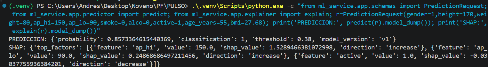

*Figura 13.1.1. Respuesta real del modelo PULSO v1: probabilidad, clasificación, umbral y principales factores SHAP.*

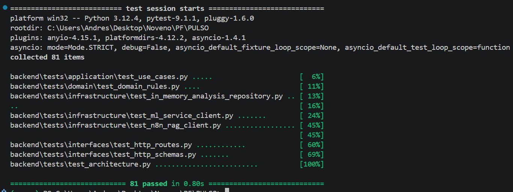

*Figura 13.1.2. Ejecución de PC-05: 81 pruebas aprobadas.*


*Figura 13.1.3. Ejecución de PC-06; la captura muestra los módulos de prueba, pero no el resumen final de Pytest.*

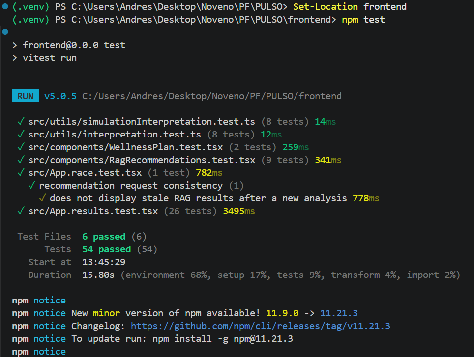

*Figura 13.1.4. Ejecución de PC-07 con Vitest: 54 pruebas aprobadas en 6 archivos.*

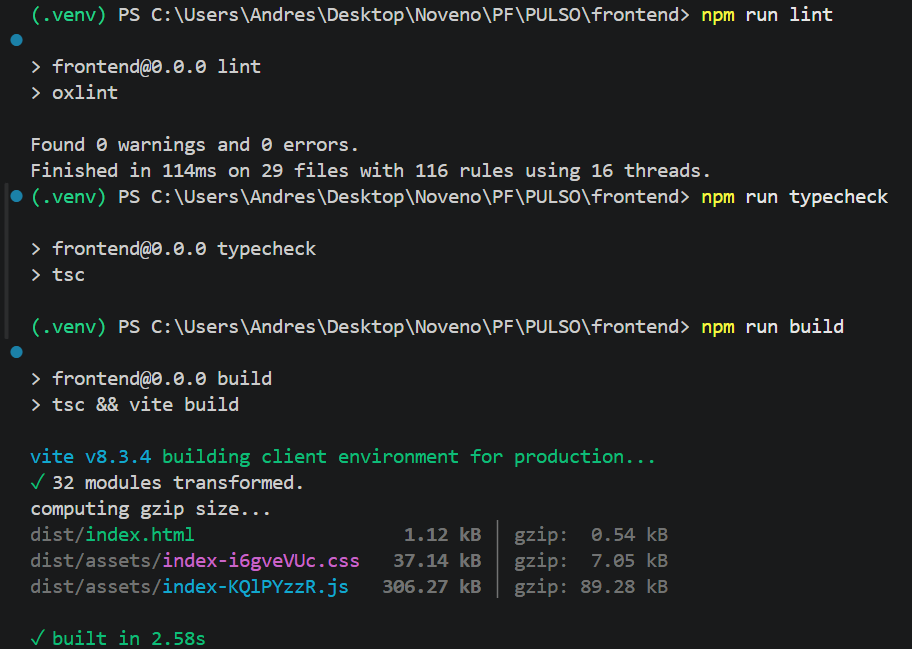

*Figura 13.1.5. Verificación de Oxlint, TypeScript y build de producción.*

### 13.2 Pruebas de integración

Las pruebas de integración verificaron los contratos y flujos entre el frontend, el backend, el ML Service y el servicio RAG de n8n. Para PI-01 a PI-04 se utilizaron solicitudes HTTP reales contra los servicios locales y el RAG configurado, usando un perfil sintético; para PI-05 a PI-07 se empleó Vitest Browser Mode con Chromium y React Testing Library. PI-08 se ejecutó como prueba controlada con errores simulados, sin interrumpir el servicio RAG remoto.

La arquitectura definitiva separa el análisis de las recomendaciones: `POST /api/analyze` devuelve `analysis_id`, predicción y explicación SHAP; después `POST /api/rag` recibe ese identificador y obtiene las recomendaciones. Por ello, PI-02 ya no espera un objeto `rag` dentro de la respuesta de `/api/analyze`.

| ID | Integración y criterio | Procedimiento y resultado observado | Estado |
|---|---|---|---|
| PI-01 | Backend ↔ ML Service. Verificar disponibilidad y carga del modelo XGBoost v1. | `GET /api/health` respondió `200` con estado `ok`. `GET /health` del ML Service respondió `200`, `model_loaded: true` y `model_version: v1`. | **Aprobada** |
| PI-02 | Backend ↔ ML ↔ SHAP. Validar el flujo de análisis sin acoplar la respuesta al RAG. | Se envió un perfil sintético a `POST /api/analyze`. La respuesta incluyó `analysis_id`, predicción del modelo `v1` y tres factores SHAP. La probabilidad observada fue 0,8614, con umbral 0,38. | **Aprobada** |
| PI-03 | Backend ↔ Simulación. Comprobar cambios permitidos y comparación de escenarios. | `POST /api/simulate` recibió un cambio de peso de 88 a 80 kg y devolvió probabilidades original y simulada (0,8614 y 0,8762), diferencia de 0,0148, cambio aplicado, versión `v1` y umbral 0,38. | **Aprobada** |
| PI-04 | Backend ↔ RAG ↔ fuentes documentales. Verificar el contrato actual y la trazabilidad. | Se solicitó RAG mediante `POST /api/rag` usando el `analysis_id` del análisis. La respuesta real tuvo `insufficient_information: false`, una recomendación, dos explicaciones de factores y diez identificadores de fuente entre las fuentes devueltas. Los logs del backend registraron HTTP 200 para `/api/analyze` y `/api/rag`. | **Aprobada** |
| PI-05 | Frontend ↔ Backend ↔ análisis y RAG. | En Chromium se completó el perfil ficticio y se verificó la respuesta de análisis y la consulta de recomendaciones RAG. La corrida automatizada posterior a la corrección de selectores obtuvo resultado global de 3 pruebas aprobadas para PI-05 a PI-07. | **Aprobada en la corrida del 20-11-2026** |
| PI-06 | Frontend ↔ Backend ↔ Simulación. | Desde la interfaz se modificó el peso y se verificó la solicitud a `/api/simulate` y la comparación renderizada. Está incluida en la corrida de Chromium de tres pruebas aprobadas indicada para PI-05. | **Aprobada en la corrida del 20-11-2026** |
| PI-07 | Frontend ↔ Validación. Rechazar presión sistólica menor que diastólica antes de enviar el análisis. | Se comprobó el mensaje de validación y la ausencia de solicitud a `/api/analyze` para los valores inconsistentes. Está incluida en la corrida de Chromium de tres pruebas aprobadas indicada para PI-05. | **Aprobada en la corrida del 20-11-2026** |
| PI-08 (adicional) | Backend ↔ RAG ↔ Manejo de errores. | Se probaron respuestas HTTP 503 y un tiempo de espera simulado del cliente RAG; también se comprobó que la ruta HTTP tradujera el fallo del RAG a HTTP 502. La ejecución combinada de las pruebas de rutas y del cliente RAG terminó con 18 pruebas aprobadas. Los fallos se simularon localmente, sin afectar n8n. | **Aprobada en entorno controlado** |

#### Ejecución y evidencia

Las verificaciones de PI-01 a PI-04 se realizaron con `Invoke-RestMethod` desde PowerShell contra `http://127.0.0.1:8000` y `http://127.0.0.1:8001`; no se enviaron datos personales, sino un perfil sintético. En la salida de consola se observaron los códigos HTTP y las estructuras JSON; los registros del backend mostraron respuestas 200 para análisis, RAG y simulación. La respuesta real del RAG se obtuvo correctamente en esta ejecución; el resultado no representa una garantía de disponibilidad o latencia permanente.

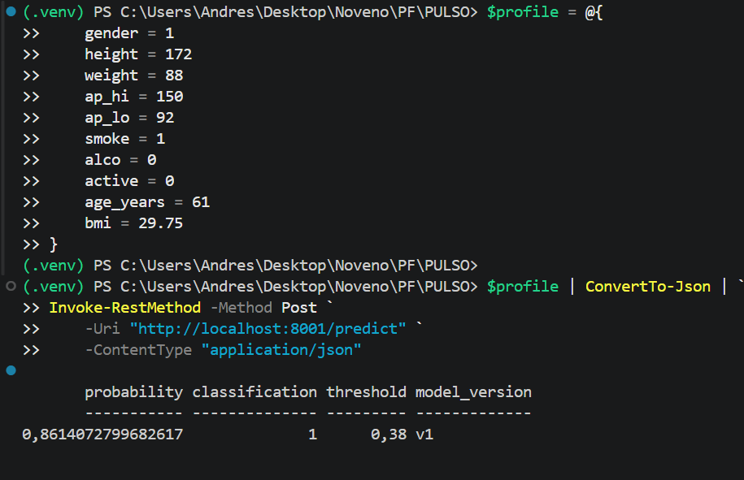

*Figura 13.2.1. Predicción y explicación SHAP obtenidas con el modelo PULSO v1.*

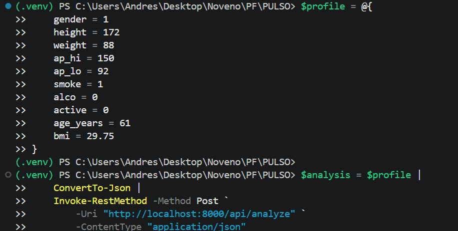

*Figura 13.2.2. Respuesta del endpoint `/predict` del ML Service.*

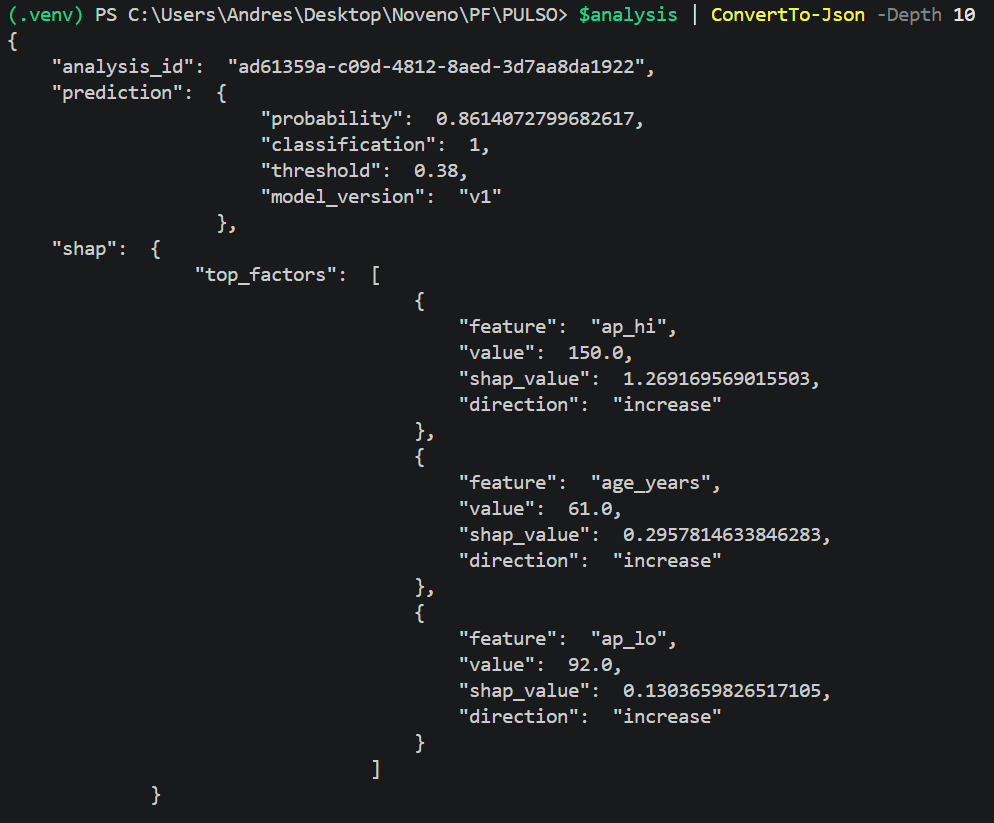

*Figura 13.2.3. Respuesta de `/api/analyze` con identificador de análisis, predicción y SHAP.*

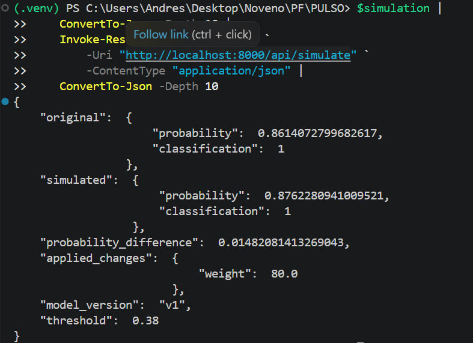

*Figura 13.2.4. Comparación de probabilidades y cambios aplicados en `/api/simulate`.*

Las imágenes siguientes documentan la solicitud de recomendaciones RAG y las partes de la respuesta JSON que muestran explicaciones, identificadores y fuentes.

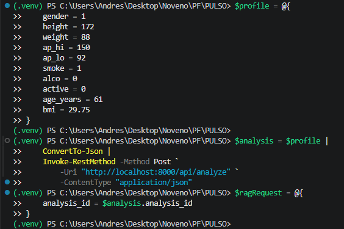

*Figura 13.2.5. Envío del identificador de análisis a `/api/rag`.*

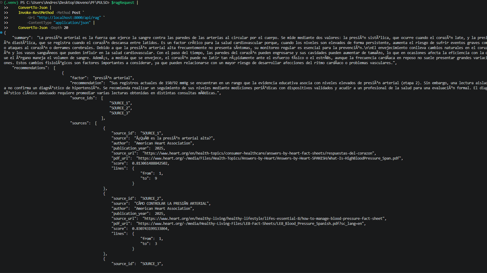

*Figura 13.2.6. Respuesta RAG con recomendaciones y metadatos de fuentes.*

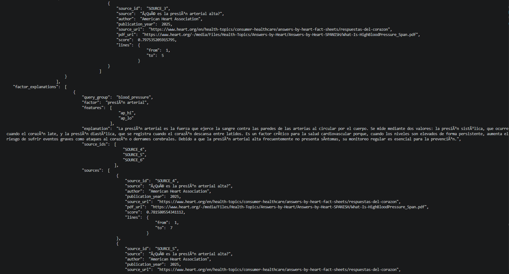

*Figura 13.2.7. Continuación de los metadatos documentales devueltos por el RAG.*

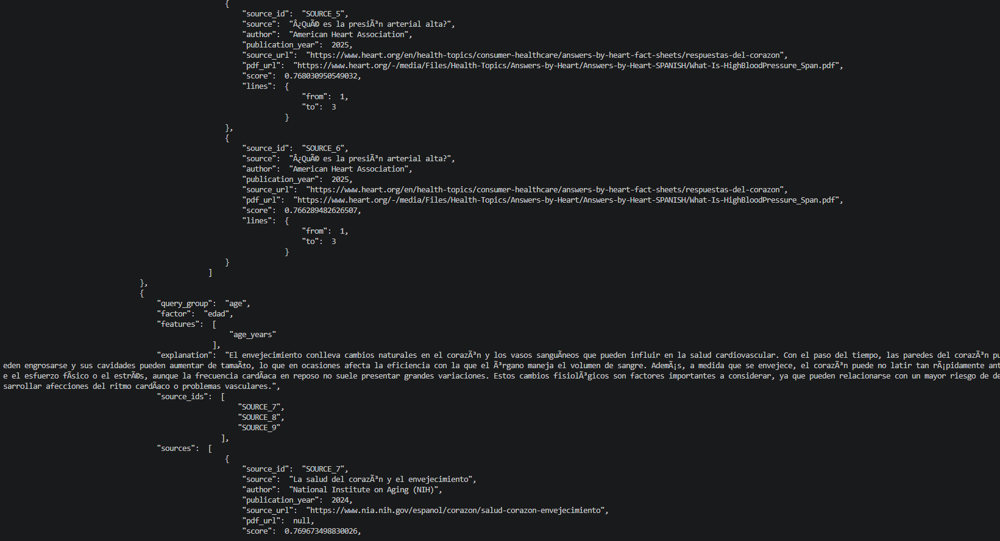

*Figura 13.2.8. Continuación de las explicaciones y sus fuentes.*

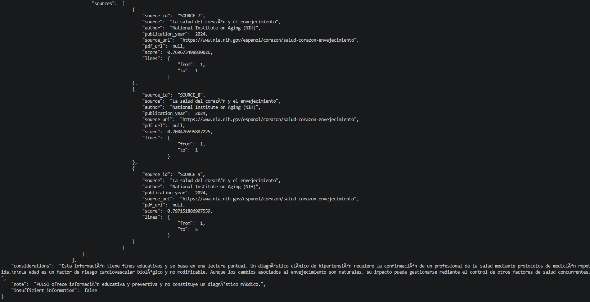

*Figura 13.2.9. Cierre de la respuesta RAG y estado de información suficiente.*

PI-05 a PI-07 se ejecutaron con Vitest Browser Mode y Chromium real, sin sustituir las llamadas del frontend al backend. La ejecución de integración informó `Test Files 1 passed` y `Tests 3 passed`. La primera ejecución había detectado selectores de prueba que no correspondían con los roles accesibles de la interfaz; se corrigieron para buscar el control de fuentes como botón y el peso como slider. Después de la corrección, las tres pruebas pasaron. Esta corrida se conserva como evidencia de la integración funcional en ese momento.

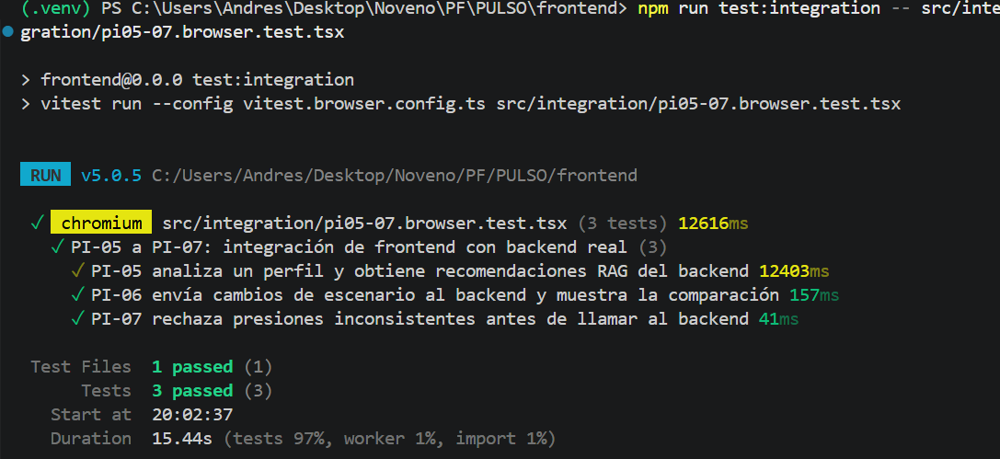

*Figura 13.2.10. Ejecución en Chromium de las tres pruebas de integración del frontend: análisis/RAG, simulación y validación.*

Para PI-08 se ejecutó:

```powershell
.\.venv\Scripts\python.exe -m pytest -q backend\tests\interfaces\test_http_routes.py backend\tests\infrastructure\test_n8n_rag_client.py
```

Resultado: `18 passed`. El caso de tiempo de espera usa un `ReadTimeout` simulado mediante transporte HTTP de prueba; no espera deliberadamente a que el servicio remoto agote el tiempo. Por tanto, PI-08 verifica el mapeo de errores y la respuesta HTTP 502, pero no mide la latencia real del servicio n8n.

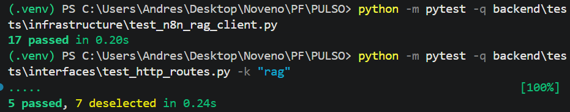

*Figura 13.2.11. Ejecución documentada de las pruebas RAG: 17 pruebas del cliente aprobadas y 5 pruebas de rutas aprobadas (7 casos no relacionados con RAG, no seleccionados). La ejecución combinada posterior, que incluyó el caso de timeout, obtuvo 18 pruebas aprobadas.*

La suite de backend y ML Service se comprobó también en la sección 13.1. Las pruebas de integración aquí descritas complementan esas pruebas: las respuestas reales de PI-01 a PI-04 verifican el despliegue local y el contrato remoto actual, mientras que PI-08 verifica el manejo de errores de manera aislada y reproducible.

*Nota sobre las evidencias disponibles: la carpeta incluye respuestas de los endpoints y resultados de pruebas; no contiene una captura independiente de los logs del backend ni una captura de pantalla del navegador durante la interacción.*

**Nota de reproducibilidad:** en la revisión de este informe, el checkout actual no contiene `frontend\src\integration\pi05-07.browser.test.tsx` ni el script `test:integration` en `frontend\package.json`. Por ello, aunque se dispone del resultado de la corrida de Chromium del 20-11-2026, para repetirla desde este checkout es necesario recuperar la versión de la rama que incluye esas pruebas. No se debe presentar la corrida como reproducible desde el estado actual hasta integrar dicho cambio. Los logs y salidas deben conservarse junto con la fecha, el entorno y la versión evaluada; las claves del archivo `.env` no deben incluirse en las evidencias.

### 13.3 Pruebas de usabilidad

Expone las pruebas de usabilidad aplicadas para evaluar la experiencia del usuario, indicando metodología, criterios de aceptación, hallazgos y nivel de cumplimiento.

## 14. Resultados, discusión y conclusiones

Presenta los resultados obtenidos a partir del desarrollo y la validación del sistema, e interpreta su significado frente a los objetivos, requerimientos, decisiones de diseño y limitaciones del proyecto.

## 15. Trabajo futuro

Identifica y describe posibles extensiones, mejoras o líneas de investigación que quedan abiertas a partir del proyecto. Puede incluir nuevas funcionalidades, optimizaciones, escalabilidad, integraciones con otros sistemas o estudios complementarios que permitan profundizar los resultados obtenidos.

## 16. Referencias

Incluye todas las fuentes consultadas y citadas en el documento, en el formato de citación definido para el curso o proyecto.
