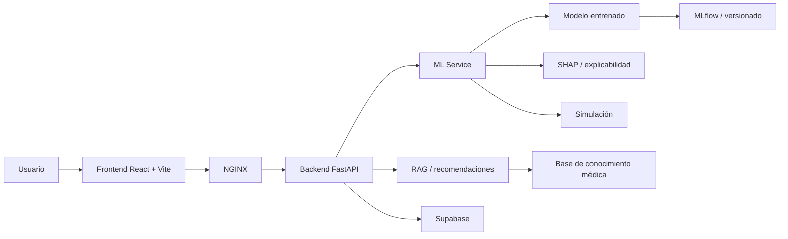
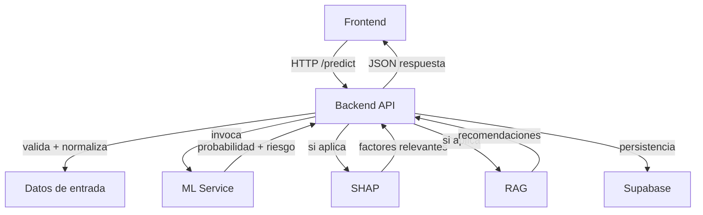
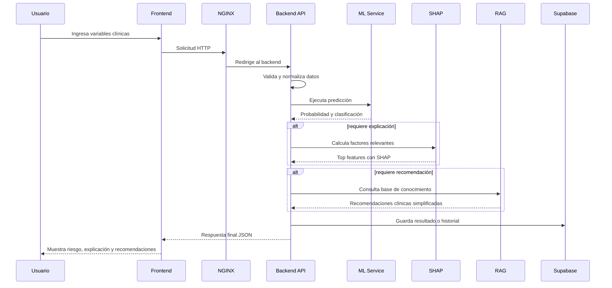

# Guía para el segundo informe del proyecto

## Resumen / Abstract

Las enfermedades cardiovasculares constituyen la principal causa de muerte en el mundo y están asociadas tanto con factores no modificables como modificables, entre ellas la hipertensión arterial, el colesterol elevado, la obesidad, el tabaquismo y la inactividad física. Aunque existen herramientas digitales para estimar el riesgo cardiovascular, muchas están orientadas a profesionales de la salud, emplean modelos calibrados para poblaciones específicas y presentan resultados cuya interpretación puede resultar compleja para personas sin formación médica. Este proyecto propone el diseño e implementación de PULSO (Plataforma Inteligente para la Predicción Explicable y Simulación Personalizada del Riesgo Cardiovascular mediante Machine Learning), un producto mínimo viable orientado a la prevención y educación en salud cardiovascular. La plataforma permitirá registrar factores de riesgo, generar una estimación mediante modelos de aprendizaje automático, explicar la influencia de las variables utilizadas y comparar el resultado inicial con escenarios hipotéticos construidos mediante la modificación de factores potencialmente controlables. Asimismo, integrará un sistema basado en Retrieval-Augmented Generation para presentar información preventiva sustentada en guías clínicas y fuentes médicas confiables, mediante un lenguaje comprensible para usuarios no especializados. El proyecto se desarrollará mediante una metodología iterativa e incremental que comprenderá la selección y preparación de datos clínicos públicos, el entrenamiento y comparación de modelos, el diseño de la arquitectura, la implementación de la plataforma web, la integración de explicabilidad y RAG, y la validación experimental del sistema. Como resultado, se espera obtener un MVP funcional que ayude a las personas a comprender sus factores de riesgo y favorezca decisiones informadas de prevención, sin sustituir la valoración realizada por profesionales de la salud.

En cuanto al estado actual del proyecto, se ha seleccionado el conjunto de datos Cardiovascular Disease Dataset, disponible en Kaggle, y se ha realizado un análisis exploratorio de datos (EDA). Asimismo, se ha iniciado la implementación y evaluación de diferentes algoritmos de clasificación. Los resultados de esta fase permitirán comparar el desempeño de los modelos y seleccionar el más adecuado para su integración en PULSO. Posteriormente, se continuará con el desarrollo y la integración de los componentes de explicabilidad mediante SHAP, simulación de escenarios y generación de información preventiva mediante RAG, así como con la validación del funcionamiento de la plataforma.

## 1. Introducción

El sector de la salud atraviesa un proceso de transformación impulsado por la digitalización de la información clínica, el crecimiento de la capacidad computacional y la aplicación de técnicas de inteligencia artificial al análisis de datos. En este contexto, el aprendizaje automático, la inteligencia artificial explicable, los sistemas de apoyo a la toma de decisiones y las plataformas digitales de salud ofrecen nuevas posibilidades para identificar patrones, estimar riesgos y comunicar información preventiva. Estas tecnologías adquieren especial relevancia frente a las enfermedades cardiovasculares, consideradas entre las principales causas de muerte en el mundo. Según la Organización Mundial de la Salud (OMS, 2025), aproximadamente 19,8 millones de personas murieron por enfermedades cardiovasculares en 2022, cifra equivalente al 32 % de las defunciones mundiales. La OMS también señala que muchas de estas enfermedades pueden prevenirse mediante la identificación y el manejo oportuno de factores conductuales y metabólicos, como el tabaquismo, la inactividad física, la alimentación poco saludable, la hipertensión arterial, la glucosa elevada, las alteraciones de los lípidos y el exceso de peso.

Actualmente existen herramientas como SCORE2, PREVENT, Framingham, Pooled Cohort y QRISK, diseñadas para estimar la probabilidad de que una persona presente un evento cardiovascular durante un periodo determinado. Sin embargo, estas soluciones difieren en las variables que emplean, la población para la cual fueron desarrolladas y la manera en que comunican sus resultados. Por ejemplo, SCORE2 fue diseñado para estimar el riesgo cardiovascular a diez años en poblaciones europeas, mientras que PREVENT utiliza información cardiovascular, renal y metabólica y está orientado principalmente a apoyar las conversaciones preventivas entre los profesionales de la salud y sus pacientes (American Heart Association [AHA], s. f.; European Society of Cardiology [ESC], s. f.-a). Además, algunas de estas herramientas presentan porcentajes y términos clínicos que pueden resultar difíciles de interpretar para personas no especializadas. Aunque generalmente permiten modificar los datos y repetir el cálculo, no siempre explican claramente la influencia de cada variable ni muestran una comparación comprensible entre el resultado original y los escenarios hipotéticos explorados.

Esta situación evidencia la necesidad de diseñar una solución tecnológica que no se limite a proporcionar un porcentaje, sino que facilite su comprensión y uso responsable. La oportunidad consiste en transformar una estimación probabilística en una experiencia educativa mediante la explicación de los factores considerados, la identificación de las variables que más influyen en el resultado y la comparación entre la condición inicial del usuario y diferentes escenarios hipotéticos.

En respuesta a esta necesidad, se desarrolla PULSO, una plataforma web orientada principalmente a personas no especializadas que busca facilitar la comprensión de los factores asociados con los problemas cardiovasculares. El sistema contempla la integración de modelos de Machine Learning de clasificación, mecanismos de explicabilidad mediante SHAP, simulación de escenarios hipotéticos y un componente basado en Retrieval-Augmented Generation (RAG) para proporcionar información preventiva sustentada en guías clínicas y fuentes médicas confiables. Para el componente predictivo se ha seleccionado el *Cardiovascular Disease Dataset*, disponible en Kaggle, cuya variable objetivo, `cardio`, identifica la presencia o ausencia de enfermedad cardiovascular en los registros. A partir de las características ingresadas por el usuario, el modelo buscará estimar la probabilidad de pertenecer a la clase `cardio = 1`. Esta salida representa una probabilidad estimada por el clasificador y no debe interpretarse como el riesgo de presentar un evento cardiovascular futuro durante un horizonte temporal determinado.

En cuanto al estado actual del proyecto, se ha completado la selección del conjunto de datos y se ha realizado un análisis exploratorio de datos (EDA) para examinar sus características y evaluar su pertinencia para el desarrollo del modelo predictivo. Asimismo, se ha iniciado la implementación y prueba de diferentes algoritmos de clasificación con el propósito de comparar su desempeño y seleccionar una alternativa para su integración en la plataforma.

## 2. Marco conceptual

El desarrollo de PULSO integra fundamentos provenientes de la salud cardiovascular, el aprendizaje automático, la inteligencia artificial explicable, la recuperación de información y la ingeniería de software. Estos conceptos permiten comprender tanto la naturaleza del problema abordado como el funcionamiento de los componentes que conforman la plataforma. Su definición resulta especialmente importante debido a que PULSO combina una estimación generada mediante un modelo de clasificación con mecanismos de explicación, simulación e información documental dirigida a personas no especializadas.
Dentro de la plataforma, cada componente cumple una función diferente. El modelo de Machine Learning estima la probabilidad de que un registro pertenezca a la clase asociada con la presencia de enfermedad cardiovascular; SHAP permite analizar cómo contribuyeron las variables de entrada a dicha estimación; la simulación permite observar cómo cambia la salida del modelo cuando se modifican determinadas variables; y el componente de Retrieval-Augmented Generation (RAG) utiliza documentación previamente seleccionada para complementar el resultado con información preventiva sustentada en fuentes trazables. Estas funciones deben diferenciarse para evitar que una predicción estadística, una explicación del modelo o una respuesta generada sean interpretadas como equivalentes a una valoración clínica.
Por esta razón, el marco conceptual también considera las limitaciones asociadas con el uso de estas tecnologías. Una probabilidad generada por un clasificador depende de los datos utilizados durante su desarrollo, una explicación de Machine Learning describe el comportamiento del modelo pero no demuestra causalidad, y una respuesta generada mediante inteligencia artificial puede contener errores aun cuando utilice documentación recuperada. En consecuencia, PULSO se plantea como una herramienta de prevención y educación cardiovascular y no como un sistema de diagnóstico, prescripción o sustitución de la valoración realizada por profesionales de la salud.

## 2.1. Enfermedades cardiovasculares y factores de riesgo
Las enfermedades cardiovasculares comprenden un conjunto de trastornos que afectan el corazón y los vasos sanguíneos, entre ellos la enfermedad coronaria, la enfermedad cerebrovascular y otras alteraciones del sistema cardiovascular. Constituyen la principal causa de muerte a nivel mundial. De acuerdo con la Organización Mundial de la Salud, aproximadamente 19,8 millones de personas murieron por enfermedades cardiovasculares en 2022, lo que representó alrededor del 32 % de las defunciones mundiales (Organización Mundial de la Salud [OMS], 2025).
El desarrollo y la progresión de estas enfermedades están relacionados con múltiples factores. Entre los principales factores conductuales identificados por la OMS se encuentran el consumo de tabaco, la alimentación poco saludable, la inactividad física y el consumo nocivo de alcohol. Sus efectos pueden manifestarse mediante factores metabólicos o intermedios como presión arterial elevada, glucosa sanguínea elevada, alteraciones de los lípidos y sobrepeso u obesidad (OMS, 2025). Junto con ellos existen características no modificables o difícilmente modificables, como la edad y determinados antecedentes individuales.
La distinción entre factores modificables y no modificables resulta relevante para PULSO porque permite diferenciar entre características utilizadas únicamente para contextualizar una estimación y aquellas que pueden explorarse mediante escenarios hipotéticos. No obstante, que una variable contribuya a una predicción no significa que exista una relación causal demostrada ni que modificarla produzca necesariamente un cambio equivalente en la condición cardiovascular real de una persona. Esta diferencia constituye uno de los principios utilizados para comunicar responsablemente los resultados del modelo y de las simulaciones.

## 2.2.  Riesgo cardiovascular y clasificación de enfermedad cardiovascular
El riesgo cardiovascular suele definirse como la probabilidad de que una persona presente un evento cardiovascular específico durante un horizonte temporal determinado. Herramientas clínicas como SCORE2, PREVENT, Framingham, Pooled Cohort Equations y QRISK utilizan variables clínicas y demográficas para estimar este tipo de riesgo en poblaciones y periodos definidos. Por tanto, una estimación de riesgo cardiovascular requiere especificar tanto el desenlace estudiado como el horizonte temporal y la población sobre la cual fue desarrollado o validado el modelo.
El componente predictivo de PULSO responde a un problema diferente. El conjunto de datos utilizado contiene una variable objetivo binaria denominada cardio, que diferencia registros asociados con presencia (cardio = 1) y ausencia (cardio = 0) de enfermedad cardiovascular. En consecuencia, el modelo de PULSO estima, a partir de las variables disponibles, una probabilidad de pertenencia a la clase cardio = 1. Esta salida corresponde a la probabilidad estimada por un clasificador y no a la probabilidad de sufrir un infarto, accidente cerebrovascular u otro evento cardiovascular durante los próximos cinco o diez años.
Esta distinción delimita el significado clínico y metodológico de los resultados. La salida de PULSO no debe interpretarse como equivalente a las estimaciones producidas por herramientas clínicas validadas para riesgo cardiovascular futuro, ni como un diagnóstico de enfermedad cardiovascular. Su utilidad dentro del proyecto radica en utilizar un problema de clasificación como base para una experiencia educativa en la que el usuario pueda observar qué características fueron relevantes para el modelo, explorar escenarios alternativos y consultar información preventiva relacionada con los factores identificados.

## 2.3. Conjunto de datos utilizado
Para el desarrollo del componente predictivo se utiliza el Cardiovascular Disease Dataset, publicado por Svetlana Ulianova en Kaggle. La versión original contiene 70.000 registros y once características, además de la variable objetivo cardio (Ulianova, s. f.). Entre las variables originales se encuentran edad (age), sexo (gender), estatura (height), peso (weight), presión arterial sistólica (ap_hi), presión arterial diastólica (ap_lo), colesterol (cholesterol), glucosa (gluc), tabaquismo (smoke), consumo de alcohol (alco) y actividad física (active).
Durante la preparación realizada para PULSO se identificaron registros con valores inconsistentes o fisiológicamente poco plausibles y se aplicaron criterios de depuración, obteniéndose 68.610 observaciones para las etapas posteriores del proyecto. También se transformó la edad original, expresada en días, a años (age_years) y se calculó el índice de masa corporal (bmi) a partir del peso y la estatura. La versión utilizada por el modelo considera las variables gender, height, weight, ap_hi, ap_lo, smoke, alco, active, age_years y bmi. Las variables cholesterol y gluc no se incorporaron a la versión final debido a que se encuentran representadas mediante categorías cuya correspondencia clínica no se encuentra documentada con suficiente claridad en la fuente utilizada.
Una limitación particularmente importante corresponde a la procedencia y representatividad de los datos. La publicación disponible en Kaggle describe la estructura y las variables del conjunto, pero no proporciona el nivel de documentación de una cohorte clínica formal respecto a aspectos como el proceso de reclutamiento, instituciones participantes, estrategia de muestreo o representatividad para la población colombiana. Por tanto, no puede asumirse que las probabilidades aprendidas por el modelo sean directamente generalizables a Colombia o América Latina. Esta limitación debe mantenerse explícita tanto durante la evaluación del clasificador como durante la comunicación de sus resultados y constituye una diferencia fundamental frente a herramientas clínicas desarrolladas y validadas sobre cohortes poblacionales claramente caracterizadas.

## 2.4. Aprendizaje automático, clasificación y evaluación de modelos
El aprendizaje automático o Machine Learning comprende métodos computacionales capaces de identificar patrones a partir de datos y utilizarlos posteriormente para realizar predicciones sobre observaciones no utilizadas durante el entrenamiento. En el aprendizaje supervisado, cada observación dispone de características de entrada y de una variable objetivo conocida. Cuando la variable objetivo presenta dos posibles clases, como ocurre con cardio = 0 y cardio = 1, el problema corresponde a una clasificación binaria.
Durante el desarrollo de PULSO se evaluaron diferentes algoritmos de clasificación, incluyendo regresión logística, árbol de decisión, Random Forest, Gradient Boosting y XGBoost. Este último pertenece a la familia de métodos de gradient tree boosting, en los cuales múltiples árboles se construyen de manera secuencial para corregir progresivamente los errores cometidos por el conjunto anterior. XGBoost incorpora mecanismos de regularización y optimizaciones destinadas a mejorar la eficiencia y capacidad predictiva del proceso de boosting (Chen & Guestrin, 2016). La comparación experimental realizada en PULSO permitió seleccionar XGBoost como modelo para el componente predictivo.
La evaluación de un clasificador no debe limitarse a una sola métrica. La exactitud (accuracy) indica la proporción total de predicciones correctas; la precisión (precision) expresa qué proporción de los registros clasificados como positivos son realmente positivos; la sensibilidad o recall indica qué proporción de los positivos reales fue identificada por el modelo; la especificidad mide la capacidad para identificar los negativos reales; y F1-score combina precisión y sensibilidad. Por su parte, ROC-AUC evalúa la capacidad del modelo para discriminar entre las clases a través de diferentes umbrales de decisión (Fawcett, 2006). Estas métricas deben analizarse conjuntamente porque optimizar una puede deteriorar otra, especialmente cuando se modifica el umbral utilizado para producir la clasificación final.

## 2.5. Probabilidades, calibración, umbral de decisión e inteligencia artificial explicable
Los modelos de clasificación probabilística pueden generar, además de una clase, una probabilidad estimada asociada con cada observación. Sin embargo, una buena capacidad de discriminación no implica necesariamente que dichas probabilidades estén correctamente calibradas. Un clasificador se considera adecuadamente calibrado cuando, para grupos de observaciones a los que asigna una determinada probabilidad, la frecuencia observada de resultados positivos se aproxima a esa probabilidad. La calibración puede analizarse mediante curvas de calibración y métricas como el Brier Score, que cuantifica el error cuadrático entre las probabilidades predichas y los resultados observados (Brier, 1950).
Para convertir una probabilidad en una clasificación es necesario establecer un umbral de decisión. Cuando la probabilidad estimada es igual o superior al umbral, el registro se asigna a la clase positiva; en caso contrario se clasifica como negativo. La selección de este valor modifica el equilibrio entre falsos positivos y falsos negativos y, por tanto, afecta métricas como sensibilidad y especificidad. En PULSO, el umbral no se considera un valor implícito del algoritmo, sino una decisión que debe justificarse a partir de los objetivos del proyecto y del comportamiento observado sobre datos de validación.
La inteligencia artificial explicable (Explainable Artificial Intelligence, XAI) comprende técnicas destinadas a facilitar la comprensión del comportamiento de modelos cuya lógica puede resultar difícil de interpretar directamente. PULSO utiliza SHAP (SHapley Additive exPlanations), un enfoque propuesto por Lundberg y Lee (2017) que asigna a cada característica una contribución a la predicción individual con base en conceptos derivados de los valores de Shapley. Esto permite identificar qué variables contribuyeron a aumentar o disminuir la salida del modelo con respecto a un valor de referencia. Sin embargo, un valor SHAP explica el comportamiento matemático del clasificador y no demuestra que la característica identificada sea la causa clínica del resultado observado.

## 2.6. Generación aumentada por recuperación (RAG)

La generación aumentada por recuperación (Retrieval-Augmented Generation, RAG) es una arquitectura que combina la recuperación de información desde una colección de documentos con un modelo de lenguaje generativo. Su propósito es proporcionar al modelo información externa y pertinente para elaborar respuestas fundamentadas en fuentes documentales, en lugar de depender exclusivamente de los conocimientos adquiridos durante su entrenamiento. Esta arquitectura permite incorporar documentación especializada y actualizar las fuentes consultadas sin necesidad de volver a entrenar el modelo de lenguaje (Lewis et al., 2020).

En PULSO, RAG se utilizará para complementar las estimaciones del modelo predictivo con información procedente de guías, documentos científicos y fuentes confiables sobre prevención y riesgo cardiovascular. De esta manera, el sistema podrá generar explicaciones en lenguaje sencillo sobre la interpretación del riesgo y los factores relacionados con su estimación. Este componente tendrá una función informativa y educativa, independiente de la predicción realizada por el modelo de aprendizaje automático, y no sustituirá el diagnóstico ni la valoración de un profesional de la salud.

## 2.7. Recuperación semántica, embeddings y bases de datos vectoriales

La recuperación semántica es una técnica de búsqueda de información que permite identificar fragmentos de documentos según su significado y contexto, en lugar de depender exclusivamente de la coincidencia exacta de palabras. Para ello, se transforma la consulta del usuario y el contenido documental en representaciones numéricas que permiten comparar su similitud semántica y recuperar los fragmentos más relevantes (Reimers y Gurevych, 2019).

Los embeddings son representaciones numéricas de textos que permiten capturar características de su significado en un espacio vectorial. Estas representaciones facilitan la comparación entre consultas y documentos para identificar contenidos relacionados. Por su parte, una base de datos vectorial (vector store) permite almacenar estos vectores junto con los fragmentos de texto y sus metadatos, y realizar búsquedas de similitud para recuperar información pertinente de manera eficiente. Ambos componentes constituyen elementos fundamentales de los sistemas RAG basados en recuperación semántica.

En PULSO, estos mecanismos permitirán organizar y consultar un corpus documental compuesto por fuentes científicas y guías confiables sobre prevención y riesgo cardiovascular. Cuando el usuario formule una pregunta, el sistema buscará los fragmentos más relevantes y los proporcionará al modelo de lenguaje como contexto para generar una respuesta comprensible y fundamentada en la documentación recuperada. Esto facilitará el acceso a información especializada sin exigir que el usuario consulte e interprete documentos técnicos completos. La calidad de las respuestas dependerá, entre otros factores, de la pertinencia, actualidad y confiabilidad de las fuentes, así como de la calidad de la recuperación y de la generación del modelo.

## 2.8. Simulación de escenarios hipotéticos
La simulación de escenarios aplicada a un modelo predictivo consiste en modificar una o más variables de entrada y volver a ejecutar el modelo para observar cómo cambia su salida. A diferencia de una predicción independiente, la simulación conserva una situación inicial como referencia y permite comparar sistemáticamente el resultado obtenido antes y después de realizar determinados cambios sobre las características del registro.
En PULSO, esta funcionalidad se aplica únicamente a variables consideradas potencialmente modificables y compatibles con las características utilizadas por el modelo. El sistema genera inicialmente una estimación a partir de los datos proporcionados por el usuario y posteriormente permite introducir valores alternativos para producir una nueva estimación. La interfaz puede entonces mostrar la diferencia entre ambas probabilidades y facilitar la comprensión de cómo responde el modelo ante las modificaciones realizadas.
Esta comparación debe interpretarse exclusivamente como un análisis contrafactual simplificado del comportamiento del clasificador. Si al modificar una variable disminuye la probabilidad estimada, no puede concluirse que realizar ese mismo cambio en la vida real producirá exactamente dicha reducción ni que exista una relación causal demostrada. La simulación tampoco se utilizará para proponer cambios en tratamientos, medicamentos o decisiones clínicas; su finalidad consiste en apoyar la exploración educativa de los factores considerados por el modelo.

## 2.9. Arquitectura de software, servicios web y contenerización
La arquitectura de software establece la organización de los componentes de un sistema, las responsabilidades asignadas a cada uno y los mecanismos mediante los cuales intercambian información. En aplicaciones distribuidas, estas decisiones influyen sobre características como acoplamiento, mantenibilidad, escalabilidad, rendimiento y tolerancia a fallos. Para la comunicación entre componentes, las interfaces de programación de aplicaciones (API) permiten exponer funcionalidades mediante contratos definidos. REST constituye un estilo arquitectónico para sistemas distribuidos basado en restricciones destinadas, entre otros objetivos, a favorecer interfaces uniformes y la evolución independiente de componentes (Fielding, 2000).
En PULSO se adopta una arquitectura modular orientada a servicios contenerizados. Esta organización separa principalmente la interfaz web, el backend, el servicio de Machine Learning y el servicio RAG. La separación permite que componentes con características operacionales diferentes evolucionen de forma relativamente independiente, sin llegar al nivel de fragmentación de una arquitectura de microservicios más granular. El servicio de Machine Learning concentra la predicción, la generación de explicaciones SHAP y la simulación, debido a que estas funcionalidades dependen del mismo modelo y de las mismas transformaciones de datos.
La contenerización complementa esta arquitectura al empaquetar las aplicaciones junto con sus dependencias en entornos aislados y reproducibles. Docker permite crear y ejecutar estos contenedores de manera independiente, reduciendo diferencias entre entornos de desarrollo y ejecución (Docker, s. f.). En PULSO, este enfoque facilita la ejecución coordinada de frontend, backend, Machine Learning, RAG y demás componentes de infraestructura, además de permitir aislar parcialmente fallos y gestionar sus dependencias mediante configuraciones reproducibles.

## 2.10. Integración continua, trazabilidad experimental y MLOps
La integración continua (Continuous Integration, CI) es una práctica de ingeniería de software mediante la cual los cambios incorporados al repositorio se verifican automáticamente antes de integrarse a la rama principal. Estas verificaciones pueden incluir ejecución de pruebas, validaciones estáticas, construcción de artefactos y otras comprobaciones destinadas a detectar errores de forma temprana. En PULSO, GitHub y GitHub Actions se utilizan para apoyar este flujo de integración y mantener control sobre los cambios realizados durante el desarrollo.
Los sistemas de Machine Learning requieren además conservar información sobre los datos, configuraciones, parámetros, métricas y artefactos asociados con cada experimento. Esta trazabilidad permite reproducir resultados, comparar modelos y determinar qué versión fue utilizada posteriormente dentro de una aplicación. Para este propósito, PULSO utiliza MLflow, cuya funcionalidad de tracking permite registrar parámetros, métricas, versiones de código y artefactos asociados con las ejecuciones de entrenamiento y evaluación (MLflow, s. f.).
Estas prácticas forman parte de un enfoque más amplio conocido como MLOps (Machine Learning Operations), orientado a integrar las actividades de desarrollo de modelos con las prácticas de ingeniería necesarias para probarlos, versionarlos, desplegarlos y mantenerlos de forma consistente. MLOps extiende principios de DevOps a sistemas de aprendizaje automático e incorpora elementos como automatización, experimentación reproducible, validación, despliegue y monitoreo del ciclo de vida del modelo (Google Cloud, 2024). En PULSO se implementa un alcance básico de MLOps centrado principalmente en la reproducibilidad de los experimentos, el registro de métricas, la selección de umbrales, el versionamiento del modelo y su integración controlada con los demás componentes del MVP.

## 3. Planteamiento del problema

El problema central que aborda este trabajo es la dificultad que enfrentan las personas no especializadas para obtener, interpretar y utilizar de manera responsable información personalizada sobre los factores asociados con las enfermedades cardiovasculares. Aunque existen herramientas digitales que permiten estimar el riesgo cardiovascular, algunas presentan resultados cuya interpretación requiere conocimientos médicos, ofrecen explicaciones limitadas sobre la influencia de las variables y utilizan modelos desarrollados para poblaciones o contextos específicos.

Por tanto, el problema no se define como la inexistencia de una plataforma que integre Machine Learning, explicabilidad y RAG. Estas tecnologías representan componentes de la solución; lo que se pretende atender es la limitada capacidad de los usuarios para comprender qué significa una estimación, qué factores influyen en ella, cuáles podrían ser modificables y cuáles son los límites del resultado obtenido.

### 3.1 Descripción del problema

Las enfermedades cardiovasculares representan una problemática relevante de salud pública. Según la Organización Mundial de la Salud (OMS, 2025), aproximadamente 19,8 millones de personas murieron por estas enfermedades en 2022, lo que equivale al 32 % de las defunciones mundiales. Una parte importante del riesgo cardiovascular se relaciona con factores que pueden detectarse o modificarse, como el tabaquismo, la inactividad física, la alimentación poco saludable, la hipertensión arterial, la glucosa elevada, las alteraciones del colesterol y el exceso de peso. Por esta razón, la identificación temprana y la comprensión de estos factores son importantes para promover conductas preventivas y facilitar la búsqueda oportuna de orientación profesional.

Aunque existen herramientas como SCORE2, PREVENT, Framingham y QRISK para estimar la probabilidad de presentar eventos cardiovasculares, sus resultados no siempre son comprensibles para personas sin conocimientos médicos. Algunas presentan porcentajes y términos clínicos sin explicar suficientemente qué significa el resultado, cuáles variables tuvieron mayor influencia o cuáles son las limitaciones de la estimación. Además, varios modelos fueron desarrollados para poblaciones específicas: SCORE2 se diseñó principalmente con datos europeos, mientras que PREVENT está orientado al contexto estadounidense y al apoyo de conversaciones preventivas entre profesionales y pacientes (American Heart Association [AHA], 2026; European Society of Cardiology [ESC], s. f.-a). Esta situación limita su aplicación directa en otros contextos, ya que el desempeño de una estimación puede variar entre poblaciones. De hecho, actualmente se desarrolla SCORE2-LAC para adaptar este tipo de evaluación a América Latina y el Caribe (ESC, s. f.-b).

Como consecuencia, las personas no especializadas pueden tener dificultades para interpretar responsablemente la información relacionada con su condición cardiovascular, reconocer los factores que más influyen en las estimaciones y comprender el significado de los escenarios hipotéticos. Un resultado presentado sin suficiente contexto puede generar una falsa sensación de seguridad, preocupación innecesaria o decisiones sin acompañamiento profesional. Por tanto, el problema central corresponde a la limitada capacidad de los usuarios no especializados para obtener, comprender y utilizar información personalizada sobre los factores asociados con las enfermedades cardiovasculares, debido a la complejidad de las herramientas disponibles, la escasa explicación de sus resultados, la ausencia de comparaciones claras y las limitaciones de generalización de los modelos. Esta problemática evidencia la necesidad de presentar las estimaciones de manera comprensible, explicable y responsable, sin reemplazar la valoración de un profesional de la salud (OMS, 2021).

Desde la perspectiva social, esta problemática pone de manifiesto la necesidad de reducir la distancia existente entre la complejidad técnica de los modelos predictivos y la capacidad de interpretación del público general. No es suficiente comunicar que una persona presenta determinado porcentaje; también es necesario explicar qué representa ese valor, cuáles factores fueron considerados y cuáles influyeron con mayor intensidad. Esta forma de comunicación puede fortalecer la alfabetización en salud, entendida como la capacidad para acceder, comprender y utilizar información relacionada con el cuidado y la prevención.

La pertinencia social y práctica del proyecto también se relaciona con el contexto colombiano. El Ministerio de Salud y Protección Social (2023) plantea que el abordaje de las enfermedades no transmisibles requiere fortalecer la atención primaria, el empoderamiento de las personas y las comunidades y la aplicación de intervenciones que contribuyan a reducir la morbilidad, la mortalidad prematura y la discapacidad. En este contexto, una plataforma que presente información preventiva de manera accesible puede contribuir a la comprensión de los factores cardiovasculares, sin formar parte necesariamente de un servicio asistencial ni reemplazar las rutas institucionales de atención.

### 3.2 Restricciones y supuestos de diseño

El desarrollo de PULSO se encuentra condicionado por restricciones académicas, tecnológicas, metodológicas y relacionadas con el uso responsable de la inteligencia artificial en salud. Estas condiciones delimitan las funcionalidades que podrán implementarse, los datos utilizados para el entrenamiento de los modelos y el alcance de los resultados proporcionados por la plataforma.

La selección del *Cardiovascular Disease Dataset*, disponible en Kaggle, ha permitido concretar la fuente de datos y orientar el componente predictivo hacia un problema de clasificación binaria. No obstante, la selección del conjunto de datos no garantiza por sí misma que los modelos desarrollados presenten un desempeño adecuado ni que sus resultados puedan generalizarse a cualquier población. Por esta razón, será necesario evaluar experimentalmente los modelos y documentar las limitaciones de los datos utilizados.

Asimismo, el diseño de la plataforma deberá considerar que las estimaciones generadas por los modelos, las explicaciones proporcionadas mediante SHAP y los escenarios hipotéticos no constituyen diagnósticos médicos ni demuestran relaciones causales. PULSO mantendrá un propósito preventivo y educativo, por lo que sus funcionalidades deberán comunicar de manera comprensible las limitaciones de los resultados y evitar que estos sean interpretados como indicaciones clínicas.

**Restricciones**

1. **Tiempo y alcance académico.** El proyecto será desarrollado dentro del tiempo asignado para el Proyecto Final y por un equipo de tres estudiantes. Por esta razón, el resultado será un producto mínimo viable (MVP) y no una plataforma certificada para uso clínico.

2. **Disponibilidad y calidad de los datos.** Se ha seleccionado el *Cardiovascular Disease Dataset*, publicado por sulianova en Kaggle, como fuente de datos para el desarrollo del componente predictivo. Aunque ya se realizó un análisis exploratorio de datos (EDA), las características del conjunto de datos, su calidad, representatividad, distribución de las clases y posibles inconsistencias podrán limitar el desempeño de los modelos.

3. **Representatividad poblacional.** El conjunto de datos seleccionado podría no representar adecuadamente a la población colombiana o latinoamericana. Esta restricción es relevante porque el desempeño de los modelos predictivos puede variar al aplicarse a poblaciones diferentes de aquellas utilizadas durante su desarrollo. Por tanto, los resultados obtenidos no podrán considerarse automáticamente generalizables a cualquier población.

4. **Alcance preventivo y educativo.** PULSO no realizará diagnósticos médicos, no prescribirá medicamentos, no recomendará suspender tratamientos y no sustituirá la consulta con profesionales de la salud.

5. **Datos proporcionados por el usuario.** La plataforma dependerá parcialmente de información autodeclarada. Los errores de medición, desconocimiento, omisión o digitación podrán afectar el resultado. Por ello, las variables solicitadas deberán contar con unidades de medida, rangos válidos e instrucciones comprensibles.

6. **Interpretación de las simulaciones.** Los escenarios se construirán modificando determinadas variables de entrada del modelo. Una disminución en la probabilidad estimada por el clasificador no demostrará una relación causal ni garantizará que la condición cardiovascular real del usuario cambie. Las simulaciones tendrán una finalidad educativa y exploratoria y no serán utilizadas para recomendar modificaciones en medicamentos o tratamientos.

7. **Limitaciones de la inteligencia artificial generativa.** La utilización de RAG reduce, pero no elimina, el riesgo de generar respuestas incompletas, imprecisas o descontextualizadas. Las salidas deberán conservar vínculos con las fuentes consultadas y advertencias sobre su carácter informativo.

8. **Recursos tecnológicos.** El entrenamiento de los modelos, el almacenamiento de información, la ejecución de los componentes de inteligencia artificial y el despliegue de la plataforma estarán condicionados por la capacidad computacional, los servicios disponibles y el presupuesto del equipo.

9. **Privacidad y seguridad.** El MVP deberá minimizar la recopilación de información personal y proteger los datos almacenados. No se utilizarán historias clínicas identificables sin las autorizaciones, medidas de seguridad y procedimientos éticos correspondientes. La protección de la autonomía y la privacidad constituye un principio fundamental para el uso de la inteligencia artificial en salud (OMS, 2021).

10. **Delimitación de la predicción.** El componente predictivo se desarrollará como un problema de clasificación binaria utilizando la variable objetivo `cardio` del conjunto de datos seleccionado. El modelo buscará estimar la probabilidad de pertenecer a la clase `cardio = 1`, asociada con la presencia de enfermedad cardiovascular en los registros. Esta estimación no establece por sí misma la probabilidad de presentar un evento cardiovascular futuro durante un horizonte temporal determinado. La población de aplicación y las condiciones de interpretación de los resultados deberán delimitarse conforme a las características de los datos y los resultados de la evaluación experimental.

**Supuestos de diseño**

1. Se dispone de un conjunto de datos público seleccionado para el desarrollo del componente predictivo, cuyas características permiten iniciar la experimentación con modelos de clasificación. Su pertinencia definitiva para los objetivos del proyecto estará sujeta a los resultados de la evaluación experimental.

2. Los usuarios dispondrán de un dispositivo con navegador web y conexión a internet para acceder a la plataforma.

3. Los usuarios conocerán o podrán consultar la información solicitada por el sistema, como edad, peso, presión arterial y demás variables requeridas por el modelo seleccionado.

4. Las variables estarán definidas con unidades de medida, rangos válidos e instrucciones comprensibles para reducir errores en el ingreso de datos.

5. Será posible seleccionar guías clínicas y fuentes médicas confiables para construir un corpus documental controlado para el sistema RAG.

6. Los datos podrán dividirse adecuadamente en conjuntos de entrenamiento, validación y prueba, evitando que los mismos registros sean utilizados simultáneamente para entrenar y evaluar el modelo.

7. Los modelos se evaluarán mediante métricas de discriminación, calibración y clasificación apropiadas para la naturaleza y distribución de los datos. La selección del modelo definitivo dependerá de los resultados experimentales y de su pertinencia para los objetivos del proyecto.

8. La plataforma conservará el resultado inicial para compararlo con los escenarios hipotéticos y diferenciará visualmente los datos originales de los valores simulados.

9. Las variables modificadas durante la simulación estarán limitadas a factores potencialmente controlables y compatibles con el modelo seleccionado.

10. Las explicaciones generadas mediante SHAP indicarán la contribución de las variables a la predicción del modelo, pero no afirmarán que exista una relación causal entre dichas variables y la condición cardiovascular del usuario.

### 3.3 Alcance actualizado

El alcance de PULSO comprende el diseño e implementación de un producto mínimo viable (MVP) sobre una plataforma web orientada a la prevención y educación cardiovascular, dirigida principalmente a personas no especializadas. La solución busca facilitar la comprensión de los factores asociados con las enfermedades cardiovasculares mediante la integración de un modelo de Machine Learning de clasificación, mecanismos de explicabilidad, simulación de escenarios hipotéticos e información preventiva sustentada en fuentes médicas confiables. Este alcance delimita tanto las funcionalidades que serán desarrolladas como aquellas que quedan fuera del proyecto, en coherencia con las restricciones y supuestos de diseño descritos en la sección 3.2.

Respecto al planteamiento inicial, se ha concretado la selección del *Cardiovascular Disease Dataset*, publicado por sulianova en Kaggle, como fuente de datos para el desarrollo del componente predictivo. Este conjunto de datos contiene la variable objetivo `cardio`, que identifica la presencia o ausencia de enfermedad cardiovascular en los registros. En consecuencia, el modelo se desarrollará como un problema de clasificación binaria y buscará estimar la probabilidad de pertenecer a la clase `cardio = 1`. Esta estimación no debe interpretarse como la probabilidad de presentar un evento cardiovascular futuro durante un horizonte temporal determinado. La delimitación de la población de aplicación y las condiciones de interpretación de los resultados estarán sujetas a las características del conjunto de datos y a la evaluación experimental de los modelos.

En cuanto al avance actual, se ha completado la selección del conjunto de datos y se ha realizado un análisis exploratorio de datos (EDA). Asimismo, se ha iniciado la implementación y prueba de diferentes algoritmos de clasificación, entre ellos regresión logística y árbol de decisión. La selección del modelo definitivo se realizará a partir de la comparación de sus resultados, considerando métricas de desempeño, calibración y otros criterios pertinentes para el proyecto. Las funcionalidades de explicabilidad, simulación, RAG y los demás componentes de la plataforma se mantienen dentro del alcance previsto para el MVP, sin que su inclusión implique que ya se encuentren implementados.

**El proyecto incluye:**

1. El registro y la gestión de la información relacionada con los factores cardiovasculares ingresada por el usuario.

2. El entrenamiento, la comparación y la selección de modelos de Machine Learning de clasificación utilizando el conjunto de datos seleccionado, con el propósito de estimar la probabilidad de pertenecer a la clase `cardio = 1`.

3. La incorporación de mecanismos de explicabilidad mediante SHAP que permitan identificar los factores que más contribuyen a cada predicción generada por el modelo seleccionado.

4. Una funcionalidad de simulación que permita modificar variables potencialmente controlables y compatibles con el modelo seleccionado, como peso, presión arterial y otras variables pertinentes, para comparar la estimación inicial con la obtenida bajo un escenario hipotético.

5. Un sistema basado en Retrieval-Augmented Generation (RAG) que consulte guías clínicas y fuentes médicas confiables para generar información y recomendaciones preventivas de carácter educativo, utilizando un lenguaje sencillo y comprensible.

6. El diseño e implementación de una base de datos para la gestión de la información de la plataforma.

7. El diseño e implementación de una API que integre los diferentes servicios del sistema, incluyendo el modelo predictivo, la explicabilidad, la simulación y el componente RAG, con la interfaz web.

8. El diseño e implementación de una interfaz web orientada principalmente a personas no especializadas.

9. Una validación experimental que permita evaluar el desempeño de la plataforma y de los modelos utilizados mediante datos no empleados previamente durante el entrenamiento.

10. La implementación de un workflow de desarrollo basado en GitHub, utilizando ramas independientes, pull requests y revisión de código para controlar la incorporación de cambios al proyecto.

11. La configuración de un proceso de integración continua mediante GitHub Actions que ejecute automáticamente pruebas, validaciones de calidad y comprobaciones de integración antes de incorporar cambios a la rama principal.

12. El versionamiento de los modelos de Machine Learning, conservando información sobre las versiones utilizadas, los datos de entrenamiento, las métricas obtenidas y las condiciones bajo las cuales fueron generados.

13. La incorporación de prácticas básicas de MLOps para automatizar y hacer trazables los procesos relacionados con los datos, entrenamiento, evaluación, versionamiento e integración de los modelos dentro de la plataforma.

**El proyecto no incluye:**

1. La generación de diagnósticos médicos, la prescripción de medicamentos ni la recomendación de modificar o suspender tratamientos.

2. Una validación clínica certificada ni un proceso de aprobación regulatoria que permita utilizar PULSO como dispositivo médico.

3. La integración con historias clínicas electrónicas institucionales ni el uso de información identificable de pacientes reales sin las autorizaciones correspondientes.

4. La prestación de atención asistencial en tiempo real ni la sustitución de la consulta con profesionales de la salud.

5. La estimación del riesgo de presentar un evento cardiovascular futuro durante un horizonte temporal determinado, dado que el modelo de clasificación se desarrollará utilizando la variable `cardio` del conjunto de datos seleccionado. Tampoco se contempla la predicción independiente de todas las enfermedades o eventos cardiovasculares posibles.

6. El desarrollo de aplicaciones móviles nativas, dado que la solución se limitará a una plataforma web.

7. La recalibración exhaustiva de los modelos para todas las poblaciones latinoamericanas, aunque las limitaciones de generalización identificadas serán documentadas.

8. Un sistema completamente automatizado de aprendizaje continuo en producción. El MVP podrá incorporar mecanismos básicos de actualización, versionamiento y trazabilidad de los modelos como parte de las prácticas de MLOps, pero no contempla un ciclo autónomo de reentrenamiento y despliegue continuo en un entorno productivo.

## 4. Objetivos

A partir del problema planteado en la sección 3 y del alcance actualizado del proyecto, se establece el objetivo general y los objetivos específicos que orientan el desarrollo de PULSO. Estos objetivos contemplan la construcción de una plataforma web que integre un modelo de clasificación de Machine Learning, mecanismos de explicabilidad, simulación de escenarios e información preventiva sustentada en fuentes médicas confiables.

La selección del *Cardiovascular Disease Dataset* ha permitido concretar el enfoque del componente predictivo hacia la clasificación binaria, utilizando la variable objetivo `cardio` para estimar la probabilidad de pertenecer a la clase asociada con la presencia de enfermedad cardiovascular. Esta decisión permite delimitar el problema de aprendizaje automático y establecer actividades de entrenamiento, comparación y evaluación de modelos con resultados verificables.

Los objetivos se desarrollarán mediante un proceso iterativo e incremental que permita evaluar progresivamente los componentes del sistema. Su cumplimiento se verificará a través de los resultados del análisis de datos, las métricas de los modelos, la implementación de las funcionalidades y las pruebas técnicas, funcionales y de usabilidad del MVP.

### 4.1 Objetivo general

Diseñar e implementar, antes de noviembre de 2026, un MVP de una plataforma web orientada a personas no especializadas que permita estimar de manera explicable la probabilidad de pertenecer a la clase asociada con la presencia de enfermedad cardiovascular, mediante un modelo de Machine Learning de clasificación entrenado con el *Cardiovascular Disease Dataset*, integrando funcionalidades de explicabilidad mediante SHAP, simulación personalizada de escenarios y generación de información y recomendaciones preventivas mediante RAG basado en guías clínicas y fuentes médicas confiables.

### 4.2 Objetivos específicos

1. **Seleccionar y analizar**, antes de finalizar septiembre de 2026, un conjunto de datos clínicos público y pertinente para el desarrollo del modelo predictivo, mediante un análisis exploratorio de datos (EDA) que permita examinar su estructura, calidad, disponibilidad de variables y distribución de la variable objetivo, documentando los resultados obtenidos y las limitaciones identificadas.

2. **Desarrollar y comparar**, antes de octubre de 2026, al menos dos modelos de Machine Learning de clasificación utilizando el conjunto de datos seleccionado, evaluándolos mediante métricas de desempeño, discriminación y calibración, con el propósito de seleccionar un modelo y documentar los resultados que justifican su integración en el MVP.

3. **Implementar**, antes de octubre de 2026, un mecanismo de explicabilidad basado en SHAP sobre el modelo seleccionado, de manera que el MVP permita identificar y presentar los principales factores que contribuyen a cada estimación generada por el clasificador.

4. **Diseñar e implementar**, antes de octubre de 2026, una funcionalidad de simulación que permita modificar variables potencialmente controlables y compatibles con el modelo seleccionado, conservando el resultado inicial para compararlo con la estimación obtenida bajo al menos un escenario hipotético.

5. **Integrar**, antes de noviembre de 2026, un sistema basado en Retrieval-Augmented Generation (RAG) que utilice guías clínicas y fuentes médicas confiables previamente seleccionadas para generar información y recomendaciones preventivas de carácter educativo, en un lenguaje sencillo y comprensible para personas no especializadas.

6. **Diseñar e implementar**, antes de noviembre de 2026, la arquitectura de software, la base de datos, la API y los mecanismos de integración necesarios para incorporar los componentes del MVP, estableciendo un workflow de desarrollo basado en GitHub que permita gestionar, probar y versionar de manera controlada los cambios realizados durante el desarrollo del proyecto.

7. **Validar**, antes de noviembre de 2026, el funcionamiento del MVP mediante pruebas técnicas, funcionales y de usabilidad, utilizando datos de evaluación no empleados durante el entrenamiento de los modelos y usuarios no involucrados en su desarrollo, con el fin de verificar el cumplimiento de los requerimientos, evaluar la comprensión de los resultados e identificar oportunidades de mejora.

8. **Implementar**, antes de noviembre de 2026, prácticas básicas de MLOps que permitan automatizar y mantener la trazabilidad de los procesos de preparación de datos, entrenamiento, evaluación, versionamiento e integración de los modelos de Machine Learning desarrollados para el MVP.

## 5. Estado del arte / soluciones relacionadas

### 5.1 Modelos clínicos de estimación del riesgo cardiovascular

La estimación del riesgo cardiovascular ha sido abordada mediante diferentes modelos desarrollados a partir de cohortes poblacionales y registros clínicos. Aunque estas herramientas comparten el propósito general de apoyar la prevención cardiovascular, existen diferencias importantes en las poblaciones utilizadas para su desarrollo, los desenlaces considerados, los horizontes temporales de predicción, las variables empleadas y los procesos de validación. Estas características condicionan la interpretación de sus resultados y la posibilidad de aplicarlos a poblaciones diferentes de aquellas en las que fueron desarrollados.

Entre los modelos más representativos se encuentran el **Framingham General Cardiovascular Disease Risk Score**, las **Pooled Cohort Equations (PCE)**, **SCORE2**, **QRISK3** y **PREVENT**. En términos generales, todos incorporan factores de riesgo cardiovascular tradicionales, como edad, sexo, presión arterial y tabaquismo; sin embargo, algunos amplían la evaluación mediante variables metabólicas, renales, clínicas o sociales. Asimismo, aunque gran parte de estos modelos estima riesgo a diez años, existen diferencias importantes en la definición del evento cardiovascular que cada uno busca predecir.

| Modelo | Población de desarrollo | Tamaño de muestra | Desenlace principal | Horizonte temporal | Variables principales | Validación y generalización |
|---|---|---:|---|---|---|---|
| **Framingham General CVD Risk Score** | Adultos de 30 a 74 años de las cohortes Original y Offspring de Framingham, Massachusetts, EE. UU., sin enfermedad cardiovascular previa | La fuente revisada identifica las cohortes utilizadas, pero no especifica en el material recopilado un tamaño único de muestra para esta versión del modelo | Enfermedad cardiovascular global: muerte coronaria, infarto de miocardio, insuficiencia coronaria, angina, ictus, ataque isquémico transitorio, enfermedad arterial periférica e insuficiencia cardíaca | 10 años | Edad, sexo, colesterol total, colesterol HDL, presión arterial sistólica, tratamiento antihipertensivo, tabaquismo y diabetes. Existe una versión simplificada que sustituye el perfil lipídico por IMC | Desarrollado principalmente en una población blanca de una localidad estadounidense. Su aplicación en otras poblaciones puede requerir recalibración y se ha señalado posible sobreestimación del riesgo en cohortes contemporáneas (D'Agostino et al., 2008) |
| **Pooled Cohort Equations (PCE)** | Adultos de 40 a 79 años de EE. UU. sin enfermedad cardiovascular previa, provenientes de ARIC, CHS, CARDIA y Framingham; incluye población blanca y afroamericana | 24.626 participantes | Primer evento ateroesclerótico cardiovascular grave (*hard ASCVD*): infarto de miocardio no fatal, muerte por enfermedad coronaria o ictus fatal/no fatal | 10 años | Edad, sexo, raza, colesterol total, colesterol HDL, presión arterial sistólica, tratamiento antihipertensivo, diabetes y tabaquismo | Validación interna y externa. Se reportaron valores del estadístico C entre 0,713 y 0,818 según sexo y raza. La generalización a poblaciones como hispanos o asiáticos requiere precaución y posible recalibración (Goff et al., 2014) |
| **SCORE2** | Adultos europeos, principalmente entre 40 y 69 años, sin enfermedad cardiovascular previa ni diabetes conocida, procedentes de 45 cohortes de 13 países | 677.684 participantes en derivación y más de 1,13 millones en validación externa | Primer evento cardiovascular fatal o no fatal: muerte cardiovascular, infarto de miocardio no fatal o ictus no fatal | 10 años | Edad, sexo, tabaquismo, presión arterial sistólica y colesterol no-HDL | Validado externamente en 25 cohortes de 15 países europeos. Se reportaron valores de C-index entre aproximadamente 0,67 y 0,81. El modelo fue recalibrado para cuatro regiones europeas de riesgo y requiere adaptación para su utilización fuera de Europa (SCORE2 Working Group & ESC Cardiovascular Risk Collaboration, 2021) |
| **QRISK3** | Pacientes de 25 a 84 años registrados en atención primaria en Inglaterra, sin enfermedad cardiovascular previa ni uso de estatinas al inicio | 7,89 millones en derivación y 2,67 millones en validación | Enfermedad cardiovascular compuesta: enfermedad coronaria, ictus isquémico o ataque isquémico transitorio | 10 años | Edad, etnia, privación social, presión arterial sistólica, variabilidad de presión arterial, IMC, colesterol, tabaquismo, diabetes, antecedentes familiares, enfermedad renal, fibrilación auricular y otras condiciones clínicas y farmacológicas | Validación en una cohorte independiente de 2,67 millones de pacientes. Se reportaron valores del C-statistic de aproximadamente 0,88 en mujeres y 0,86 en hombres. Su utilización fuera del Reino Unido requiere validación y posible recalibración (Hippisley-Cox et al., 2017) |
| **PREVENT** | Adultos de 30 a 79 años de EE. UU. provenientes de cohortes poblacionales y grandes bases de datos clínicas, con representación de diferentes grupos étnicos y sin enfermedad cardiovascular al inicio | 3,28 millones en derivación y 3,33 millones en validación externa | Enfermedad cardiovascular total, compuesta por ASCVD e insuficiencia cardíaca; también dispone de modelos específicos para ASCVD e insuficiencia cardíaca | 10 y 30 años | Edad, sexo, presión arterial sistólica, colesterol no-HDL, colesterol HDL, función renal estimada mediante eGFR, tabaquismo, diabetes, tratamiento antihipertensivo y estatinas. Puede incorporar UACR, HbA1c y deprivación social | Validado externamente en aproximadamente 3,33 millones de personas. Para enfermedad cardiovascular total se reportaron valores medianos del C-statistic de 0,794 en mujeres y 0,757 en hombres, además de una adecuada calibración. Fue desarrollado para población estadounidense y requiere validación antes de utilizarse en otros países (Khan et al., 2024) |

### 5.2 Explicabilidad en modelos de predicción cardiovascular

El incremento en el uso de modelos de Machine Learning para la predicción de enfermedades y eventos cardiovasculares ha generado la necesidad de incorporar mecanismos que permitan comprender cómo se producen sus resultados. Esta necesidad resulta especialmente relevante cuando se utilizan modelos complejos, como Random Forest, XGBoost o redes neuronales, cuyo comportamiento no siempre puede interpretarse directamente a partir de sus parámetros internos. En este contexto, diferentes investigaciones han utilizado técnicas de inteligencia artificial explicable (XAI) para identificar las variables que influyen en las predicciones, analizar relaciones entre factores clínicos y proporcionar explicaciones tanto a nivel global como individual.

#### Aplicación de SHAP en modelos cardiovasculares

Una de las técnicas utilizadas con mayor frecuencia es SHAP (*SHapley Additive exPlanations*), que permite atribuir a cada variable una contribución sobre la predicción generada por un modelo. Zhu et al. (2026) desarrollaron un modelo para estimar el riesgo de enfermedad cardiovascular incidente a nueve años en adultos chinos de 45 años o más utilizando datos longitudinales del estudio CHARLS. La investigación comparó diez algoritmos de Machine Learning y seleccionó Random Forest como modelo final, con un AUC de 0,829. Posteriormente, SHAP fue utilizado tanto para explicaciones globales como individuales, permitiendo jerarquizar las variables según su influencia y representar predicciones específicas mediante gráficos como *summary plots*, *dependence plots* y *force plots*. Entre los factores con mayor influencia se encontraron la circunferencia de cintura, los triglicéridos, la edad y la hipertensión. Los autores también identificaron relaciones no lineales entre algunas variables y la predicción y desarrollaron una calculadora web para presentar los resultados de manera interactiva.

Otro estudio realizado por Chen et al. (2022) utilizó SHAP para interpretar modelos orientados a la estratificación del riesgo de enfermedad coronaria y accidente cerebrovascular isquémico en población china. La investigación analizó 8.624 registros médicos electrónicos y utilizó un *Balanced Bagging Classifier* basado en Random Forest para manejar el desequilibrio de clases. SHAP permitió identificar variables relevantes tanto de manera global como individual y analizar diferencias entre los factores asociados con enfermedad coronaria y accidente cerebrovascular. Entre las características con mayor influencia común se encontraron la edad, la rigidez arterial medida mediante velocidad de onda de pulso, la hipertensión y el colesterol LDL. La técnica también fue utilizada para reducir el número de variables de los modelos manteniendo un desempeño elevado, alcanzando valores de AUC de 0,905 para enfermedad coronaria y 0,889 para accidente cerebrovascular isquémico.

Estos estudios muestran que SHAP puede cumplir diferentes funciones dentro de los modelos cardiovasculares. Además de generar una jerarquía global de variables, puede utilizarse para explicar predicciones individuales, estudiar relaciones no lineales e interacciones entre características y apoyar la selección de predictores. No obstante, los resultados obtenidos mediante SHAP deben interpretarse como explicaciones del comportamiento estadístico del modelo. Zhu et al. señalan explícitamente que las contribuciones SHAP no representan efectos causales ni mecanismos biológicos directos, sino contribuciones estadísticas marginales asociadas con la salida del modelo.

#### Otras técnicas de explicabilidad

La explicabilidad en modelos cardiovasculares no se limita al uso de SHAP. También se han utilizado técnicas como LIME (*Local Interpretable Model-Agnostic Explanations*), importancia por permutación (*Permutation Feature Importance*, PFI) y gráficos de dependencia parcial (*Partial Dependence Plots*, PDP), entre otros enfoques. Estas técnicas pueden ofrecer diferentes niveles de interpretación y utilizarse de manera complementaria para explicar tanto el comportamiento general de un modelo como predicciones particulares.

Ansari et al. (2026) propusieron un marco dual de explicabilidad que combina LIME y PFI para la predicción de enfermedad cardíaca utilizando el conjunto de datos Cleveland de UCI. El estudio comparó siete algoritmos de clasificación y utilizó PFI para determinar la importancia global de las variables, mientras que LIME proporcionó explicaciones locales a nivel de cada paciente. Entre las características identificadas como relevantes se encontraron la depresión del segmento ST inducida por ejercicio, el tipo de dolor torácico, la frecuencia cardíaca máxima, la talasemia y otras variables clínicas. Los autores destacan que esta combinación permite disponer simultáneamente de una perspectiva global y una explicación local del comportamiento del modelo, con un menor costo computacional que otros métodos como SHAP. Sin embargo, también reconocen que LIME puede presentar variaciones en las explicaciones cuando cambia el muestreo utilizado para generar las perturbaciones locales.

Salah y Srinivas (2022) utilizaron técnicas de explicabilidad para analizar modelos destinados a estimar el riesgo cardiovascular a largo plazo a partir de factores observados durante la adolescencia. El estudio empleó información longitudinal de 14.083 participantes del estudio estadounidense Add Health y comparó diferentes algoritmos de Machine Learning. La importancia por permutación permitió identificar factores globalmente relevantes, mientras que los gráficos de dependencia parcial fueron utilizados para analizar relaciones lineales y no lineales entre determinadas características y la predicción. Entre las variables más importantes se encontraron la edad, el índice de masa corporal, el ingreso de los padres, la actividad física y el consumo de comida rápida. El estudio también complementó estas técnicas con SHAP para comparar diferentes formas de interpretar la importancia de los predictores.

La diversidad de técnicas utilizadas evidencia que no existe un único mecanismo de explicabilidad adecuado para todos los propósitos. Algunas técnicas se orientan principalmente a identificar la importancia global de las variables, mientras que otras buscan explicar casos particulares o visualizar relaciones entre las características y las predicciones. Por esta razón, diferentes investigaciones combinan métodos globales y locales para proporcionar una representación más completa del comportamiento de los modelos.

#### Limitaciones de la explicabilidad en salud

Aunque las técnicas XAI pueden aumentar la transparencia de los modelos, la literatura señala diferentes limitaciones que deben considerarse cuando se utilizan en contextos de salud. Una de las principales corresponde a la diferencia entre asociación predictiva y causalidad. Métodos como SHAP o LIME pueden identificar qué variables influyen en la salida de un modelo, pero estas contribuciones no demuestran que modificar una variable produzca necesariamente un cambio clínico equivalente. De manera similar, una característica con alta importancia predictiva no debe interpretarse automáticamente como un factor causal de la enfermedad.

Mienye et al. (2024), en una revisión sobre inteligencia artificial explicable en salud, señalan desafíos relacionados con la estabilidad de las explicaciones, la fidelidad con respecto al comportamiento real del modelo, los sesgos, la dificultad de integración en flujos clínicos y la ausencia de causalidad en muchos métodos post-hoc. Los autores también destacan que pequeñas variaciones en los datos pueden modificar las explicaciones obtenidas y que una representación simplificada puede generar una falsa sensación de transparencia si no refleja adecuadamente el funcionamiento del modelo subyacente. Asimismo, resaltan que las necesidades de explicación varían entre desarrolladores, profesionales de la salud y pacientes, por lo que el formato y nivel de detalle deben adaptarse al público objetivo.

Las limitaciones de XAI también se relacionan con la manera en que las personas interpretan las explicaciones. Rosenbacke et al. (2024), mediante una revisión sistemática sobre la confianza de los profesionales de la salud en aplicaciones de inteligencia artificial, encontraron que proporcionar explicaciones no garantiza necesariamente un aumento de la confianza. Las explicaciones complejas, contradictorias o extensas pueden aumentar la carga cognitiva y ser ignoradas durante la toma de decisiones. Por otra parte, una explicación aparentemente convincente puede generar sobreconfianza y llevar al usuario a aceptar una recomendación incorrecta del sistema. Los autores plantean que el propósito de la explicabilidad no debe ser maximizar la confianza en la inteligencia artificial, sino contribuir a establecer un nivel de confianza adecuadamente calibrado.

En conjunto, los trabajos revisados muestran que la explicabilidad puede aportar valor al análisis de modelos cardiovasculares al permitir identificar variables influyentes, examinar relaciones entre predictores y explicar resultados individuales. Sin embargo, también evidencian que una explicación técnicamente correcta no garantiza una interpretación clínica adecuada ni una comprensión efectiva por parte del usuario. La utilidad de XAI depende tanto de la fidelidad y estabilidad de la técnica empleada como de la forma en que las explicaciones son presentadas, del público al que están dirigidas y de la claridad con la que se comuniquen sus limitaciones. Por esta razón, la incorporación de mecanismos de explicabilidad en aplicaciones de salud debe acompañarse de una presentación responsable que distinga entre contribución predictiva, asociación y causalidad.

### 5.3 Comunicación y visualización del riesgo cardiovascular

La utilidad de una herramienta de estimación cardiovascular no depende únicamente de la capacidad del modelo para producir una estimación, sino también de la manera en que dicha información es presentada al usuario. La comunicación del riesgo puede incluir porcentajes, categorías, explicaciones textuales, recomendaciones, comparaciones entre escenarios o representaciones complementarias que permitan contextualizar el resultado. Estas características adquieren especial importancia cuando las herramientas pueden ser utilizadas por personas sin formación médica, ya que un porcentaje aislado puede resultar difícil de interpretar si no se acompaña de información que explique su significado, alcance y limitaciones.

Para analizar cómo se comunica actualmente el riesgo cardiovascular, se revisaron cuatro herramientas: **CVD Risk Estimator Plus** del American College of Cardiology, **PREVENT Calculator** de la American Heart Association, la calculadora **Framingham Risk Score** de la Canadian Cardiovascular Society y **QRISK3 Lifetime**. Aunque estas herramientas se basan en modelos y poblaciones diferentes, permiten observar distintas estrategias para presentar y contextualizar estimaciones cardiovasculares.

| Herramienta | Resultado principal | Forma de contextualización | Factores modificables | Comparación de escenarios | Recomendaciones | Limitaciones de comunicación identificadas |
|---|---|---|---|---|---|---|
| **ACC CVD Risk Estimator Plus** | Riesgo porcentual y categorías de riesgo | Recursos explicativos, categorías y revisión de valores previos | Parcialmente diferenciados | Sí, mediante funciones clínicas y escenarios proyectados | Generales, personalizadas, clínicas y preventivas | Orientación principalmente clínica; no se confirmó una explicación individual de la contribución de cada variable ni una representación uniforme de la incertidumbre |
| **AHA PREVENT Calculator** | Riesgo porcentual a 10 y 30 años | Explicación mediante frecuencias naturales y percentiles según edad y sexo | Reconocidos conceptualmente, aunque no se confirmó una separación visual completa | Permite recalcular, pero no está diseñada para estimar directamente el efecto real de una intervención | Preventivas y clínicas | La interpretación puede requerir conocimientos clínicos; el recálculo hipotético no debe interpretarse como beneficio clínico validado |
| **CCS Framingham Risk Score** | Riesgo cardiovascular a 10 años y edad cardíaca | Categorías de riesgo y edad cardíaca | Parcialmente identificables | Principalmente recálculo; no se confirmó comparación automática entre valor inicial y nuevo | Preventivas y clínicas en documentación complementaria | Parte de la orientación se encuentra fuera de la interfaz y no se confirmó una representación explícita de incertidumbre o contribución individual de variables |
| **QRISK3 Lifetime** | Riesgo cardiovascular a lo largo de la vida | Comparación entre situación actual y escenario hipotético de buen control | Sí, diferenciados explícitamente | Sí, mediante campos paralelos *Current* y *What if?* | Preventivas de forma indirecta mediante el escenario de control | No se confirmaron recomendaciones personalizadas detalladas ni representación explícita de incertidumbre; el escenario hipotético podría interpretarse erróneamente como garantía de beneficio |

El **CVD Risk Estimator Plus** combina resultados cuantitativos con categorías de riesgo, recomendaciones y recursos dirigidos tanto a profesionales como a pacientes. La herramienta permite introducir y modificar diferentes variables clínicas, consultar estimaciones previas y, en determinadas funciones, proyectar escenarios asociados con diferentes estrategias de tratamiento. Además, proporciona acceso a la metodología y a los modelos utilizados. Sin embargo, la revisión realizada no permitió confirmar que la herramienta muestre una descomposición individual de la contribución de cada variable comparable con técnicas de explicabilidad como SHAP, ni que presente una visualización uniforme de la incertidumbre asociada con cada estimación. 

La herramienta **PREVENT** presenta estimaciones porcentuales para horizontes de diez y treinta años y cuenta con documentación específica para apoyar la interpretación del resultado. Una característica relevante de su estrategia de comunicación es la recomendación de expresar el porcentaje mediante frecuencias naturales, por ejemplo indicando que determinado número de cada cien personas con características similares podría desarrollar enfermedad cardiovascular durante el periodo evaluado. Esta forma de expresión permite contextualizar el porcentaje mediante una representación potencialmente más intuitiva. La documentación también permite contextualizar el riesgo mediante percentiles de edad y sexo. No obstante, la American Heart Association advierte que modificar valores y recalcular el riesgo no permite estimar directamente cuánto disminuiría el riesgo real de una persona como consecuencia de una intervención específica. 

La calculadora **Framingham Risk Score** de la Canadian Cardiovascular Society utiliza como resultado principal un porcentaje de riesgo cardiovascular a diez años y lo complementa mediante el concepto de **edad cardíaca**. Esta medida permite contextualizar el resultado comparando el perfil cardiovascular de la persona con el correspondiente a una determinada edad equivalente. Además, la documentación complementaria incorpora categorías de riesgo y orientación preventiva y clínica. Aunque esta forma de presentación puede facilitar la interpretación del resultado, parte de la información necesaria para comprenderlo se encuentra fuera de la interfaz principal y no se confirmó que exista una comparación automática entre el valor original y un escenario modificado ni una representación explícita de la incertidumbre de la estimación. 

Por su parte, **QRISK3 Lifetime** incorpora una estrategia de comunicación basada explícitamente en la comparación de escenarios. La herramienta diferencia entre la situación actual del usuario y un escenario hipotético asociado con un mejor control de determinados factores modificables, utilizando columnas paralelas identificadas como *Current* y *What if?*. Además, distingue de manera explícita los factores modificables y permite cambiar valores relacionados con tabaquismo, índice de masa corporal, colesterol y presión arterial. Esta estructura facilita observar cómo cambia la estimación al modificar determinadas entradas. Sin embargo, el resultado obtenido bajo un escenario hipotético no debe interpretarse automáticamente como una garantía del efecto clínico real de modificar dichos factores. 

La comparación muestra que las herramientas revisadas utilizan diferentes estrategias para facilitar la interpretación del riesgo. Algunas complementan el porcentaje mediante categorías o recomendaciones, otras utilizan conceptos adicionales como la edad cardíaca, y QRISK3 Lifetime incorpora directamente una comparación entre el estado actual y un escenario hipotético. También existen diferencias en la manera en que se presentan los factores modificables, las advertencias, las limitaciones y la metodología utilizada para realizar el cálculo.

A pesar de estas diferencias, se identifican algunas limitaciones comunes. En las herramientas revisadas no se confirmó de manera consistente la presentación de intervalos de incertidumbre asociados con la estimación individual ni una explicación específica de cuánto contribuye cada variable al resultado. Asimismo, la posibilidad de modificar valores y recalcular el riesgo puede generar interpretaciones equivocadas si el usuario considera que la diferencia entre ambos resultados representa necesariamente el efecto clínico que produciría una intervención real. Estas observaciones muestran que la comunicación del riesgo requiere no solo presentar una estimación numérica, sino también explicar su significado, sus condiciones de aplicación y las limitaciones asociadas con la interpretación de escenarios hipotéticos.
### 5.4 Síntesis y posicionamiento de la propuesta

La revisión realizada muestra que las soluciones existentes para la evaluación cardiovascular abordan el problema desde perspectivas diferentes. Los modelos clínicos como Framingham, Pooled Cohort Equations, SCORE2, QRISK3 y PREVENT estiman riesgo cardiovascular utilizando poblaciones, desenlaces, horizontes temporales y conjuntos de variables específicos. Estas diferencias hacen que sus resultados no sean directamente intercambiables y resaltan la importancia de considerar el contexto poblacional y metodológico en el que cada modelo fue desarrollado y validado.

Asimismo, la literatura reciente evidencia un creciente interés por incorporar mecanismos de inteligencia artificial explicable en modelos de predicción cardiovascular. Técnicas como SHAP, LIME, Permutation Feature Importance y Partial Dependence Plots han sido utilizadas para identificar variables relevantes, analizar relaciones entre predictores y proporcionar explicaciones tanto globales como individuales. Sin embargo, estos trabajos también muestran que la explicabilidad presenta limitaciones importantes: una contribución predictiva no implica causalidad, la importancia de una variable no equivale necesariamente a un efecto clínico y las explicaciones pueden variar dependiendo del modelo, los datos y la técnica utilizada.

Por otra parte, las herramientas de riesgo cardiovascular revisadas muestran distintas estrategias para comunicar sus resultados. Algunas integran categorías, comparaciones o explicaciones dentro de la interfaz, mientras que otras dependen en mayor medida de documentos complementarios, guías clínicas o de la interpretación realizada por un profesional de la salud. Esto evidencia que la comunicación del riesgo no se limita a mostrar un porcentaje, sino que requiere contextualizar el resultado, explicar sus limitaciones y facilitar su interpretación dentro de un proceso preventivo o clínico.

En conjunto, el estado del arte permite identificar cuatro elementos relevantes para el diseño de soluciones orientadas a la evaluación cardiovascular: una estimación basada en datos, mecanismos de explicabilidad, herramientas para explorar escenarios y estrategias adecuadas de comunicación del resultado. Sin embargo, estos elementos no siempre se encuentran integrados de la misma manera en una única solución, y su implementación depende del propósito específico de cada herramienta, del público objetivo y del contexto clínico o educativo en el que será utilizada.

En este contexto, PULSO se posiciona como una propuesta de carácter educativo y preventivo que busca integrar en una misma plataforma un modelo de Machine Learning de clasificación, mecanismos de explicabilidad mediante SHAP, simulación de escenarios hipotéticos y generación de información preventiva mediante RAG. A diferencia de las calculadoras clínicas analizadas, el componente predictivo de PULSO no fue desarrollado a partir de una cohorte longitudinal orientada a estimar la probabilidad de un evento cardiovascular durante un horizonte temporal determinado. En su lugar, utiliza el *Cardiovascular Disease Dataset* y plantea un problema de clasificación binaria en el que la variable `cardio` representa la presencia o ausencia de enfermedad cardiovascular en los registros.

Por esta razón, la probabilidad generada por PULSO no debe interpretarse como equivalente a las estimaciones de riesgo a diez o treinta años proporcionadas por modelos clínicos como SCORE2, PREVENT, Framingham, Pooled Cohort Equations o QRISK. La propuesta tampoco pretende sustituir estas herramientas ni reemplazar la valoración de un profesional de la salud. Su aporte se encuentra principalmente en la integración de diferentes mecanismos orientados a facilitar la comprensión del comportamiento del modelo, explorar de manera controlada escenarios hipotéticos y complementar la estimación con información preventiva sustentada en fuentes seleccionadas.

La revisión realizada también permite identificar una limitación fundamental para la generalización de PULSO: el desempeño y significado de su clasificador dependen directamente de las características y representatividad del conjunto de datos utilizado. Por tanto, cualquier interpretación de sus resultados debe considerar las restricciones poblacionales y metodológicas del *Cardiovascular Disease Dataset*. En consecuencia, el valor del MVP debe evaluarse principalmente por su capacidad para integrar predicción, explicabilidad, simulación y comunicación responsable dentro de una experiencia educativa, y no por una equivalencia clínica con calculadoras cardiovasculares validadas para poblaciones específicas.

## 6. Solución propuesta

Se propone desarrollar PULSO, un producto mínimo viable (MVP) de una plataforma web orientada a la prevención y educación cardiovascular, cuyo propósito es facilitar que las personas no especializadas comprendan la información relacionada con sus factores cardiovasculares. La solución busca superar las limitaciones identificadas en el planteamiento del problema mediante la integración de un modelo predictivo de Machine Learning, mecanismos de explicabilidad, simulación de escenarios hipotéticos y un sistema de generación de información preventiva sustentada en fuentes médicas confiables. De esta manera, PULSO pretende ofrecer una experiencia que no se limite a presentar un resultado numérico, sino que permita comprender su significado, identificar los factores que influyen en él y explorar cómo varía la estimación bajo diferentes condiciones.

La plataforma estará dirigida principalmente a personas sin formación especializada en salud que deseen conocer y comprender información relacionada con sus características, hábitos y factores cardiovasculares. Para ello, el usuario ingresará los datos solicitados mediante una interfaz web diseñada para facilitar la comprensión de las variables y sus unidades de medida. Esta información será procesada por un modelo de Machine Learning de clasificación, entrenado utilizando el *Cardiovascular Disease Dataset*, publicado por sulianova en Kaggle. El modelo buscará estimar la probabilidad de pertenecer a la clase `cardio = 1`, asociada con la presencia de enfermedad cardiovascular en los registros del conjunto de datos. El resultado se presentará como una probabilidad estimada por el clasificador, acompañada de información que permita comprender su alcance y limitaciones. Esta estimación no constituye un diagnóstico médico ni representa la probabilidad de presentar un evento cardiovascular futuro durante un periodo determinado.

Para facilitar la interpretación del resultado, PULSO incorporará un mecanismo de explicabilidad basado en SHAP (SHapley Additive exPlanations), que permitirá identificar la contribución de las variables utilizadas por el modelo a cada predicción. A través de este componente, el usuario podrá conocer qué características tuvieron mayor influencia en la estimación obtenida y cómo contribuyeron al resultado. Las explicaciones se presentarán mediante un lenguaje comprensible para personas no especializadas, diferenciando los factores potencialmente modificables de aquellos que no pueden modificarse. No obstante, las contribuciones identificadas por SHAP describirán el comportamiento del modelo y no demostrarán relaciones causales entre las variables y la condición cardiovascular del usuario.

Adicionalmente, la plataforma contará con una funcionalidad de simulación que permitirá modificar determinadas variables potencialmente controlables y compatibles con el modelo seleccionado, con el propósito de explorar escenarios hipotéticos. El sistema conservará la estimación inicial y generará una nueva predicción a partir de los valores modificados, permitiendo comparar directamente ambos resultados. Esta funcionalidad tendrá un propósito educativo y exploratorio, ya que permitirá observar cómo responde el modelo ante diferentes combinaciones de características. Sin embargo, las variaciones observadas en la estimación no deberán interpretarse como una predicción del efecto clínico real de modificar un hábito, recibir un tratamiento o cambiar una condición de salud. La simulación tampoco sustituirá las recomendaciones proporcionadas por profesionales de la salud.

Como complemento, PULSO integrará un sistema basado en Retrieval-Augmented Generation (RAG), que utilizará un conjunto previamente seleccionado de guías clínicas y fuentes médicas confiables para proporcionar información preventiva relacionada con los factores cardiovasculares. Este componente combinará la recuperación de información documental con la generación de respuestas en lenguaje natural, buscando presentar explicaciones y recomendaciones preventivas de carácter educativo de manera sencilla y comprensible. Las respuestas deberán mantener referencias a las fuentes consultadas y respetar los límites establecidos para el proyecto, evitando generar diagnósticos, prescripciones médicas o indicaciones para modificar tratamientos. De esta manera, el componente RAG complementará la estimación del modelo y sus explicaciones sin reemplazar la valoración profesional.

Desde el punto de vista técnico, la solución se desarrollará como una plataforma web que integrará una interfaz de usuario, una API, una base de datos y los componentes de Machine Learning, explicabilidad, simulación y RAG. La API permitirá establecer la comunicación entre la interfaz y los diferentes servicios del sistema, mientras que la base de datos permitirá gestionar la información necesaria para el funcionamiento de la plataforma. Asimismo, el proyecto incorporará un workflow de desarrollo basado en GitHub, integración continua mediante GitHub Actions y prácticas básicas de MLOps para mantener la trazabilidad de los datos, los experimentos y las versiones de los modelos. La definición detallada de los componentes, sus responsabilidades y sus mecanismos de interacción se desarrollará en la sección de diseño y arquitectura.

En cuanto al estado actual del desarrollo, se ha seleccionado el *Cardiovascular Disease Dataset* y se ha realizado un análisis exploratorio de datos (EDA) para examinar sus características y evaluar su pertinencia para el componente predictivo. También se ha iniciado la implementación y prueba de diferentes algoritmos de clasificación, entre ellos regresión logística y árbol de decisión. La selección del modelo definitivo dependerá de la comparación de sus resultados mediante métricas apropiadas para el problema. Posteriormente, se continuará con la integración de los componentes de explicabilidad, simulación y RAG, el desarrollo de la plataforma web y la ejecución de las pruebas necesarias para verificar el funcionamiento conjunto del MVP. Así, la propuesta busca integrar en una misma solución la estimación probabilística, la explicación de resultados, la exploración de escenarios y el acceso a información preventiva, manteniendo un alcance educativo y sin sustituir la atención médica profesional.

## 7. Metodología de desarrollo

El desarrollo de PULSO se lleva a cabo mediante una metodología iterativa e incremental, orientada a construir, evaluar y perfeccionar progresivamente los componentes del MVP. Este enfoque responde a la naturaleza del proyecto, que integra análisis de datos, modelos de Machine Learning, explicabilidad, simulación, generación de información mediante RAG y desarrollo de software. Cada componente presenta desafíos técnicos que requieren experimentación y validación antes de su integración definitiva.

La metodología combina el prototipado iterativo con las etapas de CRISP-DM para el componente de datos y Machine Learning. Adicionalmente, contempla un workflow de desarrollo basado en GitHub, prácticas de integración continua mediante GitHub Actions y principios básicos de MLOps para mantener la trazabilidad de los experimentos y las versiones de los modelos. Estos mecanismos permitirán organizar el trabajo del equipo, evaluar los resultados de cada iteración y controlar la incorporación de cambios al sistema.

Hasta el momento, el trabajo desarrollado ha permitido seleccionar el *Cardiovascular Disease Dataset*, realizar un análisis exploratorio de datos (EDA) e iniciar la implementación y prueba de diferentes algoritmos de clasificación, entre ellos regresión logística y árbol de decisión. Las siguientes iteraciones estarán orientadas a completar la evaluación y selección del modelo, incorporar los mecanismos de explicabilidad y simulación, integrar el componente RAG y desarrollar y validar la plataforma web.

### 7.1 Enfoque metodológico

El desarrollo de PULSO se realiza mediante un enfoque de prototipado iterativo e incremental. Esta elección responde a la naturaleza del proyecto, el cual integra componentes con distintos niveles de incertidumbre: la calidad y pertinencia de los datos, el desempeño real de los modelos de Machine Learning, el comportamiento del mecanismo de explicabilidad y la pertinencia de las respuestas generadas por el sistema RAG no pueden determinarse completamente antes de construir y probar cada componente. Un enfoque estrictamente lineal dificultaría corregir oportunamente errores en los datos, modelos con desempeño insuficiente o funcionalidades que no comuniquen adecuadamente los resultados al usuario.

El proyecto avanza mediante ciclos sucesivos de diseño, construcción, prueba y ajuste. En cada ciclo se define un alcance acotado de trabajo, se desarrolla un entregable parcial y se evalúan sus resultados frente a los criterios establecidos. Cuando se identifican problemas o resultados insatisfactorios, se realizan ajustes antes de continuar con las siguientes actividades. De esta manera, cada entregable se considera un prototipo susceptible de perfeccionamiento, en lugar de esperar hasta el final del proyecto para verificar si la solución cumple los objetivos planteados.

Para el componente de datos y Machine Learning, las iteraciones toman como referencia las etapas de CRISP-DM, especialmente la comprensión de los datos, su preparación, el modelado y la evaluación. Estas etapas no se desarrollan necesariamente de forma secuencial, ya que los resultados obtenidos durante la experimentación pueden requerir regresar a fases anteriores para revisar variables, modificar transformaciones o ajustar los modelos. La selección del conjunto de datos, el EDA realizado y las pruebas iniciales con algoritmos de clasificación constituyen los primeros avances de este proceso.

Adicionalmente, el desarrollo contempla un workflow de ingeniería de software orientado a mantener la trazabilidad y calidad de los cambios. Las tareas se gestionarán mediante un backlog y se desarrollarán en ramas independientes de GitHub, posteriormente integradas mediante pull requests y revisión por parte de otro integrante del equipo. Este proceso estará acompañado por prácticas de CI/CD mediante GitHub Actions, con el propósito de automatizar la ejecución de pruebas, las validaciones de calidad y la integración de cambios. Para los componentes de Machine Learning se incorporarán prácticas básicas de MLOps relacionadas con el registro de los datos utilizados, las configuraciones de entrenamiento, las métricas obtenidas y las versiones de los modelos.

### 7.2 Iteraciones o fases de desarrollo

El desarrollo de PULSO se organiza mediante un proceso iterativo compuesto por diferentes fases, tomando como referencia CRISP-DM para el componente de datos y Machine Learning. Sobre esta estructura se incorporarán progresivamente las funcionalidades de explicabilidad, simulación y generación de información mediante RAG. Cada fase tiene un propósito específico y sus resultados sirven como base para las actividades posteriores, permitiendo realizar ajustes cuando los resultados obtenidos no sean satisfactorios.

Durante las primeras etapas se ha avanzado en la comprensión del problema predictivo, la selección del conjunto de datos y su análisis exploratorio. La elección del *Cardiovascular Disease Dataset* permitió orientar el componente de Machine Learning hacia un problema de clasificación binaria, utilizando la variable objetivo `cardio`. Asimismo, se ha iniciado la experimentación con diferentes algoritmos de clasificación para estudiar su comportamiento y determinar posteriormente cuál se integrará en la plataforma.

Las siguientes fases contemplan completar la preparación y evaluación de los datos, comparar los modelos desarrollados, seleccionar el clasificador definitivo e incorporar las funcionalidades restantes. Aunque las fases se presentan en un orden lógico, podrán ejecutarse de manera parcialmente paralela o revisarse cuando los hallazgos de una iteración hagan necesario modificar decisiones anteriores.

#### 1. Comprensión de los datos (Data Understanding)

Se identificaron y revisaron conjuntos de datos disponibles para determinar su pertinencia respecto al objetivo del proyecto. Como resultado de este proceso, se seleccionó el *Cardiovascular Disease Dataset*, publicado por sulianova en Kaggle, para el desarrollo del componente predictivo.

Posteriormente, se realizó un análisis exploratorio de datos (EDA) para examinar las características del conjunto de datos y evaluar su pertinencia para el proyecto. Este análisis constituye la base para identificar aspectos que deben considerarse durante la preparación de los datos y el entrenamiento de los modelos.

La comprensión de los datos continuará durante las siguientes iteraciones, especialmente cuando los resultados de los modelos permitan identificar posibles problemas relacionados con las variables utilizadas, la distribución de las clases o las características de los registros.

#### 2. Preparación de los datos (Data Preparation)

Los datos seleccionados serán sometidos a los procesos de limpieza y transformación necesarios para adecuarlos al entrenamiento de los modelos. Estas actividades podrán incluir el tratamiento de valores faltantes, la revisión de valores atípicos, la transformación de variables, la selección de características y la normalización o estandarización cuando corresponda.

La preparación deberá considerar la naturaleza de la variable objetivo `cardio` y las características de los algoritmos de clasificación que serán evaluados. Las transformaciones se definirán de acuerdo con los hallazgos del EDA y los requerimientos de cada modelo, procurando mantener la consistencia entre los datos utilizados durante el entrenamiento y aquellos que posteriormente ingresarán los usuarios de la plataforma.

Asimismo, los datos deberán dividirse en conjuntos de entrenamiento, validación y prueba, según el diseño experimental establecido. Se verificará que las transformaciones que aprenden parámetros de los datos se ajusten únicamente con la información de entrenamiento, evitando la fuga de información y conservando un conjunto independiente para la evaluación final.

#### 3. Modelado (Modeling)

Se desarrollarán y entrenarán diferentes modelos de Machine Learning de clasificación utilizando los datos previamente preparados. Entre los algoritmos considerados se encuentran regresión logística y árbol de decisión, cuyas pruebas iniciales ya han comenzado. También podrán evaluarse otros algoritmos, como Random Forest, de acuerdo con los resultados obtenidos y los recursos disponibles.

El modelado se orientará a estimar la probabilidad de pertenecer a la clase `cardio = 1`, asociada con la presencia de enfermedad cardiovascular en los registros del conjunto de datos. Esta salida deberá interpretarse como una estimación producida por el clasificador, sin atribuirle un horizonte temporal de predicción que no se encuentra definido en los datos.

Durante esta fase se experimentará con las configuraciones de los algoritmos y se documentarán las condiciones de entrenamiento y los resultados obtenidos. La finalidad será disponer de modelos comparables que puedan evaluarse posteriormente bajo criterios comunes.

#### 4. Evaluación (Evaluation)

Se analizará el desempeño de los modelos mediante métricas apropiadas para un problema de clasificación binaria. La evaluación considerará la capacidad de discriminación, el comportamiento de las probabilidades estimadas y las diferencias entre los resultados obtenidos por los algoritmos desarrollados.

Los modelos serán comparados utilizando conjuntos de datos y procedimientos de evaluación consistentes. Entre las métricas consideradas se encuentran precisión, sensibilidad, especificidad, F1-score y ROC-AUC, complementadas con métricas de calibración cuando corresponda. La selección del modelo no dependerá exclusivamente de una métrica individual, sino de una evaluación conjunta de su desempeño, estabilidad, interpretabilidad y pertinencia para el MVP.

Los resultados obtenidos se documentarán para facilitar la comparación entre experimentos y mantener la trazabilidad del proceso. Cuando se identifiquen resultados insatisfactorios, podrán realizarse ajustes en las etapas de preparación o modelado antes de seleccionar el clasificador definitivo.

#### 5. Explicabilidad mediante SHAP

Una vez seleccionado el modelo, se incorporará SHAP (SHapley Additive exPlanations) como mecanismo de explicabilidad. Esta etapa permitirá identificar la contribución de las diferentes variables a las predicciones realizadas por el clasificador.

Las explicaciones se adaptarán para que los usuarios no especializados puedan comprender cuáles características tuvieron mayor influencia en la estimación obtenida. Se procurará presentar los resultados mediante recursos visuales y un lenguaje comprensible, evitando que la interpretación dependa de conocimientos técnicos sobre Machine Learning.

La implementación deberá verificar que las explicaciones correspondan con el modelo seleccionado y con la salida que se presenta al usuario. Asimismo, se aclarará que las contribuciones identificadas describen el comportamiento del modelo y no demuestran relaciones causales entre las variables y la condición cardiovascular.

#### 6. Simulación

Se desarrollará una funcionalidad que permita modificar determinadas variables de entrada y obtener una nueva estimación mediante el modelo seleccionado. Las variables disponibles para esta funcionalidad estarán limitadas a factores potencialmente controlables y compatibles con el clasificador.

El sistema conservará la estimación inicial y permitirá compararla directamente con el resultado obtenido bajo el escenario hipotético. La interfaz diferenciará los datos proporcionados originalmente por el usuario de los valores utilizados durante la simulación.

Esta funcionalidad tendrá una finalidad educativa y exploratoria. Las variaciones observadas representarán cambios en la salida del modelo ante diferentes valores de entrada y no deberán interpretarse como efectos clínicos garantizados ni como recomendaciones para modificar tratamientos médicos.

#### 7. Generación de información mediante RAG

Se incorporará un sistema basado en Retrieval-Augmented Generation (RAG) que permita complementar los resultados mediante información proveniente de guías clínicas y fuentes médicas previamente seleccionadas.

El componente recuperará información pertinente de un corpus documental controlado y la utilizará para generar respuestas en lenguaje natural. Su finalidad será proporcionar explicaciones e información preventiva de manera comprensible, manteniendo referencias a las fuentes consultadas.

Las respuestas generadas deberán respetar el alcance educativo de PULSO. Por tanto, se evaluará que la información sea coherente con las fuentes recuperadas y que no incluya diagnósticos, prescripciones ni indicaciones para modificar tratamientos.

#### 8. Despliegue (Deployment)

Finalmente, los componentes desarrollados serán integrados en la plataforma web PULSO. Se incorporarán el modelo predictivo, el mecanismo de explicabilidad, la simulación y el sistema RAG, conformando una versión funcional del MVP.

Durante esta etapa se realizarán pruebas de integración y funcionamiento para identificar posibles errores y verificar la comunicación entre los diferentes componentes. También se comprobará que la interfaz presente los resultados de manera coherente y que el sistema conserve las restricciones establecidas para el uso de las estimaciones.

Asimismo, se verificará el funcionamiento del workflow de integración continua y se establecerá el versionamiento del modelo utilizado por la plataforma. Los resultados de las pruebas permitirán realizar los ajustes finales necesarios antes de la entrega del MVP.

### 7.3 Estrategia de validación

La validación de PULSO se realizará progresivamente durante las diferentes iteraciones del proyecto, con el propósito de identificar errores, verificar el cumplimiento de los requerimientos y realizar ajustes antes de avanzar hacia las siguientes etapas. La estrategia contemplará tanto el desempeño de los modelos de Machine Learning como el funcionamiento de la plataforma, la integración entre sus componentes, la calidad de las explicaciones, el comportamiento de las simulaciones y la pertinencia de la información proporcionada mediante RAG.

En las primeras iteraciones se ha realizado un análisis exploratorio del conjunto de datos seleccionado. Este trabajo proporciona una base para comprender sus características y orientar las decisiones de preparación y modelado. Posteriormente, se verificará que las transformaciones aplicadas sean reproducibles y que los conjuntos de entrenamiento, validación y prueba se utilicen de manera independiente. También se revisará la pertinencia de los datos para la población de aplicación que se delimite para el MVP.

Durante las etapas de modelado y evaluación se comprobará el desempeño de los diferentes clasificadores mediante métricas como precisión, sensibilidad, especificidad, F1-score, ROC-AUC y matriz de confusión, complementadas con métricas de calibración cuando sean pertinentes. La selección del modelo se realizará a partir de una evaluación conjunta de su capacidad de discriminación, calibración, estabilidad e interpretabilidad. Los resultados serán registrados junto con las configuraciones utilizadas para facilitar la comparación y reproducción de los experimentos.

La funcionalidad de explicabilidad será validada verificando que las variables mostradas mediante SHAP correspondan con las utilizadas por el modelo y que las explicaciones sean comprensibles para usuarios no especializados. También se comprobará que las contribuciones se presenten como explicaciones de la predicción y no como relaciones causales. Por su parte, la simulación será evaluada verificando que permita modificar únicamente las variables definidas para este propósito, genere nuevas estimaciones a partir de los valores modificados y conserve el resultado inicial para realizar una comparación directa.

El componente RAG será validado mediante pruebas sobre las consultas y respuestas generadas. Se evaluará la pertinencia de los documentos recuperados, la coherencia de las respuestas con las fuentes seleccionadas y el uso de un lenguaje sencillo. También se comprobará que las respuestas mantengan su carácter informativo y preventivo y que no generen diagnósticos, prescripciones o indicaciones que excedan el alcance de PULSO.

Finalmente, se realizarán pruebas técnicas, funcionales, de integración y de usabilidad para verificar el comportamiento conjunto del MVP. Las pruebas de usabilidad permitirán evaluar aspectos como la facilidad de navegación, la comprensión del lenguaje utilizado, la interpretación de las estimaciones y la claridad de las comparaciones entre escenarios. Los resultados obtenidos se utilizarán para identificar oportunidades de mejora y orientar los ajustes finales del sistema. Esta estrategia no constituye una validación clínica ni certifica PULSO para uso médico.

#### 7.3.1 Integración continua y validación del workflow

La validación técnica de PULSO estará integrada al workflow de desarrollo mediante prácticas de integración continua. Cada funcionalidad se desarrollará en una rama independiente de GitHub y, una vez terminada, será incorporada mediante una solicitud de incorporación (pull request). Antes de integrar los cambios a la rama principal, otro integrante del equipo revisará el código y verificará el cumplimiento de los criterios de aceptación establecidos para la tarea.

La creación o actualización de cada pull request activará un flujo de trabajo mediante GitHub Actions. Este flujo permitirá automatizar la instalación de dependencias, las comprobaciones de calidad del código y la ejecución de las pruebas automatizadas que se implementen. Las pruebas podrán incluir comprobaciones unitarias, funcionales, de integración y de regresión, además de las necesarias para verificar que el proyecto pueda compilarse y ejecutarse correctamente. La integración de cambios se condicionará al cumplimiento de las verificaciones y revisiones establecidas por el equipo.

Las pruebas de integración permitirán verificar la comunicación entre los principales componentes de PULSO, incluyendo la interfaz web, la API, el modelo predictivo, el mecanismo de explicabilidad, la funcionalidad de simulación y el componente RAG. De esta manera, no solamente se comprobará que cada componente funcione individualmente, sino también que el sistema completo mantenga un comportamiento coherente después de incorporar nuevos cambios.

Para los componentes relacionados con Machine Learning, el workflow incluirá prácticas básicas de MLOps orientadas a mantener la trazabilidad y reproducibilidad del proceso. Se registrarán las versiones de los datos utilizados, las configuraciones de entrenamiento, las métricas obtenidas y las versiones de los modelos generados. Esto permitirá identificar qué modelo fue utilizado para una determinada predicción y facilitará la reproducción de los experimentos cuando sea necesario entrenar o incorporar una nueva versión.

Después de que los cambios sean integrados, se realizará una validación del MVP en un entorno de prueba para comprobar el funcionamiento conjunto de la plataforma. Los errores, fallos y observaciones encontrados durante esta etapa serán registrados como nuevas tareas e incorporados al backlog para su priorización. De esta manera, la validación se convertirá en un proceso continuo que alimentará las siguientes iteraciones del proyecto.

En conjunto, la estrategia establece un ciclo de planificación, desarrollo, pruebas, revisión, integración, validación y mejora. La incorporación de integración continua, versionamiento de modelos y prácticas básicas de MLOps permitirá que el desarrollo de PULSO sea trazable, reproducible y controlado, mientras que las pruebas técnicas, funcionales y de usabilidad permitirán verificar progresivamente el cumplimiento de los requerimientos definidos.

### 7.4 Plan de trabajo, cronograma o hitos

El plan de trabajo de PULSO organiza las actividades necesarias para desarrollar progresivamente los componentes del MVP, desde la comprensión y preparación de los datos hasta el modelado, la explicabilidad, la simulación, la integración de RAG y la validación de la plataforma. Su propósito es establecer una secuencia de actividades, entregables e hitos que permita hacer seguimiento al avance del proyecto y coordinar el trabajo de los integrantes del equipo.

Hasta el momento, se ha avanzado en la selección del conjunto de datos, la realización del análisis exploratorio y el inicio de las pruebas con modelos de clasificación. Las actividades restantes incluyen completar la comparación y selección del modelo, desarrollar las funcionalidades de explicabilidad y simulación, incorporar el componente RAG, integrar los servicios del sistema y ejecutar las pruebas previstas para el MVP.

El cronograma deberá actualizarse de acuerdo con los avances alcanzados y las actividades pendientes, conservando como referencia el plan de trabajo establecido en el primer informe. Los ajustes deberán reflejar las decisiones técnicas tomadas durante el desarrollo y permitir verificar el cumplimiento de los objetivos antes de la entrega final del proyecto.

## 8. Requerimientos

Los requerimientos de PULSO se definen a partir del alcance actualizado del MVP y de los componentes previstos para la solución. Estos requerimientos establecen las funcionalidades que debe ofrecer la plataforma y los atributos de calidad que deberán considerarse durante su implementación y validación. Su definición permite relacionar las decisiones de diseño y arquitectura con comportamientos verificables del sistema.

Debido a que PULSO utiliza un modelo de clasificación entrenado con el *Cardiovascular Disease Dataset*, la salida predictiva se interpreta como la probabilidad estimada de pertenecer a la clase `cardio = 1`. Por tanto, los requerimientos evitan presentar esta salida como equivalente a un riesgo clínico de presentar un evento cardiovascular durante un horizonte temporal determinado. Asimismo, las explicaciones, simulaciones y la información preventiva proporcionadas por la plataforma mantendrán un carácter educativo y no diagnóstico.

Los requerimientos se clasifican en funcionales y no funcionales. Los primeros describen las operaciones que deberá ejecutar la plataforma, mientras que los segundos establecen condiciones relacionadas con rendimiento, seguridad, privacidad, usabilidad, mantenibilidad, trazabilidad, interoperabilidad, reproducibilidad y fiabilidad. Algunos de estos requerimientos no funcionales deberán complementarse posteriormente con valores cuantitativos obtenidos o definidos durante las pruebas de rendimiento, integración y validación del MVP.

### 8.1 Requerimientos funcionales

Los requerimientos funcionales definen las operaciones principales que deberá ofrecer PULSO desde el ingreso de información hasta la presentación de la estimación, su explicación, la simulación de escenarios y la generación de información preventiva.

La explicabilidad y la simulación forman parte del comportamiento funcional de la plataforma. La primera deberá permitir identificar las variables que contribuyeron a una predicción específica, mientras que la segunda permitirá modificar únicamente determinados factores definidos como potencialmente controlables y observar el comportamiento del clasificador bajo un escenario hipotético. En ambos casos deberá comunicarse que los resultados representan el comportamiento del modelo y no relaciones causales o efectos clínicos garantizados.

El componente RAG complementará el resultado utilizando un corpus documental previamente seleccionado. Su función será proporcionar información preventiva respaldada por las fuentes recuperadas, manteniendo trazabilidad documental y evitando respuestas que excedan el alcance educativo definido para PULSO.

| ID | Requerimiento funcional |
|---|---|
| **RF-01** | El sistema deberá permitir al usuario ingresar las variables requeridas por la versión del modelo de Machine Learning integrada en PULSO. |
| **RF-02** | El sistema deberá mostrar para cada variable solicitada su unidad de medida, formato esperado e información necesaria para reducir errores de ingreso. |
| **RF-03** | El sistema deberá validar los datos ingresados antes de enviarlos al componente predictivo, verificando campos obligatorios, tipos de datos y rangos permitidos. |
| **RF-04** | Ante un dato inválido, incompleto o fuera de rango, el sistema deberá impedir la ejecución de la predicción y mostrar un mensaje que permita identificar y corregir el problema. |
| **RF-05** | El sistema deberá procesar los datos válidos mediante la versión del modelo de clasificación desplegada en el servicio de Machine Learning. |
| **RF-06** | El sistema deberá presentar la probabilidad estimada de pertenecer a la clase `cardio = 1` y comunicar de manera explícita el significado y alcance de esta salida. |
| **RF-07** | El sistema deberá aplicar el umbral de decisión definido para el modelo seleccionado cuando sea necesario presentar la clasificación correspondiente. |
| **RF-08** | El sistema deberá informar que la estimación generada no constituye un diagnóstico médico ni representa necesariamente el riesgo de presentar un evento cardiovascular futuro en un horizonte temporal determinado. |
| **RF-09** | El sistema deberá generar una explicación individual de la predicción mediante SHAP utilizando la misma versión del modelo que produjo la estimación. |
| **RF-10** | El sistema deberá identificar y presentar las variables con mayor contribución a la predicción, indicando la dirección de su influencia sobre la salida del modelo. |
| **RF-11** | El sistema deberá comunicar que las contribuciones obtenidas mediante SHAP explican el comportamiento del modelo y no demuestran relaciones causales. |
| **RF-12** | El sistema deberá permitir seleccionar y modificar únicamente las variables definidas como potencialmente controlables y habilitadas para simulación. |
| **RF-13** | El sistema deberá conservar los valores originales ingresados por el usuario al iniciar una simulación. |
| **RF-14** | El sistema deberá generar una nueva estimación utilizando los valores modificados en el escenario hipotético. |
| **RF-15** | El sistema deberá presentar de manera diferenciada la estimación original y la estimación obtenida mediante la simulación. |
| **RF-16** | El sistema deberá comunicar que la diferencia entre la estimación original y la simulada no representa un efecto clínico garantizado ni una recomendación de tratamiento. |
| **RF-17** | El sistema deberá generar información preventiva mediante el componente RAG utilizando exclusivamente el corpus documental seleccionado para el MVP. |
| **RF-18** | Las respuestas generadas mediante RAG deberán mantener trazabilidad hacia las fuentes documentales utilizadas para construir la respuesta. |
| **RF-19** | El sistema deberá evitar que el componente RAG proporcione diagnósticos, prescripciones o instrucciones para iniciar, modificar o suspender tratamientos médicos. |
| **RF-20** | Ante la imposibilidad de recuperar información suficiente o pertinente, el sistema deberá evitar generar una respuesta presentada como respaldada por las fuentes y deberá comunicar esta limitación al usuario. |
| **RF-21** | El sistema deberá permitir realizar una nueva evaluación modificando los datos de entrada sin conservar automáticamente una interpretación clínica del resultado anterior. |
| **RF-22** | El sistema deberá manejar fallos de los servicios de Machine Learning, RAG o almacenamiento mediante respuestas controladas, evitando presentar resultados parciales como si fueran completos. |

### 8.2 Requerimientos no funcionales

Los requerimientos no funcionales establecen las condiciones de calidad bajo las cuales deberán operar los componentes de PULSO. Dado que el MVP integra servicios con características diferentes, como predicción, explicabilidad y recuperación documental, estos requerimientos consideran no solamente la experiencia de uso, sino también la capacidad de verificar el comportamiento técnico de cada componente.

Los requerimientos de rendimiento, capacidad, disponibilidad y recuperación deberán contrastarse posteriormente mediante pruebas experimentales. Para ello se utilizarán métricas como latencia p50 y p95, tasa de errores, comportamiento bajo concurrencia, consumo de recursos y recuperación ante fallos parciales. Los valores objetivo definitivos deberán definirse antes de ejecutar las pruebas finales del MVP, de manera que sea posible verificar su cumplimiento.

También se consideran requerimientos asociados con reproducibilidad y trazabilidad del componente de Machine Learning y del sistema RAG. Estos atributos son necesarios para identificar qué modelo produjo una determinada salida, mantener consistencia entre experimentos y despliegues y comprobar qué documentos respaldaron la información preventiva generada.

| ID | Categoría | Requerimiento no funcional |
|---|---|---|
| **RNF-01** | Rendimiento | La predicción del modelo deberá cumplir el objetivo de latencia definido para el MVP bajo la carga concurrente establecida en el protocolo de pruebas. |
| **RNF-02** | Rendimiento | La generación de explicaciones SHAP deberá cumplir el objetivo de latencia definido para el MVP bajo la carga esperada. |
| **RNF-03** | Rendimiento | Las respuestas del componente RAG deberán evaluarse mediante latencia p50 y p95 y cumplir los límites establecidos para la carga esperada. |
| **RNF-04** | Capacidad | El sistema deberá soportar la cantidad de usuarios concurrentes definida para el escenario de carga esperada manteniendo la tasa de errores dentro del límite establecido. |
| **RNF-05** | Disponibilidad | El fallo de un servicio independiente deberá afectar únicamente las funcionalidades que dependan de dicho servicio, siempre que la arquitectura seleccionada lo permita. |
| **RNF-06** | Recuperación | Los servicios contenerizados deberán disponer de mecanismos de detección de estado y recuperación definidos para el entorno de despliegue. |
| **RNF-07** | Seguridad | Las comunicaciones que involucren información ingresada por los usuarios deberán utilizar los mecanismos de protección definidos para el entorno de despliegue y evitar exposición innecesaria de datos. |
| **RNF-08** | Privacidad | PULSO deberá minimizar la recopilación y persistencia de información personal y no requerirá datos identificables que no sean necesarios para las funcionalidades del MVP. |
| **RNF-09** | Usabilidad | La interfaz deberá indicar claramente el significado, formato y unidad de las variables solicitadas y diferenciar la estimación original de los escenarios simulados. |
| **RNF-10** | Accesibilidad | La interfaz deberá diseñarse considerando criterios básicos de accesibilidad web en textos, controles, estructura y presentación de información. |
| **RNF-11** | Reproducibilidad | Los mismos datos de entrada, utilizando la misma versión del modelo y las mismas condiciones de procesamiento, deberán producir la misma estimación cuando el algoritmo utilizado sea determinista o su aleatoriedad se encuentre controlada. |
| **RNF-12** | Trazabilidad ML | Deberá poder identificarse la versión del modelo, la configuración de entrenamiento y la versión o identificación del conjunto de datos asociados con cada modelo desplegado. |
| **RNF-13** | Trazabilidad RAG | Las respuestas generadas mediante RAG deberán permitir identificar los documentos o fragmentos utilizados como evidencia. |
| **RNF-14** | Mantenibilidad | Los componentes de frontend, backend, Machine Learning y RAG deberán mantener responsabilidades separadas de acuerdo con la arquitectura definida, de manera que puedan modificarse con impacto limitado sobre los demás componentes. |
| **RNF-15** | Interoperabilidad | La comunicación entre servicios deberá realizarse mediante interfaces, estructuras de datos y contratos definidos y documentados. |
| **RNF-16** | Fiabilidad | Los errores de validación, comunicación o ejecución deberán producir respuestas controladas y no resultados incorrectos presentados silenciosamente como válidos. |
| **RNF-17** | Compatibilidad | La aplicación deberá funcionar correctamente en los navegadores web definidos como objetivo para las pruebas del MVP. |
| **RNF-18** | Alcance responsable | Las explicaciones, simulaciones y respuestas generadas deberán mantener explícitamente el carácter educativo de PULSO y evitar presentar sus resultados como diagnóstico o recomendación clínica individual. |
| **RNF-19** | Pertinencia de recuperación | El componente RAG deberá recuperar información documental relacionada con los factores prioritarios identificados para el perfil evaluado. Su comportamiento será verificado mediante métricas de recuperación como Precision@k, Hit Rate@k y cobertura de factores SHAP. |
| **RNF-20** | Control de alcance RAG | Las respuestas generadas mediante RAG deberán mantenerse dentro de los factores relevantes para el perfil y del propósito educativo y preventivo de PULSO. La evaluación deberá registrar la proporción de respuestas que incorporen información no prioritaria o que exceda el alcance definido, diferenciando la severidad de las desviaciones detectadas. |

## 9. Evaluación de alternativas

Para la definición de la arquitectura de PULSO se consideran tres alternativas: una arquitectura monolítica modular contenerizada, una arquitectura modular orientada a servicios contenerizados y una arquitectura de microservicios contenerizados.

Las tres alternativas comparten una serie de elementos tecnológicos y funcionales. PULSO será una plataforma web de acceso público, sin registro ni inicio de sesión, en la cual el usuario podrá ingresar directamente sus datos cardiovasculares y obtener una estimación de riesgo, explicaciones mediante SHAP, simulaciones e información preventiva mediante RAG. Asimismo, las tres propuestas contemplan el uso de una base de datos PostgreSQL alojada en Supabase, un proxy inverso como punto de entrada para las solicitudes externas y Docker para la contenerización de los componentes.

La principal diferencia entre las alternativas corresponde al grado de separación de los componentes de la aplicación. Esta diferencia se analiza considerando tres criterios: desempeño bajo la carga esperada, grado de acoplamiento y nivel de disponibilidad y tolerancia a fallos.

### 9.1. Desempeño bajo la carga esperada

La evaluación del desempeño considera la latencia de las solicitudes, la capacidad de procesamiento y el comportamiento de la plataforma ante solicitudes concurrentes.

#### Arquitectura monolítica modular contenerizada

La arquitectura monolítica modular concentra el backend, Machine Learning, SHAP, simulaciones y RAG en una única aplicación. Esto permite que los diferentes módulos se comuniquen directamente dentro del mismo proceso, reduciendo la sobrecarga asociada a la comunicación entre servicios.

Esta característica puede favorecer una menor latencia en las comunicaciones internas. Sin embargo, los diferentes módulos comparten los mismos recursos computacionales, por lo que una funcionalidad que requiera mayor capacidad de procesamiento puede afectar el rendimiento de las demás funcionalidades.

#### Arquitectura modular orientada a servicios contenerizados

Esta alternativa separa PULSO en servicios independientes para el frontend, backend, Machine Learning y RAG, ejecutados en contenedores Docker. Esta separación permite asignar recursos de manera independiente a los componentes que presenten mayores necesidades de procesamiento.

Aunque la comunicación entre servicios introduce una sobrecarga adicional frente a la comunicación interna de un monolito, esta arquitectura proporciona un equilibrio entre rendimiento y capacidad de crecimiento. Los servicios pueden optimizarse y escalarse de acuerdo con las necesidades específicas de cada componente.

Para PULSO, esta característica resulta especialmente relevante debido a que las operaciones de Machine Learning, SHAP, simulación y RAG pueden presentar diferentes requerimientos computacionales.

#### Arquitectura de microservicios contenerizados

La arquitectura de microservicios presenta el mayor nivel de separación, dividiendo funcionalidades como predicción cardiovascular, explicabilidad SHAP, simulación y RAG en servicios especializados.

Esta distribución permite escalar individualmente cada funcionalidad. Sin embargo, una solicitud puede requerir la comunicación entre múltiples microservicios, aumentando la cantidad de interacciones y la complejidad necesaria para controlar los tiempos de respuesta y los posibles errores de comunicación.

Para la carga esperada de PULSO, las tres alternativas pueden proporcionar un desempeño adecuado. La principal diferencia se encuentra en la capacidad de crecimiento y en el nivel de complejidad necesario para obtener dicho desempeño.

### 9.2. Grado de acoplamiento

El acoplamiento se analiza considerando la dependencia entre los componentes internos, la dependencia de servicios externos y la facilidad para modificar o sustituir componentes de la plataforma.

#### Arquitectura monolítica modular contenerizada

Aunque los componentes se encuentran organizados mediante módulos independientes a nivel de código, todos forman parte de una misma aplicación. Por esta razón, comparten recursos y un mismo ciclo de despliegue.

Una modificación en un componente puede requerir reconstruir y desplegar la aplicación completa. Esto genera un mayor nivel de dependencia entre los módulos, aunque la organización modular permite mantener separadas las responsabilidades dentro del código.

#### Arquitectura modular orientada a servicios contenerizados

La separación del frontend, backend, Machine Learning y RAG en servicios independientes reduce el acoplamiento entre los principales componentes de la plataforma.

Cada servicio puede evolucionar y desplegarse de manera independiente siempre que mantenga las interfaces de comunicación definidas. Esto facilita, por ejemplo, modificar el servicio de Machine Learning sin tener que modificar o desplegar nuevamente el frontend.

A diferencia de los microservicios, esta alternativa mantiene una cantidad limitada de servicios, lo que permite obtener independencia entre componentes sin introducir una fragmentación excesiva del sistema.

#### Arquitectura de microservicios contenerizados

Los microservicios presentan el menor acoplamiento entre componentes, ya que funcionalidades específicas como predicción, SHAP, simulación y RAG se encuentran separadas en servicios independientes.

Esta separación facilita reemplazar o actualizar componentes individualmente. Sin embargo, también aumenta la cantidad de interfaces y dependencias de comunicación que deben administrarse.

### 9.3. Disponibilidad y tolerancia a fallos

La disponibilidad y tolerancia a fallos se evalúan considerando el impacto que tendría la falla de un componente sobre el funcionamiento general de PULSO y los mecanismos disponibles para recuperar los servicios.

#### Arquitectura monolítica modular contenerizada

En la arquitectura monolítica, los principales componentes del backend forman parte de una misma aplicación. Por esta razón, una falla crítica que provoque la caída del proceso puede afectar simultáneamente las funcionalidades de predicción, SHAP, simulación y RAG.

Docker permite reiniciar el contenedor afectado y facilita la recuperación del servicio, pero el aislamiento de fallos entre funcionalidades es limitado.

#### Arquitectura modular orientada a servicios contenerizados

La separación en servicios independientes permite aislar parcialmente los fallos. Por ejemplo, una interrupción del servicio RAG no necesariamente implica que el servicio de Machine Learning o el backend dejen de funcionar.

Además, cada servicio puede reiniciarse y desplegarse de manera independiente. Esto permite reducir el impacto de determinados fallos y facilita las tareas de mantenimiento y recuperación.

Esta característica resulta importante para el crecimiento futuro de PULSO, ya que permite incorporar mecanismos adicionales de disponibilidad sin tener que transformar completamente la arquitectura de la aplicación.

#### Arquitectura de microservicios contenerizados

La arquitectura de microservicios proporciona un alto nivel de aislamiento entre componentes. Una falla en un microservicio específico puede limitar una funcionalidad determinada sin afectar necesariamente al resto de la plataforma.

Sin embargo, este nivel de aislamiento requiere mecanismos adicionales para gestionar errores, disponibilidad, comunicación entre servicios y recuperación. Por lo tanto, aunque ofrece mayores posibilidades de tolerancia a fallos, también implica una mayor complejidad operativa.

### 9.4. Comparación de las alternativas

A partir de los criterios definidos, se obtiene la siguiente comparación:

| Criterio | Monolítica modular | Orientada a servicios | Microservicios |
|---|---|---|---|
| Desempeño con la carga esperada | Adecuado | Adecuado | Adecuado |
| Comunicación interna | Directa dentro de la aplicación | Entre servicios | Entre múltiples microservicios |
| Escalabilidad individual | Baja | Media-Alta | Alta |
| Acoplamiento entre componentes | Medio-Alto | Medio-Bajo | Bajo |
| Facilidad de desarrollo inicial | Alta | Media-Alta | Baja |
| Complejidad de despliegue | Baja | Media | Alta |
| Aislamiento ante fallos | Bajo | Medio-Alto | Alto |
| Complejidad operativa | Baja | Media | Alta |
| Facilidad de mantenimiento | Alta | Alta | Media-Baja |
| Necesidad de infraestructura y configuración | Baja | Media | Alta |
| Posibilidad de crecimiento progresivo | Baja | Alta | Alta |

La comparación evidencia que las tres alternativas pueden responder a las necesidades de desempeño del MVP, pero presentan diferencias importantes en cuanto a escalabilidad, acoplamiento, mantenimiento y complejidad operativa.

La arquitectura monolítica presenta una menor complejidad inicial, pero concentra los componentes en una misma aplicación y limita la capacidad de escalar funcionalidades de manera independiente. Por otro lado, la arquitectura de microservicios proporciona un mayor nivel de independencia y escalabilidad, pero requiere una infraestructura y una gestión considerablemente más complejas.

La arquitectura modular orientada a servicios se encuentra entre ambas alternativas, permitiendo separar los componentes principales y asignar recursos de manera independiente sin introducir desde el inicio la fragmentación y complejidad propia de una arquitectura de microservicios.

### 9.5. Consideraciones comunes de seguridad y acceso

Las tres alternativas parten de la misma condición de acceso público: PULSO no contará con cuentas de usuario ni requerirá autenticación para utilizar sus funcionalidades.

Por esta razón, no es necesario implementar un servicio específico de autenticación para el acceso de los usuarios. Sin embargo, el backend deberá encargarse de validar los datos recibidos antes de procesarlos y controlar el acceso a Supabase.

Las credenciales privilegiadas utilizadas para acceder a la base de datos no deberán exponerse en el frontend. El acceso a los recursos internos deberá realizarse mediante el backend y los servicios correspondientes.

También será necesario considerar mecanismos de protección frente a solicitudes abusivas, independientemente de la arquitectura seleccionada. El proxy inverso podrá actuar como punto de entrada para centralizar parte de estas medidas y controlar las solicitudes provenientes del exterior.

### 9.6. Alternativa seleccionada

Después de comparar las tres propuestas, se selecciona la **arquitectura modular orientada a servicios contenerizados** como alternativa para PULSO.

La elección se fundamenta principalmente en el equilibrio que ofrece entre la complejidad de implementación del MVP y las necesidades de crecimiento futuro del proyecto. A diferencia de la arquitectura monolítica, esta alternativa permite separar los componentes principales de PULSO en servicios independientes, facilitando su mantenimiento, actualización y asignación de recursos.

Esta separación resulta especialmente conveniente debido a que PULSO integra funcionalidades con diferentes características y necesidades computacionales, como Machine Learning, explicabilidad mediante SHAP, simulaciones y consultas mediante RAG. Al encontrarse organizadas como servicios independientes, estas funcionalidades pueden evolucionar y optimizarse de manera individual.

Además, la arquitectura permite escalar los componentes que presenten una mayor demanda sin necesidad de escalar toda la aplicación. Por ejemplo, si en una etapa posterior el servicio de Machine Learning requiere mayores recursos computacionales debido al incremento de solicitudes, estos recursos pueden asignarse específicamente a dicho servicio.

Otro aspecto considerado es la tolerancia a fallos. Al estar los componentes separados, una falla en un servicio específico puede limitar una funcionalidad sin afectar necesariamente el funcionamiento completo de la plataforma. Esto proporciona un mayor aislamiento respecto a la arquitectura monolítica.

Aunque la arquitectura de microservicios ofrece un nivel superior de separación y escalabilidad, su implementación introduce una complejidad operativa mayor debido a la cantidad de servicios, comunicaciones y mecanismos de recuperación que deben administrarse. Para las necesidades actuales y el crecimiento esperado de PULSO, se considera más apropiado mantener una cantidad controlada de servicios con responsabilidades claramente definidas.

Finalmente, la arquitectura modular orientada a servicios permite que PULSO pueda evolucionar progresivamente. Si en el futuro alguna funcionalidad requiere un nivel de independencia, escalabilidad o disponibilidad mayor, el servicio correspondiente puede seguir evolucionando o, si resulta necesario, dividirse en componentes más especializados.

Por estas razones, la arquitectura modular orientada a servicios contenerizados constituye la alternativa seleccionada para PULSO, al proporcionar un equilibrio entre **desempeño, escalabilidad, desacoplamiento, tolerancia a fallos y complejidad de implementación**, manteniendo la posibilidad de adaptar la arquitectura a las necesidades futuras del proyecto.

## 10. Diseño y arquitectura

PULSO se estructura como una solución de tipo cliente-servidor, con una organización modular orientada a servicios y una clara separación de responsabilidades entre la capa de interacción, la lógica de negocio y las funcionalidades de análisis predictivo, explicabilidad y recomendación. Esta elección responde a la necesidad de mantener una base tecnológica manejable para el MVP, pero al mismo tiempo preparar una evolución gradual del sistema hacia un modelo más escalable y tolerante a fallos.

La arquitectura propuesta no responde a un monolito rígido ni a una infraestructura compleja de microservicios, sino a una solución intermedia: un conjunto de componentes funcionales bien definidos, desplegables de manera independiente y conectados mediante interfaces claras. Esta opción es coherente con la alternativa seleccionada previamente, en la que se prioriza un equilibrio entre desempeño, desacoplamiento, facilidad de mantenimiento y complejidad operativa.

### 10.1 Descripción general de la arquitectura

La solución se organiza en capas con un flujo de información claro y repetible. El usuario interactúa con una interfaz web para ingresar sus datos y consultar el resultado del análisis, mientras el backend actúa como punto central de coordinación. El backend no solo procesa las solicitudes del frontend, sino que también valida los datos entrantes, normaliza la información, orquesta llamadas a servicios especializados y entrega una respuesta consolidada al cliente.

En esta lógica, el componente de Machine Learning queda encapsulado en un servicio independiente que asume la inferencia del riesgo cardiovascular. De manera complementaria, la explicabilidad mediante SHAP se gestiona como un servicio especializado que interpreta la predicción y resalta los factores más influyentes. El componente de RAG y recomendaciones se conecta con bases de conocimiento médico para contextualizar la salida del modelo y presentar información orientada a la prevención y la comprensión del usuario.

La persistencia se apoya en Supabase, que ofrece almacenamiento estructurado mediante PostgreSQL y soporte para vector search con pgvector. Este servicio permite registrar información útil para la aplicación, mantener trazabilidad y apoyar futuras extensiones del sistema sin duplicar lógica en la capa de frontend o de negocio.

En este sentido, la arquitectura no solo satisface el objetivo funcional inmediato del MVP, sino que también deja abierta la posibilidad de crecer de forma progresiva. Si el sistema aumenta su demanda o se incorporan nuevas funcionalidades, cada servicio puede modificarse, escalarse o reemplazarse sin afectar necesariamente el conjunto completo de la plataforma.

### 10.2 Componentes del sistema

Los componentes principales del sistema son los siguientes:

- Frontend web: es la capa de interacción con el usuario. Permite ingresar datos clínicos, visualizar resultados, consultar explicaciones y ejecutar simulaciones de escenarios. Su función principal es ofrecer una experiencia clara, accesible y comprensible para personas no especializadas.
- NGINX / reverse proxy: actúa como punto de entrada público y centraliza el acceso externo. Facilita el enrutamiento de solicitudes hacia el backend y ayuda a limitar la exposición directa de los servicios internos.
- Backend / API: se encarga de la lógica de negocio del sistema. Recibe las solicitudes del cliente, valida el payload, coordina la comunicación con los servicios de análisis y entrega una respuesta unificada.
- ML Service: encapsula la inferencia del modelo predictivo. Recibe los datos del usuario, aplica el modelo entrenado y devuelve la probabilidad de riesgo y la clasificación asociada.
- SHAP / explicabilidad: ofrece una explicación local de la predicción. Su función es mostrar qué variables influyen en la decisión del modelo y en qué dirección lo hacen.
- Simulación: permite variar parámetros modificables como el peso, la presión arterial o la actividad física para observar cómo cambia el riesgo estimado en distintos escenarios.
- RAG / recomendaciones: trabaja con una base de conocimiento médica para generar respuestas y recomendaciones en lenguaje comprensible, reforzando la interpretación del resultado obtenido.
- Supabase: brinda almacenamiento persistente en PostgreSQL y soporte para consultas vectoriales con pgvector. Sirve como capa de datos para registros, resultados y posibles auditorías del sistema.
- MLOps y versionado: MLflow, GitHub Actions y el versionado del modelo permiten mantener trazabilidad, reproducibilidad y control del pipeline de Machine Learning.

Estos componentes se relacionan directamente con los requerimientos del proyecto. El frontend cubre la interacción con el usuario; el backend garantiza la coordinación y validación; el servicio de ML ofrece la predicción; SHAP soporta la explicación interpretativa; el RAG aporta recomendaciones y contexto; y Supabase asegura la persistencia de la información.

### Componente RAG

El componente RAG de PULSO constituye un servicio especializado encargado de complementar los resultados del modelo predictivo y las explicaciones SHAP mediante información preventiva recuperada desde un corpus documental controlado. Su función no consiste en modificar la predicción generada por el modelo de Machine Learning, sino en utilizar los factores prioritarios identificados para el perfil como contexto para recuperar documentación pertinente y generar información educativa sustentada en fuentes médicas previamente seleccionadas.

El flujo RAG se implementa mediante un workflow en n8n. Este recibe desde el backend la información necesaria para contextualizar la consulta, incluyendo la predicción generada, los datos del usuario y los principales factores obtenidos mediante SHAP. A partir de esta información se construye una consulta para realizar recuperación semántica sobre los documentos almacenados en Supabase. Los fragmentos recuperados conservan metadatos asociados con su procedencia, permitiendo identificar posteriormente las fuentes utilizadas para respaldar cada recomendación.

Supabase funciona como almacén vectorial del corpus documental. Los documentos son segmentados en fragmentos y representados mediante embeddings, lo que permite recuperar contenidos por similitud semántica. Este mecanismo es coherente con el uso de `pgvector` para almacenar embeddings y ejecutar búsquedas de similitud sobre PostgreSQL.

Una vez recuperados los fragmentos más relevantes, el workflow normaliza su contenido y sus metadatos y construye el contexto documental que será enviado al modelo generativo. El modelo recibe instrucciones para utilizar exclusivamente la información recuperada, conservar el propósito educativo de PULSO, evitar diagnósticos o indicaciones terapéuticas y mantener la relación entre las recomendaciones y las fuentes utilizadas. Finalmente, la respuesta es estructurada antes de ser enviada nuevamente al backend.

El componente RAG utiliza un corpus documental controlado compuesto inicialmente por **13 fuentes seleccionadas** relacionadas con prevención y salud cardiovascular. Estas fuentes corresponden a documentos médicos y guías consideradas pertinentes para los factores contemplados por PULSO. El contenido documental es segmentado en fragmentos antes de generar sus representaciones vectoriales y almacenarlas en Supabase para realizar posteriormente la recuperación semántica. La selección del corpus busca limitar la generación a información procedente de fuentes previamente revisadas y facilitar la trazabilidad de las recomendaciones producidas por el sistema.

| ID | Título de la fuente | Institución / Autor | Tipo de documento | Tema principal | Factores o temas cubiertos | Observaciones |
|---|---|---|---|---|---|---|
| **SRC-01** | *Respuestas del corazón: Estilo de Vida + Reducción de Factores de Riesgos - ¿Cómo puedo perder peso?* | American Heart Association (AHA) | Hoja informativa / Recomendación oficial | Estrategias para la pérdida de peso sostenible y reducción del riesgo cardiovascular. | Peso corporal, IMC / obesidad, actividad física, presión arterial, colesterol, prevención cardiovascular general. | Material educativo dirigido a pacientes. |
| **SRC-02** | *Respuestas del corazón: Estilo de vida + Riesgo reducción Fumar - ¿Cómo dejo de fumar?* | American Heart Association (AHA) | Hoja informativa / Recomendación oficial | Estrategias para abandonar el consumo de tabaco y productos relacionados. | Tabaquismo, presión arterial, prevención cardiovascular general. | Fuente especializada en cesación de tabaquismo. |
| **SRC-03** | *Respuestas del corazón: Estilo de vida + Riesgo reducción Dieta + Nutrición - ¿Cómo puedo seguir un patrón de alimentación saludable?* | American Heart Association (AHA) | Hoja informativa / Recomendación oficial | Adopción de patrones de alimentación saludables para el corazón y control de porciones. | Alimentación, peso corporal, presión arterial, prevención cardiovascular general. | Incluye recomendaciones sobre alimentos, sodio, azúcares y grasas. |
| **SRC-04** | *Respuestas del corazón: Estilo de vida + reducción de riesgos Presión arterial alta - ¿Qué es la presión arterial alta?* | American Heart Association (AHA) | Hoja informativa / Recomendación oficial | Explicación de la hipertensión arterial, categorías de presión y factores asociados. | Presión arterial / hipertensión, tabaquismo, peso corporal / obesidad, consumo de alcohol, actividad física, edad, sexo, colesterol. | Fuente centrada en hipertensión y factores de riesgo relacionados. |
| **SRC-05** | *Healthy for Good - Para Mi Salud: Los 8 Pasos Esenciales - Cómo controlar la presión arterial* | American Heart Association (AHA) | Hoja informativa / Recomendación oficial | Clasificación de la presión arterial y estrategias para mantener niveles saludables. | Presión arterial / hipertensión, tabaquismo, actividad física, peso corporal, consumo de alcohol, prevención cardiovascular general. | Documento sintético con alta concentración temática en hipertensión. |
| **SRC-06** | *Healthy for Good - Para Mi Salud: Los 8 Pasos Esenciales - Cómo alimentarse mejor* | American Heart Association (AHA) | Hoja informativa / Recomendación oficial | Orientaciones para mantener un patrón alimentario saludable. | Alimentación, consumo de alcohol, presión arterial, prevención cardiovascular general. | Enfatiza reducción de sodio, azúcares añadidos y grasas saturadas. |
| **SRC-07** | *Healthy for Good - Para Mi Salud: Los 8 Pasos Esenciales - Cómo controlar el colesterol* | American Heart Association (AHA) | Hoja informativa / Recomendación oficial | Conceptos sobre colesterol y estrategias relacionadas con su control. | Colesterol HDL / LDL, tabaquismo, actividad física, prevención cardiovascular general. | Fuente concentrada principalmente en perfil lipídico. |
| **SRC-08** | *Healthy for Good - Para Mi Salud: Los 8 Pasos Esenciales - Cómo dormir lo suficiente* | American Heart Association (AHA) | Hoja informativa / Recomendación oficial | Importancia del sueño adecuado para la salud cardiovascular. | Sueño, prevención cardiovascular general, presión arterial, peso corporal / obesidad. | Fuente especializada en hábitos de sueño. |
| **SRC-09** | *Healthy for Good - Para Mi Salud: Los 8 Pasos Esenciales - Cómo controlar el azúcar en la sangre* | American Heart Association (AHA) | Hoja informativa / Recomendación oficial | Conceptos sobre glucemia y hábitos asociados con su control. | Glucemia / diabetes, peso corporal, tabaquismo, actividad física, prevención cardiovascular general. | Incluye información sobre rangos de glucemia y hábitos preventivos. |
| **SRC-10** | *Healthy for Good - Para Mi Salud: Los 8 Pasos Esenciales - Cómo mantener un peso saludable* | American Heart Association (AHA) | Hoja informativa / Recomendación oficial | Control del peso corporal y utilización del índice de masa corporal. | Peso corporal, IMC / obesidad, actividad física, prevención cardiovascular general. | Fuente centrada en peso corporal e IMC. |
| **SRC-11** | *Healthy for Good - Para Mi Salud: Los 8 Pasos Esenciales - Cómo ser más activo* | American Heart Association (AHA) | Hoja informativa / Recomendación oficial | Recomendaciones sobre actividad física aeróbica y fortalecimiento muscular. | Actividad física, prevención cardiovascular general. | Fuente especializada en actividad física e inactividad. |
| **SRC-12** | *Healthy for Good - Para Mi Salud: Los 8 Pasos Esenciales - Cómo dejar el tabaco y los productos de nicotina* | American Heart Association (AHA) | Hoja informativa / Recomendación oficial | Riesgos relacionados con nicotina y estrategias para abandonar su consumo. | Tabaquismo, presión arterial, prevención cardiovascular general. | Fuente especializada en tabaquismo y nicotina. |
| **SRC-13** | *HEARTS en las Américas: Compendio de herramientas clínicas esenciales 2023* | Organización Panamericana de la Salud (OPS) / OMS; Andrés Rosende, Pedro Orduñez et al. | Guía clínica / Documento técnico institucional | Herramientas clínicas para el manejo de hipertensión arterial y riesgo cardiovascular en atención primaria. | Presión arterial / hipertensión, tabaquismo, actividad física, consumo de alcohol, peso corporal / IMC, edad, sexo, prevención cardiovascular general. | Documento técnico extenso orientado principalmente a profesionales de la salud y con alta densidad de contenido sobre hipertensión. |

La salida del componente incluye un resumen general y un conjunto limitado de recomendaciones. Para cada recomendación se conserva información que permite identificar la fuente utilizada como respaldo documental. Esta decisión responde directamente a los requerimientos de trazabilidad del sistema y permite verificar posteriormente si una afirmación generada está respaldada por los fragmentos efectivamente recuperados.

La separación del componente RAG respecto al servicio de Machine Learning permite que ambos evolucionen de forma independiente. El modelo predictivo continúa siendo responsable de generar la estimación y los factores SHAP, mientras que RAG se limita a recuperar y presentar información documental. De esta manera, una modificación del corpus, del mecanismo de recuperación o del modelo generativo no requiere reentrenar el clasificador cardiovascular.

### Componente RAG

El componente RAG de PULSO constituye un servicio especializado encargado de complementar los resultados del modelo predictivo y las explicaciones SHAP mediante información preventiva recuperada desde un corpus documental controlado. Su función no consiste en modificar la predicción generada por el modelo de Machine Learning, sino en utilizar los factores prioritarios identificados para el perfil como contexto para recuperar documentación pertinente y generar información educativa sustentada en fuentes médicas previamente seleccionadas.

El flujo RAG se implementa mediante un workflow en n8n. Este recibe desde el backend la información necesaria para contextualizar la consulta, incluyendo la predicción generada, los datos del usuario y los principales factores obtenidos mediante SHAP. A partir de esta información se construye una consulta para realizar recuperación semántica sobre los documentos almacenados en Supabase. Los fragmentos recuperados conservan metadatos asociados con su procedencia, permitiendo identificar posteriormente las fuentes utilizadas para respaldar cada recomendación.

Supabase funciona como almacén vectorial del corpus documental. Los documentos son segmentados en fragmentos y representados mediante embeddings, lo que permite recuperar contenidos por similitud semántica. Este mecanismo es coherente con el uso de `pgvector` para almacenar embeddings y ejecutar búsquedas de similitud sobre PostgreSQL.

Una vez recuperados los fragmentos más relevantes, el workflow normaliza su contenido y sus metadatos y construye el contexto documental que será enviado al modelo generativo. El modelo recibe instrucciones para utilizar exclusivamente la información recuperada, conservar el propósito educativo de PULSO, evitar diagnósticos o indicaciones terapéuticas y mantener la relación entre las recomendaciones y las fuentes utilizadas. Finalmente, la respuesta es estructurada antes de ser enviada nuevamente al backend.

El componente RAG utiliza un corpus documental controlado compuesto inicialmente por **13 fuentes seleccionadas** relacionadas con prevención y salud cardiovascular. Estas fuentes corresponden a documentos médicos y guías consideradas pertinentes para los factores contemplados por PULSO. El contenido documental es segmentado en fragmentos antes de generar sus representaciones vectoriales y almacenarlas en Supabase para realizar posteriormente la recuperación semántica. La selección del corpus busca limitar la generación a información procedente de fuentes previamente revisadas y facilitar la trazabilidad de las recomendaciones producidas por el sistema.

| ID | Título de la fuente | Institución / Autor | Tipo de documento | Tema principal | Factores o temas cubiertos | Observaciones |
|---|---|---|---|---|---|---|
| **SRC-01** | *Respuestas del corazón: Estilo de Vida + Reducción de Factores de Riesgos - ¿Cómo puedo perder peso?* | American Heart Association (AHA) | Hoja informativa / Recomendación oficial | Estrategias para la pérdida de peso sostenible y reducción del riesgo cardiovascular. | Peso corporal, IMC / obesidad, actividad física, presión arterial, colesterol, prevención cardiovascular general. | Material educativo dirigido a pacientes. |
| **SRC-02** | *Respuestas del corazón: Estilo de vida + Riesgo reducción Fumar - ¿Cómo dejo de fumar?* | American Heart Association (AHA) | Hoja informativa / Recomendación oficial | Estrategias para abandonar el consumo de tabaco y productos relacionados. | Tabaquismo, presión arterial, prevención cardiovascular general. | Fuente especializada en cesación de tabaquismo. |
| **SRC-03** | *Respuestas del corazón: Estilo de vida + Riesgo reducción Dieta + Nutrición - ¿Cómo puedo seguir un patrón de alimentación saludable?* | American Heart Association (AHA) | Hoja informativa / Recomendación oficial | Adopción de patrones de alimentación saludables para el corazón y control de porciones. | Alimentación, peso corporal, presión arterial, prevención cardiovascular general. | Incluye recomendaciones sobre alimentos, sodio, azúcares y grasas. |
| **SRC-04** | *Respuestas del corazón: Estilo de vida + reducción de riesgos Presión arterial alta - ¿Qué es la presión arterial alta?* | American Heart Association (AHA) | Hoja informativa / Recomendación oficial | Explicación de la hipertensión arterial, categorías de presión y factores asociados. | Presión arterial / hipertensión, tabaquismo, peso corporal / obesidad, consumo de alcohol, actividad física, edad, sexo, colesterol. | Fuente centrada en hipertensión y factores de riesgo relacionados. |
| **SRC-05** | *Healthy for Good - Para Mi Salud: Los 8 Pasos Esenciales - Cómo controlar la presión arterial* | American Heart Association (AHA) | Hoja informativa / Recomendación oficial | Clasificación de la presión arterial y estrategias para mantener niveles saludables. | Presión arterial / hipertensión, tabaquismo, actividad física, peso corporal, consumo de alcohol, prevención cardiovascular general. | Documento sintético con alta concentración temática en hipertensión. |
| **SRC-06** | *Healthy for Good - Para Mi Salud: Los 8 Pasos Esenciales - Cómo alimentarse mejor* | American Heart Association (AHA) | Hoja informativa / Recomendación oficial | Orientaciones para mantener un patrón alimentario saludable. | Alimentación, consumo de alcohol, presión arterial, prevención cardiovascular general. | Enfatiza reducción de sodio, azúcares añadidos y grasas saturadas. |
| **SRC-07** | *Healthy for Good - Para Mi Salud: Los 8 Pasos Esenciales - Cómo controlar el colesterol* | American Heart Association (AHA) | Hoja informativa / Recomendación oficial | Conceptos sobre colesterol y estrategias relacionadas con su control. | Colesterol HDL / LDL, tabaquismo, actividad física, prevención cardiovascular general. | Fuente concentrada principalmente en perfil lipídico. |
| **SRC-08** | *Healthy for Good - Para Mi Salud: Los 8 Pasos Esenciales - Cómo dormir lo suficiente* | American Heart Association (AHA) | Hoja informativa / Recomendación oficial | Importancia del sueño adecuado para la salud cardiovascular. | Sueño, prevención cardiovascular general, presión arterial, peso corporal / obesidad. | Fuente especializada en hábitos de sueño. |
| **SRC-09** | *Healthy for Good - Para Mi Salud: Los 8 Pasos Esenciales - Cómo controlar el azúcar en la sangre* | American Heart Association (AHA) | Hoja informativa / Recomendación oficial | Conceptos sobre glucemia y hábitos asociados con su control. | Glucemia / diabetes, peso corporal, tabaquismo, actividad física, prevención cardiovascular general. | Incluye información sobre rangos de glucemia y hábitos preventivos. |
| **SRC-10** | *Healthy for Good - Para Mi Salud: Los 8 Pasos Esenciales - Cómo mantener un peso saludable* | American Heart Association (AHA) | Hoja informativa / Recomendación oficial | Control del peso corporal y utilización del índice de masa corporal. | Peso corporal, IMC / obesidad, actividad física, prevención cardiovascular general. | Fuente centrada en peso corporal e IMC. |
| **SRC-11** | *Healthy for Good - Para Mi Salud: Los 8 Pasos Esenciales - Cómo ser más activo* | American Heart Association (AHA) | Hoja informativa / Recomendación oficial | Recomendaciones sobre actividad física aeróbica y fortalecimiento muscular. | Actividad física, prevención cardiovascular general. | Fuente especializada en actividad física e inactividad. |
| **SRC-12** | *Healthy for Good - Para Mi Salud: Los 8 Pasos Esenciales - Cómo dejar el tabaco y los productos de nicotina* | American Heart Association (AHA) | Hoja informativa / Recomendación oficial | Riesgos relacionados con nicotina y estrategias para abandonar su consumo. | Tabaquismo, presión arterial, prevención cardiovascular general. | Fuente especializada en tabaquismo y nicotina. |
| **SRC-13** | *HEARTS en las Américas: Compendio de herramientas clínicas esenciales 2023* | Organización Panamericana de la Salud (OPS) / OMS; Andrés Rosende, Pedro Orduñez et al. | Guía clínica / Documento técnico institucional | Herramientas clínicas para el manejo de hipertensión arterial y riesgo cardiovascular en atención primaria. | Presión arterial / hipertensión, tabaquismo, actividad física, consumo de alcohol, peso corporal / IMC, edad, sexo, prevención cardiovascular general. | Documento técnico extenso orientado principalmente a profesionales de la salud y con alta densidad de contenido sobre hipertensión. |

La salida del componente incluye un resumen general y un conjunto limitado de recomendaciones. Para cada recomendación se conserva información que permite identificar la fuente utilizada como respaldo documental. Esta decisión responde directamente a los requerimientos de trazabilidad del sistema y permite verificar posteriormente si una afirmación generada está respaldada por los fragmentos efectivamente recuperados.

La separación del componente RAG respecto al servicio de Machine Learning permite que ambos evolucionen de forma independiente. El modelo predictivo continúa siendo responsable de generar la estimación y los factores SHAP, mientras que RAG se limita a recuperar y presentar información documental. De esta manera, una modificación del corpus, del mecanismo de recuperación o del modelo generativo no requiere reentrenar el clasificador cardiovascular.

### 10.3 Interacción entre módulos

La interacción entre módulos se diseña con un nivel de acoplamiento moderado-bajo. El frontend no comunica directamente con el servicio de inferencia ni con la base de conocimiento. En cambio, accede al backend a través de una API y recibe respuestas ya estructuradas y procesadas. Esta decisión centraliza la validación, el control del flujo y la lógica de integración, reduciendo la dependencia directa entre las interfaces de usuario y los componentes computacionalmente más pesados.

El flujo general de datos puede resumirse de la siguiente manera:

1. El usuario introduce datos clínicos mediante el frontend.
2. La solicitud se envía al backend a través de la API.
3. El backend valida y normaliza la información recibida.
4. Se invoca el servicio de Machine Learning para estimar el riesgo cardiovascular.
5. Si el usuario solicita una explicación, se activa SHAP para describir los factores más relevantes.
6. Si el contexto médico resulta necesario, el backend consulta el servicio RAG para obtener recomendaciones y orientaciones en lenguaje sencillo.
7. La respuesta final se consolida en una estructura única y se envía al frontend.
8. Los resultados relevantes pueden persistirse en Supabase para trazabilidad, registro o análisis posterior.

Este esquema presenta varias ventajas. En primer lugar, permite separar de forma clara la lógica de negocio de la experiencia del usuario. En segundo lugar, reduce el acoplamiento entre componentes al depender de contratos de entrada y salida definidos, en lugar de de implementaciones internas concretas. En tercer lugar, facilita el trabajo paralelo del equipo, ya que cada servicio puede desarrollarse y validarse de manera independiente, siempre que se respeten los formatos de intercambio acordados.

El acoplamiento más fuerte se presenta entre el backend y los servicios especializados, dado que el orquestador debe coordinar llamadas, manejar errores parciales y consolidar resultados. Sin embargo, este nivel de dependencia es controlado y no implica una integración rígida entre elementos del front o del ML, por lo que la arquitectura mantiene un grado adecuado de flexibilidad para un proyecto en evolución.

### 10.4 Comportamiento

El comportamiento general de la arquitectura refleja una secuencia lógica y eficiente para la evaluación del riesgo cardiovascular. El flujo principal evita pasos redundantes: el sistema calcula la predicción una sola vez, ejecuta la explicación solo cuando es requerida y recurre al servicio RAG únicamente para complementar el resultado con conocimiento médico y recomendaciones. Esto permite limitar la latencia innecesaria y preservar la claridad del proceso para el usuario final.

No obstante, existen dos puntos importantes a considerar. El primero corresponde al costo computacional de la predicción y la explicabilidad, especialmente cuando SHAP requiere evaluar la contribución de variables en un modelo complej. El segundo es la posible latencia asociada a la recuperación de información y generación de recomendaciones en el componente RAG, si la base de conocimiento es extensa o si se aplican consultas complejas. Aun así, estos efectos no representan un problema crítico para el MVP, ya que la carga esperada es moderada y la arquitectura contempla la separación funcional de cada servicio para mitigar ese impacto.

La arquitectura refleja además un buen nivel de desacoplamiento y mantenimiento. Cada componente tiene una responsabilidad claramente definida: NGINX atiende el acceso externo, el frontend ofrece la experiencia visual, el backend coordina las operaciones, el servicio ML calcula el riesgo, SHAP interpreta la salida, RAG contextualiza la recomendación y Supabase gestiona la persistencia. Esta estructura permite realizar mejoras o sustituciones parciales sin recurrir a una reestructuración completa del sistema.

La secuencia de ejecución del sistema puede resumirse de la siguiente manera:

En conjunto, la arquitectura propuesta resulta adecuada para el alcance del proyecto. Mantiene la solución comprensible y viable para un MVP académico, favorece la evolución incremental del sistema y permite incorporar nuevos servicios o mejoras funcionales sin comprometer la estabilidad general del producto. Para PULSO, esta organización representa un equilibrio razonable entre funcionalidad, escalabilidad, mantenibilidad y complejidad operativa.

## 11. Implementación y avance actual

Documenta el estado real de construcción del sistema y el grado de avance alcanzado.

### 11.1 Stack tecnológico

PULSO integra tecnologías orientadas al desarrollo web, aprendizaje automático, explicabilidad, recuperación documental, contenerización, integración continua y trazabilidad de experimentos. La selección del stack busca mantener una separación clara entre los componentes principales de la plataforma y facilitar su integración dentro de una arquitectura modular orientada a servicios.

- **React:** biblioteca utilizada para el desarrollo de la interfaz web de PULSO. Permite construir componentes reutilizables y gestionar de manera dinámica la interacción del usuario con los formularios, resultados de predicción, explicaciones, simulaciones e información generada mediante RAG.

- **FastAPI:** framework utilizado para la construcción del backend y de las interfaces de programación de aplicaciones. Permite exponer endpoints para la comunicación entre el frontend y los servicios internos del sistema, además de facilitar la validación de datos mediante modelos estructurados.

- **Python:** lenguaje principal utilizado para el desarrollo del backend, el procesamiento de datos, el entrenamiento y evaluación de modelos de Machine Learning, la generación de explicaciones mediante SHAP y la integración con otros servicios.

- **Pydantic:** biblioteca utilizada para definir y validar los contratos de datos intercambiados entre los diferentes componentes del sistema. Permite verificar que las solicitudes y respuestas cumplan con las estructuras esperadas.

- **httpx:** biblioteca utilizada para realizar solicitudes HTTP desde el backend hacia servicios externos o componentes independientes, particularmente en la integración con el servicio RAG.

- **scikit-learn:** biblioteca utilizada para el procesamiento de datos, entrenamiento, evaluación y comparación de diferentes modelos de Machine Learning, así como para el cálculo de métricas y la construcción de pipelines de modelado.

- **XGBoost:** biblioteca utilizada para implementar el modelo de Gradient Boosting seleccionado para el componente predictivo de PULSO. El modelo genera una probabilidad asociada con la pertenencia a la clase `cardio = 1`.

- **SHAP:** biblioteca de explicabilidad utilizada para calcular la contribución de las variables de entrada sobre las predicciones individuales del modelo. Sus resultados permiten identificar los factores con mayor influencia sobre cada estimación.

- **MLflow:** herramienta utilizada para registrar y mantener la trazabilidad de los experimentos de Machine Learning. Permite almacenar información asociada con modelos, parámetros, métricas, umbrales de decisión y artefactos generados durante la experimentación.

- **n8n:** plataforma utilizada para orquestar el workflow del componente RAG. Coordina la recepción de la información procedente del backend, la recuperación documental, la preparación del contexto, la interacción con el modelo generativo y la construcción de la respuesta final.

- **Supabase:** plataforma utilizada para gestionar servicios de almacenamiento y base de datos asociados con la aplicación. En el componente RAG se emplea para almacenar el corpus documental y facilitar la recuperación de fragmentos mediante búsqueda vectorial.

- **PostgreSQL:** sistema de gestión de bases de datos relacional utilizado como base de la infraestructura de almacenamiento proporcionada por Supabase.

- **pgvector:** extensión de PostgreSQL utilizada para almacenar representaciones vectoriales y ejecutar búsquedas por similitud semántica entre las consultas y los fragmentos documentales del corpus RAG.

- **Google Gemini:** modelo generativo utilizado en el componente RAG para construir respuestas en lenguaje natural utilizando como contexto los fragmentos documentales recuperados previamente.

- **Embeddings:** representaciones vectoriales utilizadas para transformar consultas y fragmentos documentales en estructuras numéricas comparables, permitiendo realizar recuperación semántica dentro del corpus.

- **JavaScript:** lenguaje utilizado principalmente dentro de nodos de código del workflow de n8n para normalizar información, preparar el contexto documental, procesar metadatos y estructurar la respuesta final del componente RAG.

- **Docker:** plataforma de contenerización utilizada para empaquetar los componentes de PULSO junto con sus dependencias, facilitando la ejecución reproducible y el aislamiento entre servicios.

- **Docker Compose:** herramienta utilizada para definir y ejecutar conjuntamente los diferentes contenedores que conforman la plataforma, incluyendo sus redes, puertos, variables de entorno y dependencias.

- **Nginx:** servidor web utilizado como proxy inverso para centralizar el acceso externo a los diferentes servicios de la plataforma y redirigir las solicitudes hacia los componentes correspondientes.

- **Git:** sistema de control de versiones utilizado para registrar y gestionar los cambios realizados sobre el código fuente del proyecto.

- **GitHub:** plataforma utilizada para alojar el repositorio del proyecto y gestionar el flujo colaborativo de desarrollo mediante ramas, pull requests y revisión de código.

- **GitHub Actions:** servicio de integración continua utilizado para automatizar verificaciones sobre el código, ejecutar pruebas y validar cambios antes de su incorporación a las ramas principales del proyecto.

- **Pytest:** framework utilizado para implementar y ejecutar pruebas automatizadas sobre los componentes desarrollados en Python, incluyendo funcionalidades relacionadas con el backend y el servicio de Machine Learning.

- **JSON:** formato utilizado para el intercambio estructurado de información entre el frontend, backend, servicio de Machine Learning, componente RAG y otros elementos de la arquitectura.

### 11.2 Componentes implementados

Describe qué módulos o componentes ya fueron construidos, qué funcionalidades cubren y cuál es su estado actual.

####  Componente RAG implementado

El componente RAG se encuentra implementado mediante un workflow en n8n conectado con un almacén vectorial en Supabase y un modelo generativo. El workflow recibe información procedente del componente predictivo, recupera los fragmentos documentales con mayor similitud semántica, prepara el contexto y genera una respuesta estructurada con información preventiva relacionada con los factores considerados prioritarios.

El flujo incorpora etapas de normalización y preparación de los datos recuperados, con el propósito de conservar el contenido documental y los metadatos necesarios para identificar posteriormente la procedencia de la información. La respuesta final incluye un resumen y recomendaciones asociadas con identificadores de fuentes, permitiendo comprobar qué documentos y fragmentos fueron utilizados como evidencia.

Como parte de la implementación del componente RAG, se construyó un corpus documental inicial compuesto por **13 fuentes** relacionadas con prevención y factores cardiovasculares. Los documentos fueron incorporados al flujo de vectorización y almacenados en la base vectorial junto con metadatos destinados a conservar la identificación de la fuente y la localización de los fragmentos. Este corpus constituye la base documental utilizada actualmente durante las pruebas funcionales del sistema y podrá ampliarse o ajustarse en iteraciones posteriores de acuerdo con los resultados de la evaluación de recuperación.

El componente fue sometido a una evaluación funcional mediante 20 casos controlados, cuyos resultados se presentan en la sección 13.1. La evaluación permitió verificar tanto el proceso de recuperación como la generación final y evidenció un comportamiento favorable en trazabilidad, aunque también identificó oportunidades de mejora relacionadas con la precisión de la recuperación y la selección de información prioritaria.

### 11.3 Integraciones realizadas

Explica las integraciones ya desarrolladas con servicios externos, bases de datos, autenticación u otros componentes.

#### Integración RAG

La integración entre el backend de PULSO y el componente RAG se realiza mediante comunicación HTTP. El backend prepara una estructura que contiene la información necesaria para contextualizar la generación, incluyendo la predicción, datos relevantes del perfil y los principales factores identificados mediante SHAP. Esta estructura es enviada al servicio RAG, que ejecuta el workflow de recuperación y generación y retorna una respuesta estructurada.

Para mantener un contrato definido entre los componentes, la respuesta RAG contempla información general de la respuesta, recomendaciones y datos de las fuentes utilizadas. El backend valida y procesa esta estructura antes de entregarla a la capa de presentación. De esta manera, el componente generativo permanece desacoplado del servicio de Machine Learning y puede modificarse sin cambiar la lógica interna del clasificador.

La integración también contempla el manejo de errores de comunicación y respuestas que no cumplen la estructura esperada. Estos mecanismos resultan relevantes debido a que el componente RAG depende de servicios externos y presenta tiempos de respuesta y modos de fallo diferentes de los correspondientes al servicio predictivo.

### 11.4 Pendientes para la entrega final

Indica qué elementos faltan por implementar, integrar, corregir o validar antes del cierre del proyecto.

#### Pendientes RAG

A partir de la evaluación funcional realizada, el principal pendiente del componente RAG corresponde a mejorar la pertinencia de los fragmentos recuperados y reducir la generación de información relacionada con factores secundarios o no prioritarios. Aunque la trazabilidad documental presentó resultados altos, la Precision@5 obtenida evidencia que parte del contexto recuperado puede contener información poco relacionada con los factores prioritarios del perfil.

Para la siguiente iteración se plantea mejorar la construcción de las consultas utilizadas en la recuperación semántica, priorizar explícitamente los factores SHAP modificables y evitar que factores no accionables generen recomendaciones artificiales. También se incorporarán mecanismos posteriores a la generación para comprobar que las recomendaciones finales correspondan con los factores prioritarios y con las fuentes documentales utilizadas.

La nueva versión será evaluada utilizando el mismo conjunto de casos empleado en la evaluación inicial. Esto permitirá comparar directamente Precision@5, Hit Rate@5, cobertura de factores SHAP, trazabilidad, uso de `insufficient_information` y tasa de respuestas fuera de alcance antes y después de los ajustes.

## 12. Despliegue y operación preliminar

Describe cómo se ejecuta actualmente la solución, en qué entorno funciona, qué dependencias requiere y cuál es su estado de despliegue o configuración.

### Despliegue y operación preliminar del RAG

El componente RAG opera actualmente como un servicio externo al proceso de predicción principal. El backend de PULSO se comunica con el workflow mediante solicitudes HTTP y recibe como respuesta una estructura con el resumen, las recomendaciones y la información de trazabilidad asociada con las fuentes recuperadas.

El workflow depende de la disponibilidad de n8n, del almacén vectorial configurado en Supabase y del servicio generativo utilizado para construir la respuesta. Supabase permite almacenar embeddings y ejecutar búsquedas de similitud sobre los documentos representados vectorialmente, funcionalidad utilizada para seleccionar el contexto documental que se suministra al modelo generativo.

Debido a estas dependencias, el componente RAG presenta características operacionales diferentes del servicio de Machine Learning. Una falla o un tiempo de respuesta elevado en el servicio generativo, el workflow o la base vectorial puede impedir la generación de información preventiva sin que necesariamente deba impedir la ejecución de la predicción cardiovascular. Esta separación será considerada durante las pruebas de integración, disponibilidad y tolerancia a fallos de la arquitectura.

## 13. Validación preliminar

Presenta las pruebas o validaciones realizadas hasta el momento para verificar el comportamiento del sistema y su grado de cumplimiento frente a los requerimientos.

### 13.1 Pruebas por componentes

#### 13.1.X Evaluación del componente predictivo

La evaluación del componente predictivo se realizó utilizando una partición independiente de los datos en conjuntos de entrenamiento, validación y prueba. Después del proceso de depuración del conjunto de datos se conservaron **68.610 registros**.

La división se realizó de forma estratificada respecto a la variable objetivo `cardio`, con el propósito de mantener una proporción similar de las clases en cada subconjunto. Se utilizó `random_state = 42` para garantizar la reproducibilidad del procedimiento. La distribución final correspondió a **70 % para entrenamiento, 15 % para validación y 15 % para prueba**.

| Conjunto | n | cardio = 0 | cardio = 1 | Prevalencia de `cardio = 1` |
|---|---:|---:|---:|---:|
| Total | 68.610 | 34.669 | 33.941 | 49,47 % |
| Entrenamiento | 48.027 | 24.268 | 23.759 | 49,47 % |
| Validación | 10.291 | 5.200 | 5.091 | 49,47 % |
| Prueba | 10.292 | 5.201 | 5.091 | 49,47 % |

La prevalencia de la clase positiva permaneció prácticamente constante entre las particiones, lo cual es consistente con el uso de estratificación durante la división de los datos.

##### Comparación entre modelos

Se evaluaron cinco algoritmos de clasificación: Logistic Regression, Decision Tree, Random Forest, XGBoost y Gradient Boosting. Para cada modelo se realizó ajuste de hiperparámetros mediante `GridSearchCV`, seguido de una evaluación de discriminación, calibración y selección de umbral.

Las métricas utilizadas para comparar los modelos fueron Accuracy, Precision, Sensibilidad o Recall, Especificidad, F1-score y ROC-AUC. Adicionalmente, se evaluó la calidad de las probabilidades mediante Brier Score, Log Loss, Expected Calibration Error (ECE) y curvas de calibración.

| Modelo | Threshold | Accuracy | Precision | Sensibilidad | Especificidad | F1 | ROC-AUC | Calibración | Brier | Log Loss | ECE |
|---|---:|---:|---:|---:|---:|---:|---:|---|---:|---:|---:|
| Logistic Regression | 0,37 | 0,6965 | 0,6588 | 0,8020 | 0,5933 | 0,7234 | 0,7798 | Isotónica | 0,1903 | 0,5645 | 0,0056 |
| Decision Tree | 0,31 | 0,6814 | 0,6336 | 0,8440 | 0,5221 | 0,7238 | 0,7811 | Isotónica | 0,1888 | 0,5603 | 0,0087 |
| Random Forest | 0,38 | 0,7026 | 0,6639 | 0,8077 | 0,5996 | 0,7288 | 0,7866 | Sin calibración adicional | 0,1872 | 0,5568 | 0,0075 |
| XGBoost | 0,38 | 0,7059 | 0,6688 | 0,8030 | 0,6108 | 0,7298 | 0,7881 | Sin calibración adicional | 0,1864 | 0,5548 | 0,0051 |
| Gradient Boosting | 0,38 | 0,7034 | 0,6660 | 0,8036 | 0,6054 | 0,7283 | 0,7881 | Sin calibración adicional | 0,1864 | 0,5547 | 0,0076 |

Los resultados muestran que ningún modelo fue superior en todas las métricas. Decision Tree presentó la mayor sensibilidad, mientras que Gradient Boosting obtuvo valores ligeramente superiores en ROC-AUC y Brier Score. Sin embargo, XGBoost presentó el mejor balance global entre Accuracy, Precision, Especificidad y F1-score, manteniendo al mismo tiempo una sensibilidad superior al 80 %, un ROC-AUC prácticamente equivalente al mejor resultado observado y el menor ECE entre los modelos evaluados.

A partir de esta evaluación conjunta se seleccionó **XGBoost** como modelo final de PULSO.

##### Selección del umbral de decisión

Para cada modelo se evaluaron diferentes umbrales de clasificación. La selección del threshold se realizó bajo el criterio de **mantener una sensibilidad o Recall igual o superior al 80 %**, debido a que se buscó reducir la proporción de registros positivos clasificados como negativos.

Dentro de los umbrales que cumplían este criterio, se consideró también el comportamiento de Accuracy, Precision, Especificidad y F1-score, con el fin de evitar un deterioro excesivo del desempeño global del clasificador.

Para XGBoost se seleccionó un umbral de decisión de **0,38**, con el cual se obtuvo una sensibilidad de aproximadamente **80,30 %** durante la etapa de selección. Este valor fue adoptado posteriormente como el threshold oficial de PULSO v1. De esta forma, una probabilidad estimada mayor o igual a 0,38 se clasifica como `cardio = 1`.

##### Evaluación final de XGBoost en el conjunto de prueba

Una vez seleccionado XGBoost, el modelo fue evaluado sobre el conjunto de prueba independiente, compuesto por **10.292 registros**, utilizando el threshold oficial de 0,38.

| Métrica | Resultado |
|---|---:|
| Accuracy | 0,707928 |
| Precision | 0,671492 |
| Sensibilidad / Recall | 0,801807 |
| Especificidad | 0,616035 |
| F1-score | 0,730886 |
| ROC-AUC | 0,796757 |
| Brier Score | 0,182506 |
| Log Loss | 0,545384 |
| Threshold | 0,38 |

La matriz de confusión obtenida fue:

| | Predicho 0 | Predicho 1 |
|---|---:|---:|
| Real 0 | TN = 3.204 | FP = 1.997 |
| Real 1 | FN = 1.009 | TP = 4.082 |

Los resultados muestran que el modelo mantuvo en el conjunto de prueba el criterio establecido durante la selección del threshold, alcanzando una sensibilidad de aproximadamente **80,18 %**. La especificidad fue de aproximadamente **61,60 %**, lo cual refleja el compromiso introducido por la selección de un umbral orientado a conservar un Recall igual o superior al 80 %.

##### Intervalos de confianza

Para estimar la incertidumbre de las métricas obtenidas sobre el conjunto de prueba se calcularon intervalos de confianza del 95 % mediante **bootstrap percentil con 1.000 remuestreos**.

| Métrica | Estimación | IC 95 % |
|---|---:|---:|
| Accuracy | 0,707928 | [0,698795; 0,716479] |
| Precision | 0,671492 | [0,659351; 0,682883] |
| Sensibilidad | 0,801807 | [0,790580; 0,812539] |
| Especificidad | 0,616035 | [0,602269; 0,628803] |
| F1-score | 0,730886 | [0,721116; 0,740472] |
| ROC-AUC | 0,796757 | [0,788157; 0,805347] |

Los intervalos obtenidos fueron relativamente estrechos, lo que indica una variabilidad limitada de las métricas frente a los remuestreos realizados sobre el conjunto de prueba.

##### Evaluación de calibración

Además de las métricas de clasificación y discriminación, se evaluó la calidad de las probabilidades estimadas por el modelo. Para XGBoost se obtuvo un **Brier Score de 0,182506** y un **Log Loss de 0,545384** en el conjunto de prueba.

La evaluación se complementó mediante una curva de calibración, utilizada para comparar las probabilidades predichas por el modelo con la frecuencia observada de la clase positiva.

**Curva de calibración del modelo XGBoost sobre el conjunto de prueba.**

##### Evaluación por subgrupos

Con el propósito de observar posibles diferencias en el comportamiento del modelo entre grupos presentes en el conjunto de datos, se realizó una evaluación por sexo y por grupos de edad.

###### Resultados por sexo

| Subgrupo | n | Prevalencia | Accuracy | Precision | Sensibilidad | Especificidad | F1 | ROC-AUC |
|---|---:|---:|---:|---:|---:|---:|---:|---:|
| gender_1 | 6.713 | 48,43 % | 0,7129 | 0,6684 | 0,8084 | 0,6233 | 0,7317 | 0,8029 |
| gender_2 | 3.579 | 51,41 % | 0,6985 | 0,6772 | 0,7902 | 0,6015 | 0,7294 | 0,7846 |

Los resultados muestran un comportamiento relativamente similar entre ambos grupos. `gender_1` presentó valores ligeramente superiores de Accuracy, Sensibilidad, Especificidad y ROC-AUC, mientras que `gender_2` presentó una precisión ligeramente mayor. Estas diferencias deben interpretarse de manera descriptiva y no constituyen por sí mismas evidencia de equidad o sesgo del modelo.

###### Resultados por grupo de edad

| Grupo etario | n | Prevalencia | Accuracy | Precision | Sensibilidad | Especificidad | F1 | ROC-AUC |
|---|---:|---:|---:|---:|---:|---:|---:|---:|
| < 50 años | 3.191 | 35,94 % | 0,7950 | 0,7528 | 0,6399 | 0,8821 | 0,6918 | 0,8201 |
| 50–59 años | 5.245 | 51,65 % | 0,6656 | 0,6447 | 0,7852 | 0,5379 | 0,7081 | 0,7564 |
| ≥ 60 años | 1.856 | 66,54 % | 0,6778 | 0,6765 | 0,9887 | 0,0596 | 0,8033 | 0,7243 |

El comportamiento por edad presentó diferencias más marcadas. En el grupo menor de 50 años, el modelo alcanzó la mayor Accuracy, Especificidad y ROC-AUC, aunque con una sensibilidad inferior al 80 %. En el grupo de 50 a 59 años aumentó la sensibilidad y disminuyó la especificidad.

El comportamiento más extremo se observó en el grupo de 60 años o más. En este subgrupo la sensibilidad alcanzó **0,9887**, mientras que la especificidad fue únicamente **0,0596** y el ROC-AUC fue **0,7243**. Esto indica que, con el umbral global de 0,38, el modelo clasifica correctamente a casi todos los registros positivos de este grupo, pero también clasifica como positivos a una proporción muy elevada de los registros negativos.

Este resultado debe analizarse considerando que la prevalencia de `cardio = 1` también aumenta con la edad dentro del conjunto de datos, pasando de 35,94 % en menores de 50 años a 66,54 % en el grupo de 60 años o más. Por tanto, las diferencias observadas evidencian que el rendimiento del modelo no es uniforme entre grupos etarios y constituyen una limitación relevante para la interpretación de sus resultados.

El análisis por subgrupos es de carácter exploratorio y no constituye una evaluación formal de equidad algorítmica ni una validación clínica del modelo.

#### 13.1.X Evaluación funcional del componente RAG

Con el fin de evaluar el comportamiento del componente de generación aumentada por recuperación (RAG) de PULSO, se realizó una evaluación funcional y exploratoria mediante un conjunto controlado de 20 casos de prueba. Esta evaluación no corresponde a una validación clínica del sistema, sino a una verificación técnica orientada a determinar la pertinencia de la información recuperada, la trazabilidad documental de las recomendaciones, la cobertura de los factores identificados mediante SHAP y el cumplimiento del alcance educativo y preventivo definido para la plataforma.

Cada caso de prueba incluyó el perfil del usuario, la probabilidad generada por el modelo de clasificación, el umbral de decisión, los principales factores obtenidos mediante SHAP y un comportamiento esperado. Para cada caso, el componente RAG recuperó los cinco fragmentos con mayor similitud desde la base vectorial y posteriormente generó un máximo de tres recomendaciones utilizando únicamente el contexto documental recuperado.

La evaluación se dividió en dos etapas. En primer lugar, se analizó el proceso de recuperación de información mediante las métricas Precision@5, Hit Rate@5 y cobertura de factores SHAP. En segundo lugar, se evaluó la respuesta generada considerando la trazabilidad técnica de las fuentes, la trazabilidad semántica de las recomendaciones, la presencia de información fuera del alcance esperado y el manejo de situaciones con información insuficiente.

Para apoyar la revisión de los fragmentos recuperados y las recomendaciones generadas se utilizó NotebookLM con el mismo corpus documental empleado por PULSO. Los 20 casos fueron divididos en cuatro grupos de cinco casos y cada grupo fue evaluado dos veces de forma independiente utilizando la misma rúbrica. Las discrepancias entre ambas evaluaciones fueron posteriormente revisadas contra los fragmentos recuperados, la respuesta original del RAG y las reglas funcionales establecidas para PULSO. Por esta razón, NotebookLM se utilizó como herramienta de apoyo para la revisión y no como evaluador único del sistema.

Las métricas utilizadas fueron las siguientes:

- **Precision@5:** proporción de fragmentos directamente pertinentes entre los cinco resultados recuperados.
- **Hit Rate@5:** proporción de casos en los que al menos uno de los cinco fragmentos recuperados fue directamente pertinente.
- **Cobertura SHAP:** proporción de factores con dirección de aumento para los cuales se recuperó evidencia documental pertinente.
- **Cobertura SHAP accionable:** cobertura de los factores modificables con dirección de aumento, excluyendo variables no modificables como edad, sexo o estatura.
- **Trazabilidad técnica:** proporción de recomendaciones que utilizaron identificadores de fuentes realmente presentes entre los fragmentos recuperados.
- **Trazabilidad semántica:** grado en el que el contenido de cada recomendación estuvo respaldado por la información de los fragmentos citados.
- **Tasa de respuestas fuera de alcance:** proporción de casos en los que se identificaron recomendaciones o afirmaciones que no correspondían a los factores prioritarios del perfil o excedían el propósito educativo y preventivo del sistema.
- **Uso correcto de `insufficient_information`:** proporción de casos en los que el sistema manejó adecuadamente escenarios donde la evidencia disponible no justificaba recomendaciones específicas.

Los resultados consolidados se presentan en la Tabla.

| Métrica | Resultado |
|---|---:|
| Casos evaluados | 20 |
| Precision@5 promedio | 35,0 % |
| Hit Rate@5 | 85,0 % |
| Cobertura SHAP total | 75,5 % |
| Cobertura SHAP accionable | 100 % en casos aplicables |
| Trazabilidad técnica | 100 % |
| Trazabilidad semántica estricta | 98,3 % |
| Trazabilidad semántica amplia | 100 % |
| Respuestas fuera de alcance | 65,0 % |
| Uso correcto de `insufficient_information` | 90,0 % |

**Resultados consolidados de la evaluación funcional del componente RAG.**

Para interpretar las desviaciones de alcance identificadas durante la evaluación del componente RAG, se definieron cuatro niveles de severidad. La **severidad 0** corresponde a los casos en los que la respuesta se mantiene completamente alineada con los factores prioritarios y con el alcance educativo y preventivo de PULSO. La **severidad 1 o desviación menor** se asigna cuando aparece información secundaria o una recomendación adicional no prioritaria, pero esta no modifica sustancialmente el sentido de la respuesta ni introduce implicaciones clínicas relevantes. La **severidad 2 o desviación relevante** se utiliza cuando la respuesta incorpora recomendaciones claramente ajenas a los factores identificados, interpreta incorrectamente un factor protector o introduce contenido clínico que excede el propósito del sistema, aunque sin llegar a constituir una situación crítica. Finalmente, la **severidad 3 o desviación crítica** corresponde a respuestas que podrían inducir a interpretaciones clínicas inapropiadas, como emitir diagnósticos, afirmar presencia o ausencia de enfermedad, recomendar tratamientos o medicamentos, o presentar la probabilidad o el umbral del modelo como una medida clínica de riesgo.

| Severidad | Casos | Porcentaje |
|---|---:|---:|
| 0 – Sin desviación | 7 | 35 % |
| 1 – Desviación menor | 8 | 40 % |
| 2 – Desviación relevante | 5 | 25 % |
| 3 – Desviación crítica | 0 | 0 % |

**Distribución de severidad de las desviaciones de alcance detectadas.**

Los resultados muestran que el sistema logró recuperar al menos un fragmento pertinente en el 85 % de los casos y alcanzó una cobertura completa de los factores SHAP modificables en aquellos escenarios donde existían factores accionables. Asimismo, todas las recomendaciones utilizaron fuentes pertenecientes al contexto recuperado y el 98,3 % presentó respaldo semántico completo.

No obstante, la Precision@5 promedio fue del 35 %, lo que indica que, aunque habitualmente se recupera al menos un fragmento útil, una parte importante de los cinco primeros resultados contiene información secundaria o poco relacionada con los factores prioritarios del caso. Esta situación también se reflejó en la tasa de respuestas fuera de alcance, debido a que el modelo generador puede utilizar información documentalmente válida presente en los fragmentos recuperados para formular recomendaciones que no necesariamente corresponden a los factores identificados mediante SHAP.

No se identificaron desviaciones de severidad crítica durante los 20 casos evaluados.

### 13.2 Pruebas de integración

### 13.3 Pruebas de usabilidad

## 14. Resultados parciales y discusión

Presenta los principales hallazgos obtenidos hasta el momento, interpreta su significado y analiza el nivel de avance del proyecto frente a los objetivos planteados.

### 14.1 Resultados y discusión del componente predictivo

La comparación entre los cinco algoritmos evaluados mostró un desempeño relativamente cercano entre los modelos de ensamble, especialmente Random Forest, XGBoost y Gradient Boosting. No se identificó un modelo superior en todas las métricas, por lo que la selección final se realizó considerando de forma conjunta discriminación, sensibilidad, especificidad, F1-score y comportamiento de las probabilidades estimadas.

Decision Tree presentó la mayor sensibilidad durante la comparación, con un valor de 0,8440, pero este resultado estuvo acompañado por una menor especificidad de 0,5221. Gradient Boosting alcanzó marginalmente el mayor ROC-AUC y el menor Brier Score, mientras que XGBoost presentó el mejor Accuracy, Precision, Especificidad y F1-score, junto con un ROC-AUC prácticamente equivalente y el menor ECE. Este balance motivó su selección como modelo final de PULSO.

La selección del umbral de decisión se realizó bajo el criterio de mantener un **Recall igual o superior al 80 %**. La prioridad otorgada a esta métrica también estuvo influenciada por la orientación de un asesor del proyecto, quien señaló la importancia de favorecer la identificación de los casos positivos que realmente se encuentran presentes en los datos. Bajo esta perspectiva, se consideró preferible reducir, dentro de límites razonables, la proporción de registros con `cardio = 1` que fueran clasificados como negativos.

Esta decisión es coherente con el enfoque de **promoción y prevención (P&P)** definido para PULSO, en el que el modelo busca funcionar como una herramienta educativa y de orientación preventiva. Sin embargo, priorizar la sensibilidad implica necesariamente un compromiso con otras métricas. Al disminuir el umbral de clasificación para detectar una mayor proporción de positivos, puede aumentar también la cantidad de falsos positivos y reducirse la especificidad. Por esta razón, el Recall no se utilizó como único criterio de selección: entre los umbrales que cumplían la condición de alcanzar al menos un 80 % de sensibilidad se consideró también el comportamiento de Accuracy, Precision, Especificidad y F1-score.

Para XGBoost se seleccionó un threshold de **0,38**, con el cual se obtuvo una sensibilidad superior al 80 % durante la etapa de validación. Este umbral representa, por tanto, un compromiso entre la prioridad otorgada a la identificación de registros positivos y la necesidad de mantener un desempeño global aceptable.

En la evaluación independiente sobre el conjunto de prueba, XGBoost mantuvo este comportamiento, alcanzando una sensibilidad de **0,8018** y una especificidad de **0,6160** utilizando el umbral oficial de 0,38. Esto confirma que el criterio establecido para la selección del threshold se conservó también sobre datos no utilizados durante el proceso de selección.

La matriz de confusión permite observar directamente el compromiso asociado con esta decisión. De los 5.091 registros positivos presentes en el conjunto de prueba, 4.082 fueron clasificados correctamente y 1.009 fueron clasificados como negativos. Entre los 5.201 registros negativos, 3.204 fueron clasificados correctamente y 1.997 fueron clasificados como positivos. En consecuencia, la priorización del Recall contribuye a identificar una mayor proporción de los casos positivos presentes en el conjunto de datos, pero también produce un número considerable de falsos positivos.

Esta característica debe considerarse especialmente al comunicar los resultados de PULSO. Una clasificación positiva no debe interpretarse como confirmación de enfermedad cardiovascular, de la misma forma que una clasificación negativa no permite descartar clínicamente su presencia. El modelo identifica patrones aprendidos a partir del conjunto de datos utilizado y su salida corresponde exclusivamente a una estimación del clasificador.

Los intervalos de confianza obtenidos mediante bootstrap mostraron una variabilidad relativamente reducida en las métricas globales del conjunto de prueba. Sin embargo, el análisis por subgrupos evidenció que este desempeño agregado no representa de manera uniforme todos los grupos presentes en los datos.

Las diferencias más relevantes se observaron por edad. Mientras que el grupo menor de 50 años presentó una especificidad de 0,8821, una sensibilidad de 0,6399 y un ROC-AUC de 0,8201, en el grupo de 60 años o más la sensibilidad aumentó hasta 0,9887, la especificidad disminuyó hasta 0,0596 y el ROC-AUC fue de 0,7243.

Este comportamiento evidencia que el umbral global de 0,38 produce efectos diferentes entre grupos etarios. En el grupo de mayor edad, el clasificador presenta una fuerte tendencia a asignar la clase positiva, lo que permite identificar casi todos los registros positivos, pero reduce considerablemente la capacidad para reconocer correctamente los registros negativos. Este hallazgo ejemplifica una de las principales limitaciones de priorizar globalmente la sensibilidad: el compromiso entre falsos negativos y falsos positivos puede manifestarse de manera distinta entre subgrupos.

Esta diferencia debe interpretarse junto con el aumento de la prevalencia de la clase positiva entre los grupos etarios. La prevalencia pasó de 35,94 % en menores de 50 años a 66,54 % en personas de 60 años o más. En consecuencia, el buen valor global de sensibilidad no debe interpretarse como evidencia de un desempeño homogéneo en toda la población representada por el conjunto de datos.

Los resultados por sexo fueron comparativamente más homogéneos, aunque se observaron diferencias menores en Accuracy, Sensibilidad, Especificidad y ROC-AUC. Estos análisis son exploratorios y no permiten concluir por sí solos la existencia o ausencia de sesgos. Sin embargo, evidencian la importancia de complementar las métricas globales con análisis desagregados por subgrupos.

En conjunto, los resultados respaldan la selección de XGBoost como modelo del MVP desde una perspectiva experimental, al ofrecer un balance favorable entre las métricas evaluadas y cumplir con el criterio de Recall mínimo establecido. La decisión de priorizar la sensibilidad responde al enfoque preventivo del proyecto y a la intención de identificar una proporción elevada de los casos positivos presentes en los datos, pero debe entenderse siempre junto con el incremento asociado de falsos positivos y las diferencias observadas entre subgrupos.

PULSO se mantiene en todo momento dentro de un alcance de **promoción y prevención (P&P)**. No constituye una herramienta diagnóstica, no reemplaza la valoración de un profesional de la salud y no ha sido clínicamente validado como calculadora de riesgo cardiovascular. Sus resultados deben interpretarse como estimaciones educativas derivadas del comportamiento del modelo sobre las variables disponibles en el conjunto de datos. Por esta razón, tanto la priorización del Recall como el umbral seleccionado deben entenderse como decisiones experimentales propias del diseño del MVP y no como criterios clínicos generalizables.

### 14.2 Resultados y discusión del componente RAG

Los resultados obtenidos permiten identificar una diferencia importante entre la capacidad del componente RAG para producir respuestas documentalmente respaldadas y su capacidad para recuperar únicamente información pertinente para cada perfil.

En términos de trazabilidad, el comportamiento observado fue favorable. El 100 % de las recomendaciones utilizó referencias correspondientes a fragmentos realmente recuperados y la trazabilidad semántica estricta alcanzó el 98,3 %. Esto indica que el principal problema detectado no corresponde a una generación de información sin respaldo documental, sino a la selección y priorización de la información utilizada para construir la respuesta.

El proceso de recuperación presentó un Hit Rate@5 del 85 %, lo que evidencia que en la mayoría de los casos se logró recuperar al menos un fragmento directamente relacionado con los factores prioritarios. Sin embargo, la Precision@5 promedio fue del 35 %. Esto significa que varios de los fragmentos restantes del Top-5 correspondían a contenidos generales o a temas secundarios que no necesariamente estaban relacionados con los principales factores SHAP del caso.

Durante la evaluación se observó especialmente una alta presencia de fragmentos provenientes de documentación relacionada con hipertensión arterial, medición de presión, seguimiento clínico y protocolos de tratamiento. Este comportamiento apareció incluso en casos donde los principales factores estaban relacionados con tabaquismo, actividad física, consumo de alcohol o peso corporal. Como consecuencia, el modelo generador podía encontrar recomendaciones válidas dentro de estos fragmentos y utilizarlas en la respuesta, aunque no fueran prioritarias para el perfil analizado.

Este comportamiento explica la tasa de respuestas fuera de alcance del 65 %. Sin embargo, dicha métrica debe interpretarse junto con la distribución de severidad: el 40 % de todos los casos presentó únicamente desviaciones menores y no se identificaron desviaciones críticas. En estos casos, las recomendaciones adicionales generalmente estaban respaldadas por el corpus, pero correspondían a factores secundarios o no prioritarios.

Un ejemplo de este comportamiento se presentó en casos donde el tabaquismo o la inactividad física constituían los principales factores de aumento según SHAP. El sistema generaba correctamente recomendaciones relacionadas con estos factores, pero posteriormente podía añadir una recomendación sobre medición de presión arterial debido a que este contenido también se encontraba entre los fragmentos recuperados.

Otro hallazgo relevante fue el comportamiento frente a factores no modificables. En escenarios donde los factores principales correspondían únicamente a variables como edad, sexo o estatura, el sistema mostró tendencia a generar recomendaciones preventivas relacionadas con otros factores en lugar de limitar la respuesta o utilizar el indicador `insufficient_information`. Estos casos evidenciaron la necesidad de incorporar reglas explícitas para diferenciar factores accionables y no accionables antes de realizar la generación.

En contraste, la cobertura SHAP accionable alcanzó el 100 % en los casos aplicables. Esto indica que cuando existía un factor modificable con dirección de aumento —como presión arterial, tabaquismo, actividad física, consumo de alcohol o peso/IMC— el proceso de recuperación logró encontrar al menos un fragmento pertinente relacionado con dicho factor. Por lo tanto, la principal oportunidad de mejora no consiste únicamente en recuperar más información, sino en aumentar la precisión y diversidad de los fragmentos seleccionados.

A partir de estos resultados se identificaron tres líneas principales de mejora para una siguiente iteración del componente RAG: restringir la generación a factores SHAP accionables, mejorar la construcción de las consultas enviadas al almacén vectorial y añadir mecanismos de validación posteriores a la generación que impidan que recomendaciones relacionadas con factores no prioritarios sean entregadas al usuario.

Estos ajustes serán evaluados utilizando el mismo conjunto de 20 casos de prueba, permitiendo comparar directamente el comportamiento de la versión actual con una versión posterior del componente RAG.

## 15. Plan de cierre hacia la entrega final

Describe las actividades restantes, prioridades, riesgos y estrategia de cierre para completar el proyecto en las semanas finales.

###  Plan de cierre del RAG

Como parte del cierre del proyecto, el componente RAG requiere una nueva iteración orientada principalmente a aumentar la precisión de la recuperación y reducir las respuestas fuera del alcance esperado. La primera prioridad será modificar la construcción de las consultas de recuperación para que los factores SHAP accionables tengan mayor peso en la selección de los fragmentos documentales.

La segunda prioridad será incorporar reglas que permitan diferenciar explícitamente factores modificables y no modificables antes de generar recomendaciones. Cuando el perfil no proporcione factores accionables respaldados adecuadamente por el corpus, el sistema deberá utilizar el mecanismo de información insuficiente en lugar de introducir recomendaciones relacionadas con variables secundarias.

Finalmente, se incorporará una validación posterior a la generación destinada a comprobar que las recomendaciones correspondan con los factores prioritarios y que las fuentes declaradas respalden semánticamente el contenido generado. Una vez aplicados estos cambios, se repetirá la evaluación sobre los mismos 20 casos para determinar si disminuye la tasa de respuestas fuera de alcance y aumenta la Precision@5 sin comprometer la trazabilidad y cobertura ya alcanzadas.

## 16. Referencias

American College of Cardiology. (2026). *CVD Risk Estimator Plus*. https://www.acc.org/CVDPlus

American Heart Association. (2026). *Predicting Risk of cardiovascular disease EVENTs (PREVENT) calculator*. https://professional.heart.org/en/guidelines-and-statements/about-prevent-calculator

Ansari, Z. A., Khan, W., Ansari, M. S. H., Fatima, S., & Siddiqui, S. (2026). Dual explainability framework for heart disease prediction using LIME and permutation feature importance. *Discover Applied Sciences, 8*, 19. https://doi.org/10.1007/s42452-025-08108-5

Canadian Cardiovascular Society. (2024). *Framingham Risk Score (FRS) calculator*. https://ccs.ca/frs/

Chen, B., Ruan, L., Yang, L., Zhang, Y., Lu, Y., Sang, Y., Jin, X., Bai, Y., Zhang, C., & Li, T. (2022). Machine learning improves risk stratification of coronary heart disease and stroke. *Annals of Translational Medicine, 10*(21), 1156. https://doi.org/10.21037/atm-22-1916

D’Agostino, R. B., Sr., Vasan, R. S., Pencina, M. J., Wolf, P. A., Cobain, M., Massaro, J. M., & Kannel, W. B. (2008). General cardiovascular risk profile for use in primary care: The Framingham Heart Study. *Circulation, 117*(6), 743–753. https://doi.org/10.1161/CIRCULATIONAHA.107.699579

Endeavour Predict CIC. (2026). *QRISK3-lifetime cardiovascular risk calculator*. https://qrisk.org/lifetime/

European Society of Cardiology. (2026). *HeartScore*. https://www.heartscore.org/en_GB

Goff, D. C., Jr., Lloyd-Jones, D. M., Bennett, G., Coady, S., D’Agostino, R. B., Sr., Gibbons, R., Greenland, P., Lackland, D. T., Levy, D., O’Donnell, C. J., Robinson, J. G., Schwartz, J. S., Shero, S. T., Smith, S. C., Jr., Sorlie, P., Stone, N. J., & Wilson, P. W. F. (2014). 2013 ACC/AHA guideline on the assessment of cardiovascular risk: A report of the American College of Cardiology/American Heart Association Task Force on Practice Guidelines. *Journal of the American College of Cardiology, 63*(25 Pt B), 2935–2959. https://doi.org/10.1016/j.jacc.2013.11.005

Hippisley-Cox, J., Coupland, C., & Brindle, P. (2017). Development and validation of QRISK3 risk prediction algorithms to estimate future risk of cardiovascular disease: Prospective cohort study. *BMJ, 357*, j2099. https://doi.org/10.1136/bmj.j2099

Khan, S. S., Matsushita, K., Sang, Y., Ballew, S. H., Grams, M. E., Surapaneni, A., Blaha, M. J., Carson, A. P., Chang, A. R., Ciemins, E., Go, A. S., Gutierrez, O. M., Hwang, S.-J., Jassal, S. K., Kovesdy, C. P., Lloyd-Jones, D. M., Shlipak, M. G., Palaniappan, L. P., Sperling, L., … Coresh, J. (2024). Development and validation of the American Heart Association’s PREVENT equations. *Circulation, 149*(6), 430–449. https://doi.org/10.1161/CIRCULATIONAHA.123.067626

Mienye, I. D., Obaido, G., Jere, N., Mienye, E., Aruleba, K., Emmanuel, I. D., & Ogbuokiri, B. (2024). A survey of explainable artificial intelligence in healthcare: Concepts, applications, and challenges. *Informatics in Medicine Unlocked, 51*, 101587. https://doi.org/10.1016/j.imu.2024.101587

Rosenbacke, R., Melhus, Å., McKee, M., & Stuckler, D. (2024). How explainable artificial intelligence can increase or decrease clinicians’ trust in AI applications in health care: Systematic review. *JMIR AI, 3*, e53207. https://doi.org/10.2196/53207

Salah, H., & Srinivas, S. (2022). Explainable machine learning framework for predicting long-term cardiovascular disease risk among adolescents. *Scientific Reports, 12*(1), 21812. https://doi.org/10.1038/s41598-022-25933-5

SCORE2 Working Group & ESC Cardiovascular Risk Collaboration. (2021). SCORE2 risk prediction algorithms: New models to estimate 10-year risk of cardiovascular disease in Europe. *European Heart Journal, 42*(25), 2439–2454. https://doi.org/10.1093/eurheartj/ehab309

Zhu, X.-Y., Li, W., Pan, X.-Y., Li, T., & Yuan, G.-L. (2026). Explainable machine learning for long-term cardiovascular disease risk prediction in Chinese middle-aged and older adults: A 9-year longitudinal cohort study with web-based risk calculator. *Scientific Reports, 16*, 14998. https://doi.org/10.1038/s41598-026-45297-4

Lewis, P., Perez, E., Piktus, A., Petroni, F., Karpukhin, V., Goyal, N., Küttler, H., Lewis, M., Yih, W., Rocktäschel, T., Riedel, S., & Kiela, D. (2020). Retrieval-augmented generation for knowledge-intensive NLP tasks. Advances in Neural Information Processing Systems, 33. [https://arxiv.org/abs/2005.11401](https://arxiv.org/abs/2005.11401)

Reimers, N., & Gurevych, I. (2019). Sentence-BERT: Sentence embeddings using Siamese BERT-networks. Proceedings of the 2019 Conference on Empirical Methods in Natural Language Processing. [https://doi.org/10.18653/v1/D19-1410](https://doi.org/10.18653/v1/D19-1410)

Sentence Transformers. (s. f.). Semantic search. [https://www.sbert.net/examples/sentence_transformer/applications/semantic-search/README.html](https://www.sbert.net/examples/sentence_transformer/applications/semantic-search/README.html)

American Heart Association. (s.f.). *Healthy for Good - Para Mi Salud: Los 8 Pasos Esenciales - Cómo alimentarse mejor*. https://www.heart.org/eatsmart 

American Heart Association. (s.f.). *Healthy for Good - Para Mi Salud: Los 8 Pasos Esenciales - Cómo controlar el azúcar en la sangre*. https://www.heart.org/lifes8 

American Heart Association. (s.f.). *Healthy for Good - Para Mi Salud: Los 8 Pasos Esenciales - Cómo controlar el colesterol*. https://www.heart.org/cholesterol 

American Heart Association. (s.f.). *Healthy for Good - Para Mi Salud: Los 8 Pasos Esenciales - Cómo controlar la presión arterial*. https://www.heart.org/lifes8 

American Heart Association. (s.f.). *Healthy for Good - Para Mi Salud: Los 8 Pasos Esenciales - Cómo dejar el tabaco y los productos de nicotina*. https://www.heart.org/lifes8 

American Heart Association. (s.f.). *Healthy for Good - Para Mi Salud: Los 8 Pasos Esenciales - Cómo dormir lo suficiente*. https://www.heart.org/lifes8 

American Heart Association. (s.f.). *Healthy for Good - Para Mi Salud: Los 8 Pasos Esenciales - Cómo mantener un peso saludable*. https://www.heart.org/lifes8 

American Heart Association. (s.f.). *Healthy for Good - Para Mi Salud: Los 8 Pasos Esenciales - Cómo ser más activo*. https://www.heart.org/lifes8 

American Heart Association. (s.f.). *Respuestas del corazón: Estilo de vida + Reducción de factores de riesgos - ¿Cómo puedo perder peso?*. https://www.heart.org/RespuestasDelCorazon 

American Heart Association. (s.f.). *Respuestas del corazón: Estilo de vida + Reducción de riesgos Presión arterial alta - ¿Qué es la presión arterial alta?*. https://www.heart.org/AnswersByHeart 

American Heart Association. (s.f.). *Respuestas del corazón: Estilo de vida + Riesgo reducción Dieta + Nutrición - ¿Cómo puedo seguir un patrón de alimentación saludable?*. https://www.heart.org/RespuestasDelCorazon 

American Heart Association. (s.f.). *Respuestas del corazón: Estilo de vida + Riesgo reducción Fumar - ¿Cómo dejo de fumar?*. https://www.heart.org/RespuestasDelCorazon 

Organización Panamericana de la Salud. (2024). *HEARTS en las Américas: Compendio de herramientas clínicas esenciales 2023* (Código: OPS/NMH/NV/24-0002). OPS. 

Brier, G. W. (1950). Verification of forecasts expressed in terms of probability. *Monthly Weather Review, 78*(1), 1–3. https://doi.org/10.1175/1520-0493(1950)078%3C0001:VOFEIT%3E2.0.CO;2

Chen, T., & Guestrin, C. (2016). XGBoost: A scalable tree boosting system. *Proceedings of the 22nd ACM SIGKDD International Conference on Knowledge Discovery and Data Mining*, 785–794. https://doi.org/10.1145/2939672.2939785

Docker. (s. f.). *What is a container?* Docker Docs. https://docs.docker.com/get-started/docker-concepts/the-basics/what-is-a-container/

Fawcett, T. (2006). An introduction to ROC analysis. *Pattern Recognition Letters, 27*(8), 861–874. https://doi.org/10.1016/j.patrec.2005.10.010

Fielding, R. T. (2000). *Architectural styles and the design of network-based software architectures* [Doctoral dissertation, University of California, Irvine]. https://ics.uci.edu/~fielding/pubs/dissertation/top.htm

Google Cloud. (2024). *MLOps: Continuous delivery and automation pipelines in machine learning*. https://cloud.google.com/architecture/mlops-continuous-delivery-and-automation-pipelines-in-machine-learning

Lundberg, S. M., & Lee, S.-I. (2017). A unified approach to interpreting model predictions. *Advances in Neural Information Processing Systems, 30*. https://arxiv.org/abs/1705.07874

MLflow. (s. f.). *MLflow Tracking*. MLflow Documentation. https://mlflow.org/docs/latest/ml/tracking/

Organización Mundial de la Salud. (2025). *Cardiovascular diseases (CVDs)*. https://www.who.int/news-room/fact-sheets/detail/cardiovascular-diseases-(cvds)

Ulianova, S. (s. f.). *Cardiovascular Disease Dataset*. Kaggle. https://www.kaggle.com/datasets/sulianova/cardiovascular-disease-dataset
