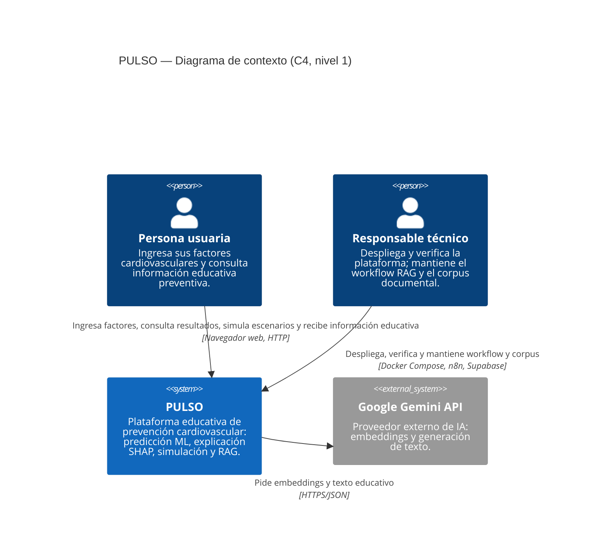
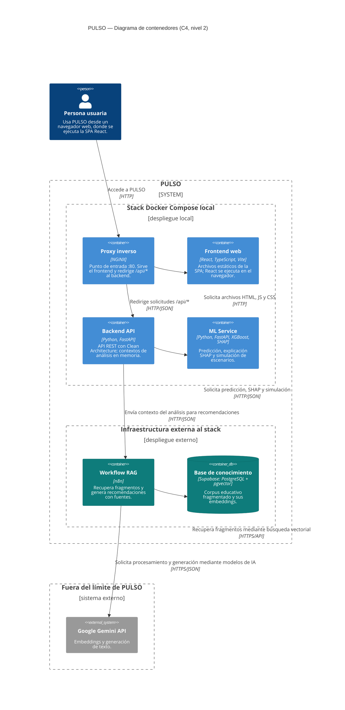
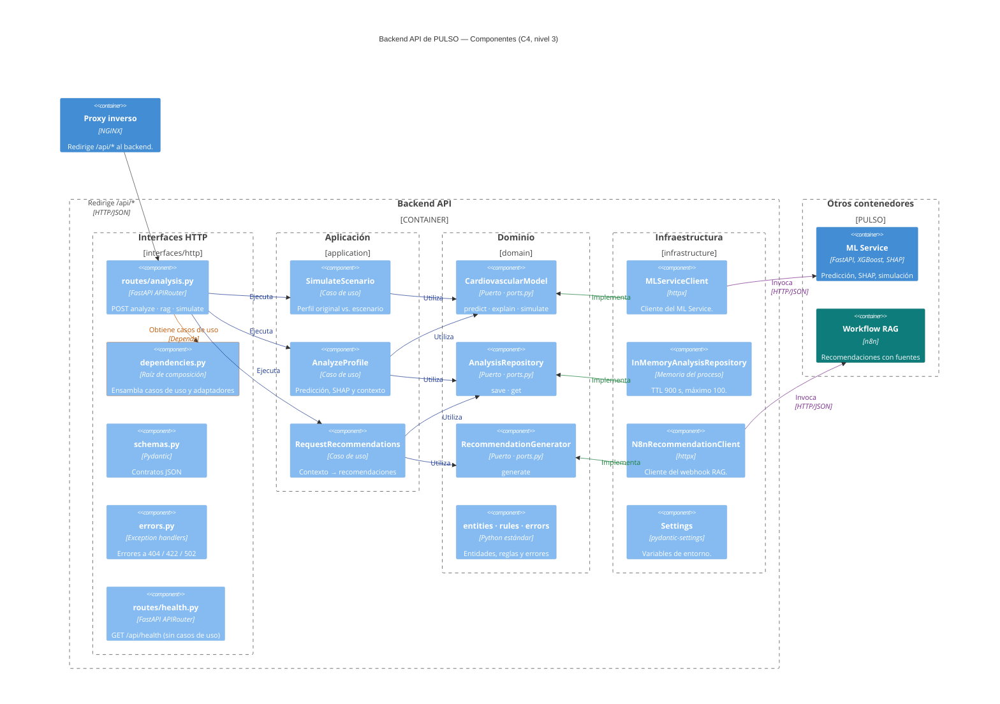

# Arquitectura de PULSO con el modelo C4 (niveles 1 a 3)

Material para el apartado **E5. Arquitectura** de `Informe_1_Backend.md`. Los diagramas usan la sintaxis C4 de Mermaid (`C4Context`, `C4Container`, `C4Component`) y se contrastaron con el código de las ramas `Informe_Backend` y `refactor/backend-clean-architecture`. El código de `backend/` es idéntico en ambas ramas.

> Los niveles 1 y 2 usan la directiva `%%{wrap}%%` para ajustar el texto dentro de las cajas. El nivel 3 no la usa, para que los nombres largos de clase (`InMemoryAnalysisRepository`) no se partan; por eso sus descripciones son cortas. Los niveles 2 y 3 suben el tamaño de letra con `%%{init: {"c4": {...}}}%%`.
>
> Mermaid C4 calcula cuántas cajas caben por fila a partir del ancho de la pantalla (`screen.availWidth`). Los diagramas están pensados para 1280 px o más; `docs/C4_PULSO_render.html` fija ese mínimo para que la exportación sea siempre igual.
>
> La pauta (Entrega 1, E5) exige que cada nivel aparezca en el PDF **como imagen con leyenda**, sin código Mermaid. Las imágenes de los niveles 2 y 3 ya están exportadas en `docs/c4_img/` (SVG y PNG de alta resolución). Para regenerarlas, abre `docs/C4_PULSO_render.html` y usa los botones de descarga.

## 0. Diferencias encontradas antes de dibujar

| # | Fuente | Afirmación | Evidencia en el código | Decisión |
|---|---|---|---|---|
| 1 | `Informe_1_Backend.md` §7, rama `Informe_Backend` | PostgreSQL, tabla `users`, JWT bearer, Argon2, `/api/auth/*` y `SQLAlchemy` están implementados | No existe ningún archivo con `jwt`, `argon2`, `sqlalchemy` ni `postgres` en `backend/`, `frontend/src`, `docker-compose.yml` ni `infrastructure/`, en ninguna rama remota. `main.py` solo registra `health` y `analysis`. | **No se dibuja.** El informe debe corregirse: hoy afirma funcionalidades que no existen. |
| 2 | Prompt | El repositorio de configuración es `Settings` | La clase `Settings` está en `infrastructure/config.py` | Se rotula «Settings (config.py)». |
| 3 | Prompt | `N8nRecommendationClient` | La clase existe, en el archivo `infrastructure/n8n_rag_client.py` | Se usa el nombre de la clase. |
| 4 | Prompt | Tabla `public.documents_pulso_test` y función `public.match_documents_pulso_test` | El workflow exportado en `rag/workflows/n8nRag2ConFuentes.json` apunta a la tabla `documents` y usa la función de consulta por defecto del nodo Supabase | Ese nivel de detalle no aparece en los diagramas. Ver §4, punto 2. |
| 5 | Prompt | n8n es externo al stack de Docker Compose | `.env.docker` define `RAG_SERVICE_URL` como `http://host.docker.internal:5678/…`: n8n corre en la máquina anfitriona, fuera de Compose, y se llama por HTTP | Se rotula «fuera de Docker Compose» y el protocolo es HTTP, no HTTPS. |
| 6 | Prompt | El navegador accede por HTTP/HTTPS | `infrastructure/nginx/default.conf` solo escucha en el puerto 80; no hay TLS | Se rotula HTTP. HTTPS queda como mejora. |
| 7 | Prompt | Proveedor externo de IA genérico | El workflow usa `models/gemini-embedding-001` (embeddings) y `models/gemini-3-flash-preview` (generación) | Se nombra «Google Gemini API». |
| 8 | — | — | `main.py` (`create_app`) registra las rutas y los manejadores de errores | Se menciona en el texto; no se dibuja para no saturar el nivel 3. |

## Límite del sistema

**Decisión:** el workflow RAG de n8n y la base de conocimiento en Supabase son **contenedores de PULSO**, no sistemas externos. El único sistema externo es el proveedor de IA (Google Gemini).

**Justificación.** En C4, un elemento pertenece al sistema cuando el equipo lo construye y es responsable de él, aunque se despliegue fuera de Docker Compose o en un servicio gestionado:

- el equipo escribe y versiona el workflow (`rag/workflows/n8nRag2ConFuentes.json`), con su prompt, la consulta y la validación de fuentes;
- el equipo cura el corpus de Supabase (15 documentos, 160 fragmentos);
- las recomendaciones educativas son una funcionalidad central de PULSO, no un servicio de terceros.

En cambio, el equipo no controla los modelos de Gemini: solo los consume. Este límite se mantiene en los tres niveles. Para diferenciar el despliegue, n8n y Supabase llevan otro color y la nota «fuera de Docker Compose».

*Alternativa:* si el docente pide tratar n8n y Supabase como terceros, se reemplazan por `System_Ext` en el nivel 1 y por `Container_Ext`/`ContainerDb_Ext` fuera del `System_Boundary` en el nivel 2. Las relaciones no cambian.

## Convenciones visuales

| Estilo | Significado |
|---|---|
| Azul | Elemento implementado y desplegado con Docker Compose (en el nivel 2, dentro del límite «Stack Docker Compose local») |
| Verde azulado | Elemento implementado de PULSO desplegado fuera de Docker Compose (n8n, Supabase; en el nivel 2, dentro del límite «Infraestructura externa al stack») |
| Gris | Sistema externo, fuera del control del equipo |
| Flecha azul, «Ejecuta» / «Utiliza» (nivel 3) | Dependencia en tiempo de ejecución: ruta → caso de uso → puerto |
| Flecha verde, «Implementa» (nivel 3) | Dependencia de código: el adaptador cumple el `Protocol` del puerto |
| Flecha morada, «Invoca» (nivel 3) | Comunicación externa por HTTP/JSON con otro contenedor |
| Flecha y borde naranja (nivel 3) | Composición: `dependencies.py` |

Los tres diagramas solo contienen elementos implementados. El módulo de usuarios (registro, JWT, roles, consentimiento, historial y PostgreSQL) no aparece en ninguno porque no existe en el código.

---

## 1. Nivel 1 — Diagrama de contexto

**Figura 7.1. Diagrama de contexto del sistema PULSO (C4, nivel 1).** Personas que usan PULSO y el único sistema externo del que depende.

**Elementos**

- **Persona usuaria:** usa las funciones predictivas y educativas. No tiene cuenta: el sistema no implementa autenticación.
- **Responsable técnico:** opera el stack de Docker Compose, comprueba `/api/health` y mantiene el workflow de n8n y el corpus de Supabase.
- **PULSO:** el sistema completo, que incluye el workflow RAG y la base de conocimiento (ver «Límite del sistema»).
- **Google Gemini API:** sistema externo que genera los embeddings de la consulta y el texto educativo.

**Relaciones:** la persona usuaria interactúa con PULSO desde el navegador por HTTP (no hay TLS configurado). El responsable técnico interviene con herramientas de operación, no con la interfaz pública. PULSO consume Gemini por HTTPS a través del workflow RAG; este detalle aparece en el nivel 2.

**Por qué se representa así:** el nivel 1 muestra el sistema como una sola caja. No aparecen controladores, endpoints, clases ni la base de datos, ni tampoco un servicio de correo, de usuarios o un administrador con rol, porque no existen.

---

## 2. Nivel 2 — Diagrama de contenedores

**Figura 7.2. Diagrama de contenedores de PULSO (C4, nivel 2).** NGINX es el único punto de entrada: sirve el frontend y redirige `/api/*` al backend. Los cuatro contenedores del stack Docker Compose local se separan de n8n y Supabase, que se usan desde infraestructura externa al stack. Google Gemini queda fuera del límite de PULSO.

**Elementos**

- **Persona usuaria:** la misma del nivel 1. Usa un navegador; ahí se ejecuta la SPA React una vez descargados sus archivos.
- **Proxy inverso (NGINX):** `infrastructure/nginx/default.conf`. Envía `/api/` a `backend:8000` y `/` a `frontend:80`.
- **Frontend web:** build de Vite servido por el contenedor `frontend`, que usa un NGINX interno con `try_files` para la SPA. El código se ejecuta en el navegador y llama a `/api/*` con rutas relativas (`VITE_API_URL=""`).
- **Backend API:** FastAPI. El repositorio temporal de análisis aparece como una anotación del contenedor y no como un almacén propio, porque vive en la memoria del proceso (TTL de 900 s, máximo 100 entradas, una sola instancia). Su detalle está en el nivel 3.
- **ML Service:** FastAPI con XGBoost y SHAP; expone `/predict`, `/explain`, `/simulate` y `/health`.
- **Workflow RAG (n8n):** webhook, preparación del contexto, Supabase Vector Store (top-k 5), cadena LLM y validación de fuentes.
- **Base de conocimiento (Supabase):** PostgreSQL con pgvector; corpus de 15 documentos y 160 fragmentos, embeddings de 3072 dimensiones.
- **Google Gemini API:** `gemini-embedding-001` para los embeddings y un modelo Gemini para la generación.

**Relaciones**

- **Persona usuaria (navegador) → NGINX** «Accede a PULSO» [HTTP]: todas las peticiones del navegador, tanto las de archivos como las de `/api/*` que hace la SPA, llegan a NGINX.
- **NGINX → Frontend** «Solicita archivos HTML, JS y CSS» [HTTP]: el contenedor `frontend` solo entrega archivos estáticos; no ejecuta lógica.
- **NGINX → Backend** «Redirige solicitudes `/api/*`» [HTTP/JSON].
- No hay ninguna flecha entre frontend y backend, ni flechas de ida y vuelta entre NGINX y el frontend. La SPA llama a la API desde el navegador, y esa llamada es la misma relación persona → NGINX → backend.
- **Backend → ML Service** «Solicita predicción, SHAP y simulación» y **Backend → n8n** «Envía contexto del análisis para recomendaciones»: HTTP/JSON con `httpx`, con un tiempo máximo de 30 s.
- **n8n → Supabase** «Recupera fragmentos mediante búsqueda vectorial» [HTTPS/API] y **n8n → Gemini** «Solicita procesamiento y generación mediante modelos de IA» [HTTPS/JSON]. Solo el workflow RAG los usa; el backend no los conoce.

**Por qué se representa así**

- **Contenedor C4 frente a contenedor Docker.** NGINX, frontend, backend y ML Service están en Docker Compose; n8n y Supabase no. Aun así, los seis son contenedores C4 porque son unidades desplegables que pertenecen a PULSO. La diferencia de despliegue se marca con dos límites dentro de PULSO y con el color.
- Las cajas siguen una cuadrícula de dos columnas sin cruces de flechas. Las etiquetas de las flechas horizontales van debajo, en el espacio libre entre filas, para no taparlas con las cajas.
- El navegador no es un contenedor C4 sino el entorno donde se ejecuta el frontend. Por eso aparece en la tecnología de las relaciones y no como una caja aparte.
- El responsable técnico no aparece en el nivel 2. Sus relaciones (mantener el workflow en el editor de n8n y el corpus en Supabase) cruzaban todo el diagrama, y el nivel 1 ya las muestra. Si el docente pide que aparezca, se añade `Rel(responsable, rag, "Mantiene el workflow", "Editor n8n")` y `Rel(responsable, kb, "Mantiene el corpus", "Panel Supabase")`.
- No hay una base PostgreSQL de usuarios, porque no existe.
- No se dibuja el ML Service llamando al RAG ni el RAG llamando al modelo, porque esas conexiones no existen.

---

## 3. Nivel 3 — Diagrama de componentes del backend

**Figura 7.3. Componentes de la Backend API (C4, nivel 3).** Las cuatro capas de Clean Architecture aparecen como columnas. Flechas azules: dependencias en tiempo de ejecución («Ejecuta», «Utiliza»). Verdes: implementación de puertos. Moradas: comunicación externa. Naranja: composición en `dependencies.py`. El dominio no tiene flechas salientes.

**Elementos**

- **Interfaces HTTP:** `routes/analysis.py`, `routes/health.py`, `schemas.py`, `dependencies.py` y `errors.py`. `routes/health.py` está al final de la columna, sin flechas hacia los casos de uso, porque no los usa. `main.py` (`create_app`) registra los dos routers con el prefijo `/api` y los manejadores de errores; no se dibuja.
- **Aplicación:** `AnalyzeProfile`, `RequestRecommendations` y `SimulateScenario`. Reciben los puertos por constructor y no importan ninguna clase concreta.
- **Dominio:** los tres puertos de `ports.py` (`typing.Protocol`) y un componente que agrupa `entities.py`, `rules.py` y `errors.py`. Se agrupan porque ninguna flecha del diagrama llega a ellos; dibujarlos por separado añadía cajas sin aportar relaciones. Solo usan la biblioteca estándar.
- **Infraestructura:** los tres adaptadores y `Settings`. Los clientes también usan entidades y errores del dominio (por ejemplo, lanzan `ModelServiceError`); esas flechas se omiten porque la flecha «implementa» ya muestra que dependen del dominio.

**Relaciones**

1. **NGINX → `routes/analysis.py`** «Redirige /api/*» [HTTP/JSON].
2. **Rutas → casos de uso** «Ejecuta» (azul): `execute(...)` en tiempo de ejecución.
3. **Casos de uso → puertos** «Utiliza» (azul): `AnalyzeProfile` usa `CardiovascularModel` y `AnalysisRepository`; `RequestRecommendations` usa `AnalysisRepository` y `RecommendationGenerator`; `SimulateScenario` usa `CardiovascularModel`. Ninguno conoce las clases concretas.
4. **Adaptadores → puertos** «Implementa» (verde): `MLServiceClient` → `CardiovascularModel`, `InMemoryAnalysisRepository` → `AnalysisRepository`, `N8nRecommendationClient` → `RecommendationGenerator`. Es una dependencia de código, no una llamada, y apunta hacia el dominio.
5. **Adaptadores → otros contenedores** «Invoca» [HTTP/JSON] (morado): `MLServiceClient` → ML Service y `N8nRecommendationClient` → workflow RAG.
6. **`routes/analysis.py` → `dependencies.py`** «Obtiene casos de uso» [Depends] (naranja). `dependencies.py` es la raíz de composición: crea los casos de uso, les inyecta los adaptadores concretos y lee `Settings`. Esas siete relaciones de creación no se dibujan porque cruzaban todo el diagrama; lo indican el texto de la caja y su borde naranja. Es el único módulo que importa la infraestructura, y las pruebas lo sustituyen con `app.dependency_overrides`.
7. **El dominio no depende de FastAPI, Pydantic, httpx ni n8n:** ninguna flecha sale del límite del dominio. `backend/tests/test_architecture.py` lo comprueba analizando los imports.

**Por qué se representa así**

- Las capas son límites (`Boundary`) y no una cadena de flechas, para no sugerir que la ejecución recorre las capas en secuencia. El flujo real es: ruta → caso de uso → puerto → (adaptador) → servicio externo.
- La llamada «caso de uso → puerto» y la relación «adaptador → puerto» tienen distinto color y rótulo porque no significan lo mismo: la primera es uso en tiempo de ejecución y la segunda es implementación de una interfaz.
- ML Service y el workflow RAG quedan fuera del límite del backend, en un límite «Otros contenedores», igual que en el nivel 2, y se conectan solo con su adaptador.
- Las capas se disponen en columnas (interfaces, aplicación, dominio, infraestructura) y cada puerto está en la misma fila que su adaptador, así que las flechas «Implementa» son horizontales. Los casos de uso se ordenan (`SimulateScenario`, `AnalyzeProfile`, `RequestRecommendations`) para que las flechas «Utiliza» no se crucen.
- Se omiten las relaciones secundarias `schemas.py` → dominio y `errors.py` → errores del dominio: las descripciones de esas cajas ya las indican.
- `routes/health.py` no recibe una flecha propia de NGINX: habría atravesado `routes/analysis.py`. Su descripción indica el endpoint `GET /api/health`.
- `InMemoryAnalysisRepository` es un componente y no un `ComponentDb`, para no presentarlo como persistencia.

---

## 4. Revisión de consistencia entre niveles

**Coherencia comprobada**

| Elemento | Nivel 1 | Nivel 2 | Nivel 3 |
|---|---|---|---|
| Persona usuaria | Persona | Persona → NGINX | (representada por NGINX como origen) |
| Responsable técnico | Persona | — (ver justificación del nivel 2) | — |
| Sistema PULSO | Caja única | `System_Boundary` con 6 contenedores | Detalle del contenedor Backend API |
| NGINX | Dentro de PULSO | Contenedor | Contenedor de contexto |
| Frontend | Dentro de PULSO | Contenedor | — |
| Backend API | Dentro de PULSO | Contenedor, en el stack Docker Compose | `Container_Boundary` con 16 componentes en 4 capas |
| ML Service | Dentro de PULSO | Contenedor | Contenedor de contexto ← `MLServiceClient` |
| Workflow RAG (n8n) | Dentro de PULSO | Contenedor, en «Infraestructura externa al stack» | Contenedor de contexto ← `N8nRecommendationClient` |
| Supabase | Dentro de PULSO | ContainerDb, en «Infraestructura externa al stack» | — (el backend no lo usa) |
| Google Gemini | Sistema externo | Sistema externo | — (el backend no lo usa) |
| Repositorio temporal | — | Anotación en Backend API | `InMemoryAnalysisRepository` |

- Cada relación del nivel 2 que sale del backend corresponde a un adaptador del nivel 3, y no hay más adaptadores que relaciones.
- El nivel 3 no añade sistemas externos que no estén en el nivel 2.
- Ningún diagrama incluye PostgreSQL de usuarios, JWT, roles ni historial.

**Elementos que dependen de información no verificada en el repositorio**

1. **Corpus de Supabase (15 documentos, 160 fragmentos, 3072 dimensiones):** el repositorio no tiene scripts de carga ni el esquema SQL; las cifras vienen del equipo. Solo se usan en el texto, no en los diagramas.
2. **Tabla `documents_pulso_test` y función `match_documents_pulso_test`:** el workflow exportado usa `documents` y la función por defecto. Lo más probable es que la exportación esté desactualizada respecto a la instancia de n8n en uso. Conviene volver a exportar el workflow y versionarlo.
3. **Modelo de generación:** la exportación usa `models/gemini-3-flash-preview`. Por eso el diagrama dice solo «Google Gemini API».
4. **Cómo se mantiene el corpus** (relación del responsable técnico en el nivel 1): no hay evidencia de un proceso de ingesta en el repositorio. Si existe un workflow de ingesta en n8n, la relación debería decir «Responsable técnico → workflow de ingesta → Supabase».
5. **Ubicación de n8n:** `.env.docker` apunta a `host.docker.internal:5678` (n8n en la máquina anfitriona). Si en la demostración se usa n8n Cloud, el protocolo del nivel 2 pasa a HTTPS.
6. **HTTPS público:** NGINX solo escucha en HTTP :80. Si el despliegue final añade TLS, hay que actualizar los niveles 1 y 2.

**Acción recomendada sobre el informe:** el apartado 7 de `Informe_1_Backend.md` (rama `Informe_Backend`), sus diagramas Mermaid actuales y las tablas de base técnica afirman que PostgreSQL, JWT, Argon2 y `/api/auth/*` están implementados. El código no lo respalda. Esos textos deben reemplazarse por estos diagramas, o el módulo de usuarios debe pasar a un diagrama aparte, titulado «Arquitectura propuesta del módulo de usuarios».
