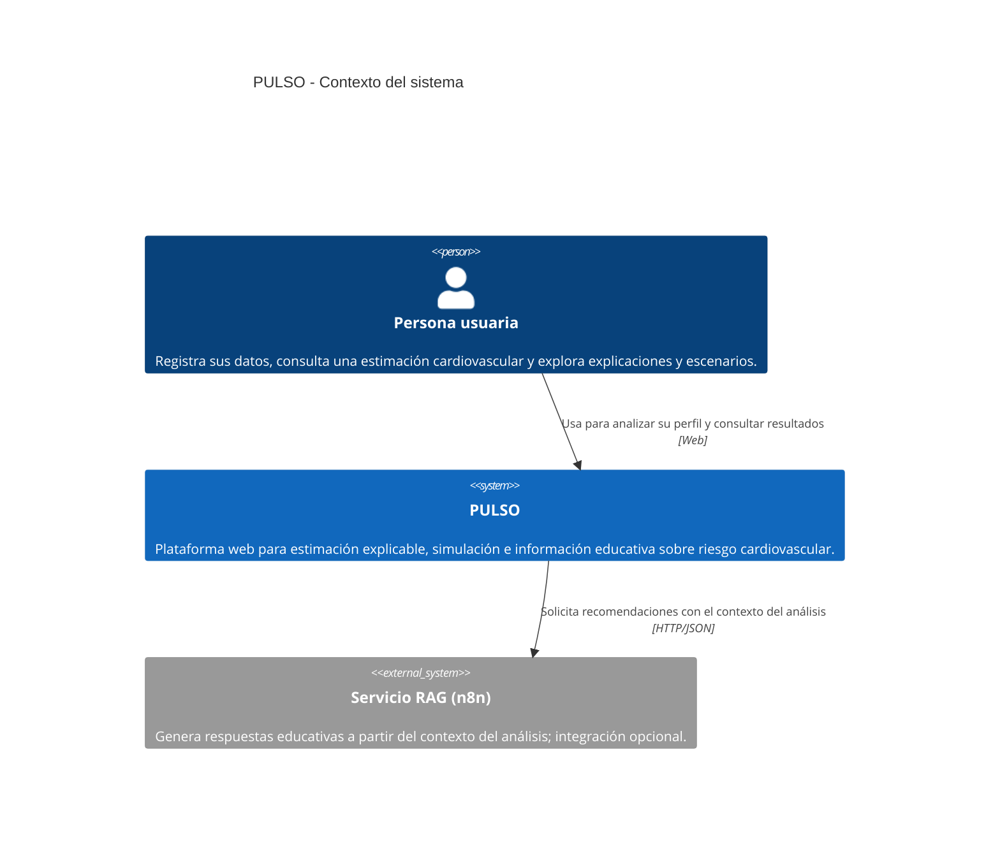
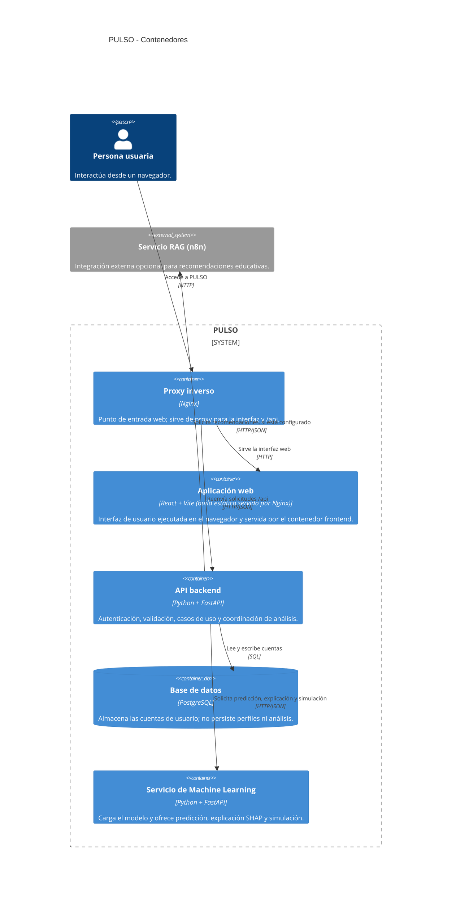
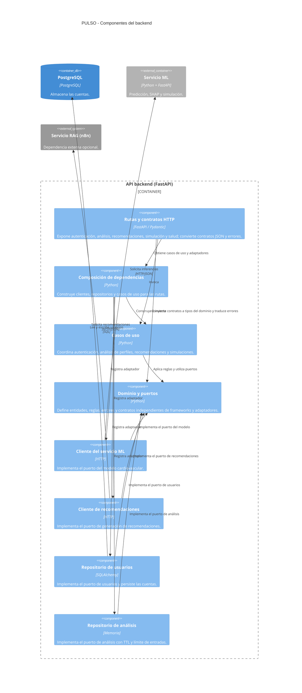

# PULSO: plataforma de predicción explicable y educación preventiva cardiovascular

## Informe de avance para la Entrega 1 Backend

**Curso:** Proyecto Final Backend  
**Integrantes:** Miguel Angel Márquez Coronel, María Gabriela Rey Barrios y Andrés Felipe Serrano Mendoza  
**Fecha:** 13/11/2026 

## Resumen

PULSO es una plataforma web propuesta para apoyar la prevención y la educación cardiovascular mediante una estimación generada por aprendizaje automático, explicaciones de las variables que influyen en la salida del modelo, simulación de escenarios e información recuperada de fuentes confiables. El público principal son personas no especializadas. La plataforma no tiene como propósito diagnosticar, prescribir tratamientos ni sustituir la atención de profesionales de la salud.

El componente de Machine Learning utiliza el *Cardiovascular Disease Dataset* de Kaggle y aborda una tarea de clasificación binaria sobre la variable `cardio`. Por ello, su salida representa una probabilidad estimada de pertenecer a la clase `cardio = 1`; no representa el riesgo de sufrir un evento cardiovascular futuro en un horizonte temporal definido. El modelo final documentado es XGBoost, con umbral de clasificación 0.38 y sin calibración adicional. SHAP describe el comportamiento del modelo, mientras que las simulaciones muestran cómo cambia su salida ante entradas alternativas; ninguno de estos resultados demuestra causalidad clínica.

El repositorio integra una interfaz React/Vite, un backend FastAPI, PostgreSQL, un servicio Python de Machine Learning y una integración RAG. La interfaz permite registrarse e iniciar sesión antes de enviar factores, visualizar una predicción, consultar factores SHAP, solicitar información preventiva y explorar una simulación. El backend guarda las cuentas en PostgreSQL, almacena las contraseñas mediante hashes Argon2 y protege las rutas de análisis con JWT bearer. No se implementan roles, consentimiento de privacidad ni eliminación de cuenta. Este informe presenta esas diferencias como características y límites del estado actual, no como funcionalidades ya realizadas.

## 1. Contexto y problema

Las herramientas de evaluación cardiovascular suelen estar dirigidas a profesionales, dependen de poblaciones específicas y pueden presentar resultados difíciles de interpretar para el público general. El problema que aborda PULSO es la dificultad de comprender información personalizada sobre factores asociados con enfermedades cardiovasculares, así como las limitaciones de las estimaciones y de los escenarios hipotéticos.

La propuesta integra predicción, explicabilidad, simulación e información educativa en una experiencia web. El modelo utilizado en el MVP se entrena con datos públicos. Su variable objetivo identifica la presencia o ausencia de enfermedad cardiovascular en los registros de origen. Por tanto, el sistema no debe describirse como una calculadora clínica de riesgo futuro ni como un instrumento diagnóstico.

La procedencia del conjunto de datos no permite asumir representatividad para Colombia o América Latina. Los resultados deben comunicarse con esa limitación, sin atribuirles validez clínica poblacional que no haya sido demostrada.

## 2. Objetivos y alcance

### 2.1 Objetivo general

Diseñar e implementar un MVP web que facilite a personas no especializadas la comprensión de factores asociados con enfermedades cardiovasculares mediante un clasificador de Machine Learning, explicaciones SHAP, simulaciones de escenarios e información educativa sustentada en fuentes confiables.

### 2.2 Alcance funcional

El alcance funcional de PULSO comprende:

1. Ingreso y validación de los factores requeridos por el modelo.
2. Estimación de la probabilidad de pertenecer a la clase `cardio = 1`.
3. Presentación de la clasificación, la probabilidad, el umbral y la versión del modelo.
4. Explicación local de la predicción mediante los factores SHAP principales.
5. Comparación de la predicción original con escenarios hipotéticos admitidos por el modelo.
6. Solicitud de información educativa mediante RAG, basada en fuentes médicas seleccionadas.
7. Interfaz web orientada al público general, con mensajes sobre las limitaciones del resultado.

La gestión de cuentas, los roles, el consentimiento, la eliminación de datos y el almacenamiento persistente no forman parte de las funcionalidades demostrables en el estado revisado del repositorio. Se mencionan más adelante como aspectos transversales de la pauta que deben distinguirse del alcance implementado de PULSO.

### 2.3 Fuera del alcance

PULSO no diagnostica enfermedades, no prescribe ni modifica tratamientos, no reemplaza la consulta profesional y no certifica clínicamente sus modelos. La simulación es una exploración matemática de las salidas del clasificador, no una recomendación de intervención ni una demostración de causalidad.

## 3. E1. Inception y validación del problema

Los informes de PULSO describen la necesidad, la población objetivo, las limitaciones de las herramientas existentes y el alcance educativo de la solución. En los archivos revisados no consta un acta de Inception con fecha, asistentes, evidencias de reunión ni validación externa. Por tanto, este apartado resume el planteamiento documentado del proyecto y deja pendiente la incorporación de un acta si el equipo realizó esa actividad.

**Registro de validación:** [Completar con fecha real, asistentes, equipo de origen, necesidades confirmadas, acuerdos y enlace a la evidencia autorizada.]  
**Decisiones de alcance validadas por el equipo de origen:** [Completar.]  
**Enlace a grabación y evidencias:** [Completar en el informe de evidencias.]

PULSO se presenta como el proyecto desarrollado por el equipo. La pauta se utiliza como referencia para organizar este informe; sus referencias específicas a CLENA y a los proyecto enumerados no se trasladan a PULSO, pues no corresponden al contexto documentado del proyecto.

## 4. E2. Historias de usuario propuestas

Las siguientes historias traducen el alcance funcional de PULSO y algunos requisitos transversales pertinentes de la pauta. Constituyen una propuesta de backlog para organizar el trabajo; su inclusión en este informe no significa que todas estén implementadas, publicadas en GitHub o validadas por usuarios externos. Las historias de cuentas, roles y persistencia se incluyen como posibilidades de evolución y no como funcionalidades presentes en la aplicación actual.

| ID | Historia | Criterios de aceptación | Puntos | Prioridad |
|---|---|---|---:|---|
| HU-01 | Como usuario, quiero crear una cuenta para acceder de forma segura a PULSO. | Dado un correo válido y una contraseña conforme a la política, cuando completo el registro, entonces se crea la cuenta. Dado un correo ya registrado, cuando intento registrarme, entonces la cuenta no se duplica y recibo un error uniforme. | 5 | Alta |
| HU-02 | Como usuario, quiero iniciar y cerrar sesión para controlar el acceso a mis datos. | Dadas credenciales válidas, cuando inicio sesión, entonces recibo access y refresh tokens. Dada una sesión cerrada o un refresh token vencido, cuando intento renovar el acceso, entonces la renovación se rechaza. | 5 | Alta |
| HU-03 | Como usuario, quiero aceptar el aviso de privacidad para autorizar el tratamiento de mis datos. | Dado que no he aceptado el aviso, cuando intento crear una cuenta, entonces el registro se bloquea. Dado que acepto, cuando se guarda el consentimiento, entonces se registra la versión del aviso y la fecha. | 3 | Alta |
| HU-04 | Como usuario, quiero solicitar la eliminación de mi cuenta para controlar mis datos. | Dada una cuenta autenticada, cuando solicito eliminarla, entonces el sistema ejecuta el proceso documentado de eliminación o anonimización. Dada una cuenta eliminada, cuando intento iniciar sesión, entonces el acceso se rechaza. | 5 | Alta |
| HU-05 | Como usuario, quiero ingresar mis factores cardiovasculares para solicitar un análisis. | Dado el formulario, cuando ingreso valores válidos con sus unidades, entonces puedo enviar el perfil. Dado un valor fuera del rango o una relación inválida entre presiones, cuando envío el formulario, entonces se muestra el error y no se ejecuta el análisis. | 5 | Alta |
| HU-06 | Como usuario, quiero recibir la estimación del clasificador para conocer su salida sobre mis datos. | Dado un perfil válido, cuando solicito el análisis, entonces recibo probabilidad, clase, umbral y versión del modelo. Dado que el servicio de ML no responde, cuando solicito el análisis, entonces se informa el fallo sin inventar un resultado. | 5 | Alta |
| HU-07 | Como usuario, quiero conocer los límites de la predicción para interpretarla responsablemente. | Dado un resultado, cuando lo consulto, entonces se indica que estima pertenencia a `cardio = 1` y no un evento futuro ni un diagnóstico. Dada la pantalla de resultado, cuando se muestra la estimación, entonces también se informa la limitación de representatividad de los datos. | 3 | Alta |
| HU-08 | Como usuario, quiero consultar una explicación SHAP para entender cómo respondió el modelo. | Dado un análisis exitoso, cuando abro su explicación, entonces veo los factores principales y la dirección de su contribución. Dada la explicación, cuando se presenta, entonces se aclara que no demuestra causalidad clínica. | 5 | Alta |
| HU-09 | Como usuario, quiero simular cambios permitidos para comparar la salida del modelo. | Dado un perfil original, cuando modifico variables admitidas, entonces veo juntas la salida original y la simulada. Dado un cambio inválido, cuando envío el escenario, entonces se rechaza y el perfil original se conserva. | 5 | Alta |
| HU-10 | Como usuario, quiero consultar información preventiva con fuentes visibles. | Dado un análisis, cuando solicito información, entonces recibo contenido educativo con referencias recuperadas. Dado que no hay fuentes pertinentes o falla RAG, cuando hago la solicitud, entonces el sistema informa la limitación sin fabricar referencias. | 5 | Alta |
| HU-11 | Como usuario, quiero consultar mi historial para revisar análisis anteriores. | Dado que consentí el almacenamiento y tengo análisis, cuando consulto el historial, entonces veo solo mis registros paginados. Dado que no consentí el almacenamiento, cuando consulto el historial, entonces no hay perfiles guardados para mostrar. | 5 | Media |
| HU-12 | Como usuario, quiero eliminar un análisis almacenado para controlar su conservación. | Dado un análisis propio, cuando solicito eliminarlo, entonces deja de estar disponible según la política de retención. Dado un análisis de otra cuenta, cuando intento eliminarlo, entonces la operación se deniega. | 3 | Alta |
| HU-13 | Como administrador, quiero asignar roles para limitar las operaciones disponibles. | Dado un administrador autenticado, cuando asigna un rol permitido, entonces el cambio queda aplicado. Dado un usuario sin permiso, cuando intenta cambiar roles, entonces la operación se rechaza. | 5 | Alta |
| HU-14 | Como personal autorizado, quiero administrar fuentes educativas para mantener actualizado el contenido de RAG. | Dada una fuente aprobada, cuando la registro con metadatos válidos, entonces queda disponible con su procedencia. Dado un usuario sin el rol autorizado, cuando intenta modificar fuentes, entonces el acceso se deniega. | 8 | Media |
| HU-15 | Como usuario, quiero utilizar PULSO con teclado y tecnologías de asistencia. | Dado que navego con teclado, cuando recorro el flujo, entonces el foco visible sigue un orden lógico. Dado un campo inválido, cuando uso un lector de pantalla, entonces el error y la etiqueta del campo se anuncian. | 3 | Alta |
| HU-16 | Como usuario, quiero recibir errores consistentes para entender cómo recuperarme. | Dada una solicitud inválida, cuando responde la API, entonces entrega el formato uniforme de error. Dado un error interno, cuando ocurre, entonces la respuesta no expone secretos, trazas ni datos personales. | 3 | Alta |

## 5. E3. Modelo de dominio

### 5.1 Conceptos del dominio

El dominio separa la información de identidad del usuario de los datos utilizados por el modelo. Un análisis contiene un perfil de entrada, una referencia a la versión del modelo, una predicción y, cuando se solicite, una explicación. Una simulación conserva el perfil de referencia y calcula una segunda salida usando cambios permitidos. El componente RAG aporta información documental independiente del cálculo predictivo.

**Entidades y objetos de valor propuestos:** Usuario, Rol, Consentimiento, PerfilDeFactores, Analisis, Prediccion, Explicacion, FactorSHAP, Escenario, ResultadoSimulado y FuenteEducativa. Su persistencia debe decidirse con base en el principio de minimización; no todos necesitan convertirse en tablas.

### 5.2 Reglas de negocio

1. Un perfil solo se envía al modelo si satisface los rangos y reglas de consistencia definidos por el contrato de predicción.
2. El clasificador utiliza las variables `gender`, `height`, `weight`, `ap_hi`, `ap_lo`, `smoke`, `alco`, `active`, `age_years` y `bmi`.
3. La probabilidad corresponde a la salida del clasificador para `cardio = 1`; no es un riesgo clínico futuro ni un diagnóstico.
4. La clasificación binaria aplica el umbral versionado del modelo; el umbral actual documentado es 0.38.
5. SHAP explica la contribución de las variables a la salida del modelo y no permite concluir causalidad.
6. Los escenarios hipotéticos solo modifican variables admitidas y comparan las salidas matemáticas del modelo.
7. Las respuestas educativas de RAG deben conservar las fuentes utilizadas y no deben indicar cambios de medicación o tratamiento.
8. La conservación de perfiles de salud requiere consentimiento explícito, acceso limitado y una política de eliminación.

### 5.3 Glosario

| Término | Definición en PULSO |
|---|---|
| Clasificación | Asignación de un registro a una de las clases definidas por `cardio`. |
| Probabilidad estimada | Salida probabilística de `predict_proba()` para la clase positiva. |
| Umbral | Valor que convierte la probabilidad en una clase; el modelo actual usa 0.38. |
| Feature | Variable de entrada utilizada por el modelo. |
| BMI / IMC | Índice calculado a partir del peso y la estatura. |
| SHAP | Método para atribuir contribuciones de variables a la salida de un modelo. |
| Explicación local | Contribuciones calculadas para una predicción individual. |
| Simulación | Nueva inferencia del modelo con valores de entrada hipotéticos. |
| RAG | Recuperación de fragmentos documentales que se proporcionan como contexto a un generador. |
| Fuente educativa | Documento aprobado que puede recuperarse para responder consultas informativas. |
| Calibración | Correspondencia entre probabilidades predichas y frecuencias observadas; no se aplica al modelo final actual. |
| Datos sintéticos | Datos ficticios creados para pruebas o demostraciones, no asociados con personas reales. |

### 5.4 Casos de uso

RegistrarUsuario, IniciarSesion, AceptarAvisoDePrivacidad, EliminarCuenta, ValidarPerfil, AnalizarPerfil, ConsultarExplicacion, SimularEscenario, SolicitarInformacionEducativa, ConsultarHistorial, EliminarAnalisis, AsignarRol y GestionarFuenteEducativa.

**Diagrama de dominio:** [Insertar aquí la figura exportada del diagrama de clases, con título y leyenda, al preparar la versión PDF.]

## 6. E4. Modelo de datos

PostgreSQL y la tabla `users` ya están implementados para autenticación. Las demás tablas de la siguiente estructura son un modelo lógico de referencia para responder al apartado de modelo de datos de la pauta; no describen tablas implementadas ni implican que todos estos datos deban almacenarse en el MVP. La decisión de persistir datos personales o de salud requiere definir antes su necesidad y tratamiento.

| Tabla propuesta | Campos principales | Relaciones y propósito |
|---|---|---|
| `users` | `id UUID PK`, `email VARCHAR(254) UNIQUE`, `password_hash VARCHAR(255)`, `created_at TIMESTAMPTZ` | Tabla implementada para identidad y autenticación. El hash se genera con Argon2. |
| `roles` | `id SMALLSERIAL PK`, `name VARCHAR(30) UNIQUE` | Catálogo de roles requeridos. |
| `user_roles` | `user_id UUID FK`, `role_id SMALLINT FK`, `assigned_at TIMESTAMPTZ` | Relación muchos-a-muchos entre cuentas y roles. |
| `privacy_consents` | `id UUID PK`, `user_id UUID FK`, `notice_version VARCHAR(30)`, `accepted_at TIMESTAMPTZ`, `withdrawn_at TIMESTAMPTZ NULL` | Evidencia de consentimiento y versión del aviso. |
| `analyses` | `id UUID PK`, `user_id UUID FK NULL`, `model_version VARCHAR(50)`, `probability NUMERIC(8,7)`, `classification SMALLINT`, `threshold NUMERIC(5,4)`, `created_at TIMESTAMPTZ` | Resultado, solo si se acuerda persistirlo y existe consentimiento. El perfil completo no se guarda por defecto. |
| `simulations` | `id UUID PK`, `analysis_id UUID FK`, `changes JSONB`, `probability NUMERIC(8,7)`, `classification SMALLINT`, `created_at TIMESTAMPTZ` | Escenarios derivados, sujetos a la misma política de retención. |
| `educational_sources` | `id UUID PK`, `title TEXT`, `source_url TEXT`, `version VARCHAR(50)`, `status VARCHAR(20)`, `created_at TIMESTAMPTZ` | Procedencia y estado de las fuentes aprobadas para RAG. |

Los índices iniciales por evaluar son: índice único sobre `users.email`; índices para las claves foráneas; e índice compuesto en `analyses(user_id, created_at DESC)` si se ofrece historial. Cada índice se debe justificar por las consultas de la aplicación y confirmarse en la migración. No se recomienda almacenar el perfil de salud, la explicación completa o el texto de consultas sin necesidad funcional y consentimiento explícito.

**Diagrama entidad-relación:** [Insertar aquí la figura exportada con tipos PostgreSQL, claves y cardinalidades antes de generar el PDF.]

## 7. E5. Arquitectura

### 7.1 Arquitectura implementada

El sistema actual está organizado en contenedores: interfaz React/Vite, backend FastAPI, PostgreSQL, servicio de Machine Learning en Python y proxy Nginx. El backend aplica Clean Architecture en cuatro capas: `domain` contiene entidades, reglas, errores y puertos; `application` coordina los casos de uso; `infrastructure` implementa los clientes HTTP, el repositorio de usuarios en PostgreSQL, el hash Argon2, JWT y el repositorio de análisis en memoria; e `interfaces/http` expone las rutas, los contratos JSON y la composición de dependencias. Las dependencias apuntan hacia el dominio, que no depende de FastAPI, Pydantic ni de los clientes externos.

Los casos de uso implementados incluyen registrar e iniciar sesión, analizar un perfil, solicitar recomendaciones y simular un escenario. El análisis solicita predicción y explicación al servicio ML, y guarda el contexto necesario para RAG en un repositorio en memoria asociado al usuario autenticado. Luego, la solicitud educativa recupera ese contexto y consulta n8n sin repetir la inferencia. El repositorio de análisis tiene un TTL de 900 segundos y un máximo de 100 entradas; está limitado a un único proceso y no ofrece persistencia compartida. PostgreSQL almacena las cuentas, no los perfiles ni los análisis. El detalle de capas y flujos está en [ARQUITECTURA_BACKEND.md](ARQUITECTURA_BACKEND.md).

### 7.2 Descripción de los niveles C4

- **Nivel 1, contexto:** una persona usuaria interactúa con PULSO para ingresar factores, consultar una estimación, revisar su explicación, explorar una simulación y solicitar información educativa. El servicio RAG y las fuentes documentales son dependencias externas del flujo informativo.
- **Nivel 2, contenedores:** frontend React/Vite; API backend FastAPI; PostgreSQL para cuentas; servicio ML en Python; proxy Nginx; servicio RAG configurado mediante URL. Las comunicaciones internas se realizan mediante solicitudes HTTP y JSON, salvo el acceso del backend a PostgreSQL.
- **Nivel 3, componentes:** el backend se divide en dominio, casos de uso, adaptadores de infraestructura y la interfaz HTTP. Los puertos del dominio abstraen el modelo cardiovascular, el generador de recomendaciones, el repositorio de análisis y el repositorio de usuarios; los clientes del ML Service y de n8n, SQLAlchemy y el repositorio en memoria implementan esos puertos. Las dependencias se ensamblan en `interfaces/http/dependencies.py`, y los errores del dominio se traducen a respuestas HTTP. El servicio ML separa carga del modelo, predicción, explicabilidad y simulación. El frontend integra acceso, evaluación, resultado, factores SHAP, recomendaciones y simulación.

Los diagramas siguientes usan la sintaxis C4 de Mermaid. En un visor compatible con Mermaid se muestran como figuras; al exportar el informe a PDF, se deben renderizar y conservar sus títulos y pies de figura. El servicio RAG se indica como externo y opcional porque su URL se configura por entorno y puede no estar habilitada.

**Figura 7.1. Diagrama de contexto del sistema (C4, nivel 1).** La persona usuaria accede a PULSO; las recomendaciones educativas pueden delegarse al servicio RAG configurado.

**Figura 7.2. Diagrama de contenedores (C4, nivel 2).** Nginx es el punto de entrada y enruta el tráfico al frontend o a la API; la API utiliza PostgreSQL, el servicio ML y, si está configurado, el servicio RAG.

**Figura 7.3. Diagrama de componentes del backend (C4, nivel 3).** Se muestra la API FastAPI y sus adaptadores; las implementaciones dependen de los puertos definidos en el dominio.

La pauta propone tecnologías y decisiones de arquitectura específicas para otros proyectos. Para PULSO se documentan las decisiones que realmente están en uso: FastAPI/Python en el backend y servicio ML, React/Vite en frontend, PostgreSQL, Docker Compose y Nginx como proxy. No se atribuye al proyecto una implementación NestJS ni un módulo de inyección NestJS.

## 8. E6. Base técnica y estado de implementación

| Aspecto técnico de referencia | Estado observado en PULSO |
|---|---|
| Backend y API | Backend FastAPI/Python; `/api/health` es público, `/api/auth/register`, `/api/auth/login` y `/api/auth/me` gestionan autenticación, y las rutas `/api/analyze`, `/api/rag` y `/api/simulate` requieren JWT bearer. |
| Arquitectura del backend | Clean Architecture con capas de dominio, aplicación, infraestructura e interfaz HTTP; las dependencias se ensamblan mediante inyección y el dominio permanece independiente de FastAPI y de los servicios externos. |
| Frontend | React/Vite con componentes y archivos JSX. |
| Servicio de Machine Learning | Servicio Python independiente para inferencia, SHAP y simulación; el modelo final documentado es XGBoost. |
| Persistencia | PostgreSQL guarda cuentas y hashes Argon2. Los contextos de análisis para RAG siguen en memoria (TTL de 900 s, máximo 100 entradas, un solo proceso); no se guardan perfiles ni historial. |
| Contenedores | Docker Compose coordina ML, backend, frontend y Nginx. |
| Documentación de API | FastAPI genera documentación OpenAPI; la ruta `/docs` debe confirmarse al ejecutar la configuración local. |
| CI y pruebas | Existen workflows para backend/RAG, frontend, ML e infraestructura. Las pruebas del backend se organizan por capas y verifican también las reglas de dependencias entre ellas; el estado de checks de cada PR se debe comprobar en GitHub. |
| Variables y secretos | La configuración utiliza variables de entorno para algunas integraciones; revisar y documentar `.env.example` antes de la entrega. |
| Autenticación, roles y privacidad | Registro e inicio de sesión con JWT bearer y contraseñas Argon2 están implementados. Roles, consentimiento de privacidad y eliminación de cuenta no están implementados. El token se conserva en `localStorage`; para producción se recomienda cookie `HttpOnly` y HTTPS. |

La pauta solicita además NestJS y TypeScript como parte de su base técnica. Estos elementos no corresponden a la arquitectura actual de PULSO y no se presentan aquí como implementados. El informe conserva el estado real del proyecto para que el docente pueda valorar la adaptación solicitada.

## 9. E7. Funcionalidad existente y brechas

### 9.1 Funcionalidad demostrable en el código actual

- El formulario web envía los datos de entrada al endpoint de análisis.
- El usuario puede crear una cuenta e iniciar sesión; el backend valida el JWT para las rutas de análisis.
- Las cuentas se almacenan en PostgreSQL y las contraseñas se guardan con hash Argon2, nunca en texto plano.
- `POST /api/analyze` ejecuta el caso de uso de análisis, solicita predicción y explicación al servicio ML, conserva temporalmente el contexto y devuelve un identificador de análisis.
- El servicio ML valida rangos y consistencia entre altura, peso e IMC.
- La interfaz muestra predicción y factores SHAP.
- La interfaz permite solicitar recomendaciones RAG usando el identificador de análisis; el caso de uso recupera el contexto del repositorio en memoria y consulta n8n sin repetir la inferencia.
- `POST /api/simulate` ejecuta el caso de uso de simulación, que solicita al servicio ML una comparación entre valores originales y simulados.
- La interfaz HTTP traduce errores del dominio a respuestas HTTP, incluidos los casos de análisis inexistente, entrada o escenario inválido y fallo de servicios externos.
- Docker Compose coordina ML, backend, frontend y Nginx.

### 9.2 Brechas para considerar funcionalidades terminadas según la pauta

La implementación descrita incluye PostgreSQL para cuentas y autenticación con JWT; no incluye gestión automatizada de migraciones posteriores, datos semilla, roles, consentimiento, eliminación de cuenta, rutas protegidas por rol ni historial paginado de análisis. Los análisis no se persisten. Estas capacidades no se atribuyen al alcance implementado; la pauta las incluye como referencias transversales y su pertinencia o prioridad para PULSO debe acordarse con el docente. Por la diferencia entre el alcance funcional de PULSO y los proyectos CLENA de la pauta, no se calcula un porcentaje de cumplimiento del 80 % a partir de las funcionalidades de esa tabla.

## 10. Evidencias de Scrum y GitHub Flow

La información verificable de los elementos siguientes debe incorporarse desde GitHub y las actas del equipo antes de cerrar el informe:

| Evidencia | Referencia que debe agregarse |
|---|---|
| Product Owner, Scrum Master y equipo de desarrollo | [Nombres y sección del README] |
| GitHub Project y estados del tablero | [URL del tablero] |
| Milestone Sprint 1 y objetivo | [URL del milestone] |
| Historias validadas | [URLs de Issues] |
| Dailies o Sprint Review | [Fechas reales, actas y enlaces a grabaciones] |
| Pull Requests, revisiones y CI | [URLs de PR y estado de checks] |
| Protección de `main` y colaborador del curso | [Evidencia o configuración verificable] |

No se completan fechas, asistentes, aprobaciones ni enlaces que no estén disponibles en el repositorio.

## 11. Conclusiones

PULSO cuenta con una base de producto demostrable para el flujo de análisis: formulario, predicción, explicación SHAP, simulación y consulta educativa RAG. El proyecto también dispone de un flujo MLOps documentado y un modelo XGBoost seleccionado con umbral 0.38. La documentación delimita que el clasificador estima la clase `cardio = 1`, no un evento futuro, y que SHAP y las simulaciones no prueban causalidad.

La pauta se utilizó como estructura para presentar el problema, el backlog, los modelos, la arquitectura, la base técnica, las funcionalidades y la gestión del trabajo. Debido a que sus ejemplos y requisitos funcionales fueron escritos para proyectos distintos, algunos apartados se adaptaron al alcance de PULSO y otros se reportan como no implementados o no aplicables al estado actual. La valoración del curso corresponde al docente; este informe no afirma cumplimiento total de todos los criterios de la pauta.

## Referencias internas del proyecto

- [Primer informe](../PrimerInforme.md)
- [Segundo informe](../SegundoInforme.md)
- [Documentación del modelo final y SHAP](MODELO_FINAL_Y_GUIA_SHAP.md)
- [Estructura MLOps](ESTRUCTURA_MLOPS_PULSO_ACTUALIZADA.md)
