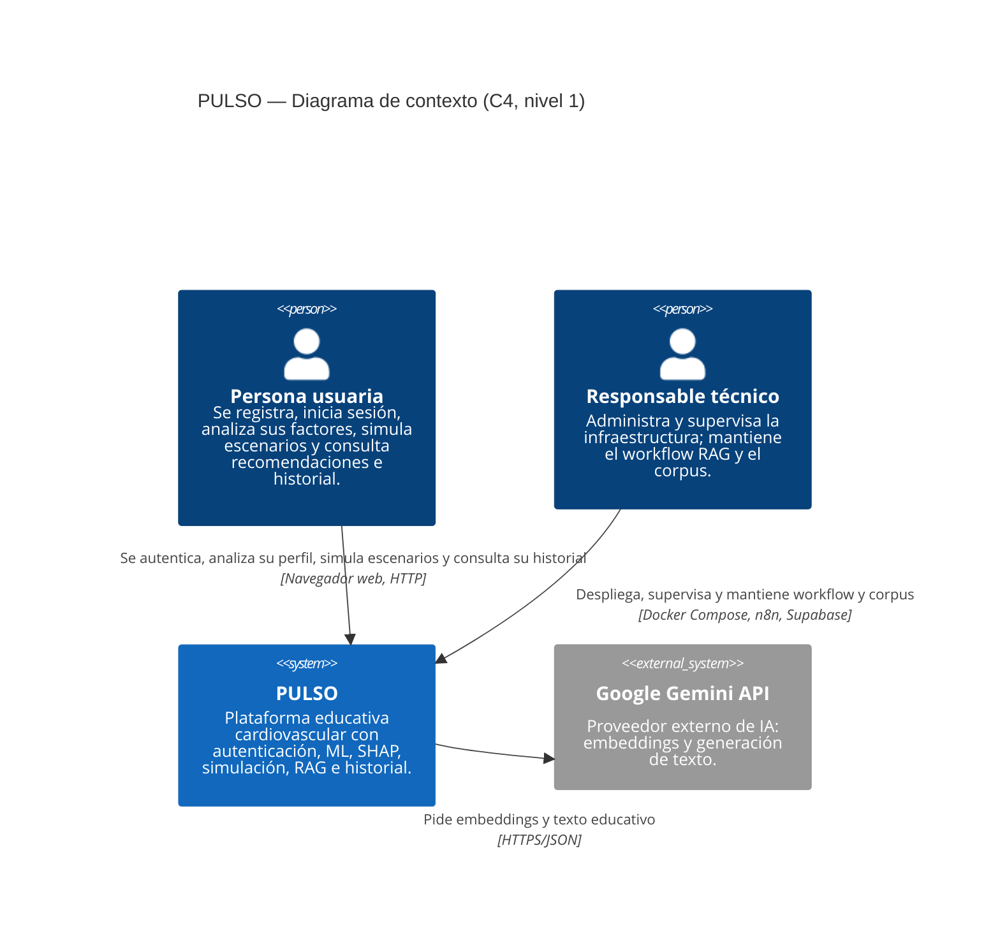
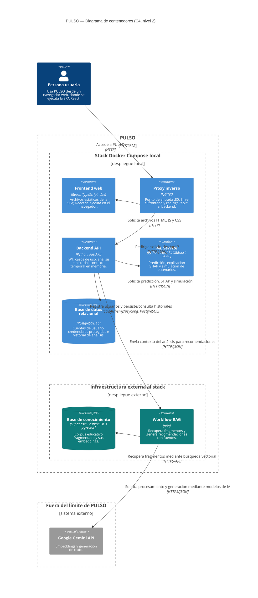
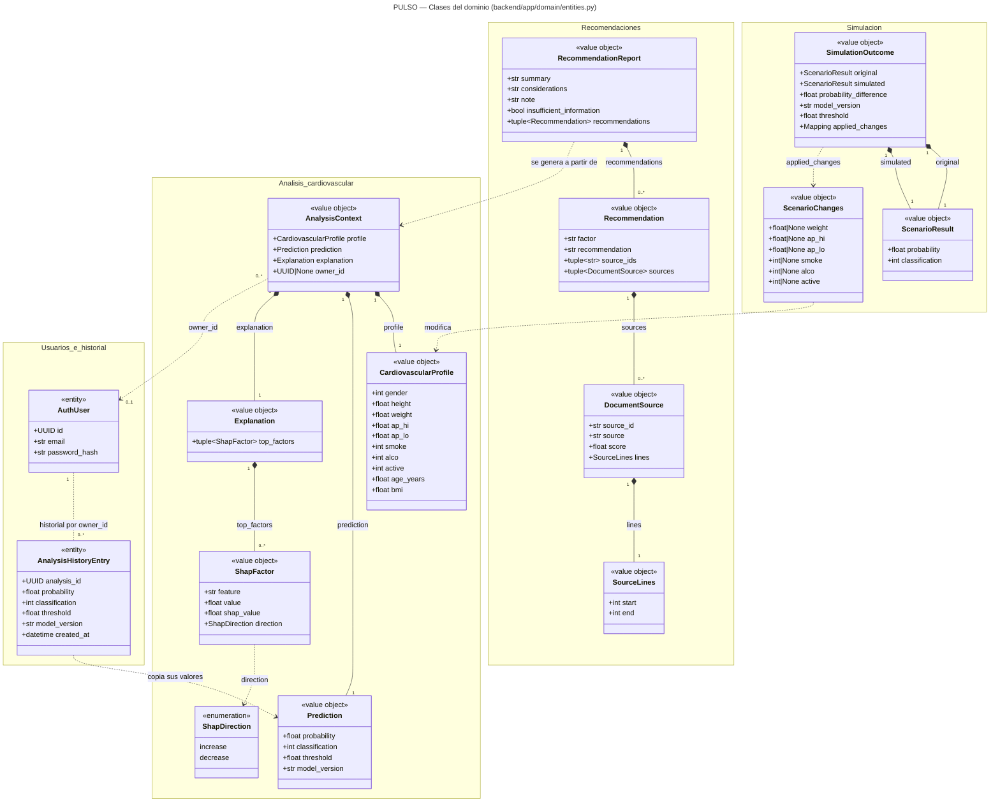
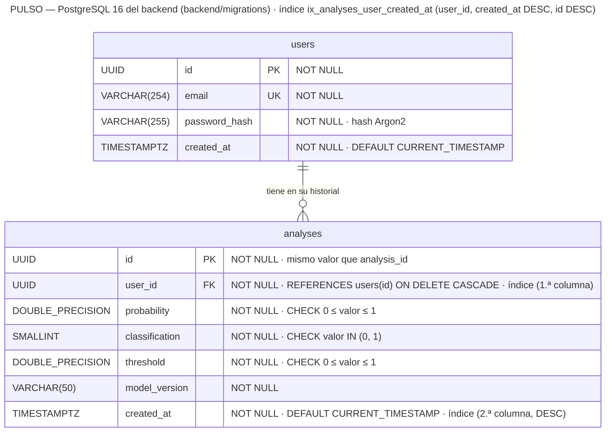
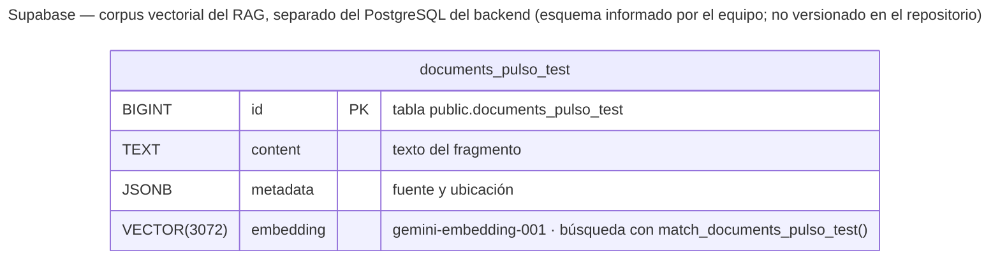

# Diagramas de arquitectura, dominio y datos de PULSO

Material para los apartados E3 (dominio), E4 (datos) y E5 (arquitectura) del informe. Los diagramas describen el código de la rama `Informe_Backend`, que corresponde al [PR #28](https://github.com/acoronellm/PULSO/pull/28) («Implement user authentication and analysis history features», abierto y sin fusionar en `main`; último commit revisado: `a8c4b57`).

| Archivo | Figura | Apartado |
|---|---|---|
| `C4_N1_Contexto` | C4 nivel 1, contexto | E5 |
| `C4_N2_Contenedores` | C4 nivel 2, contenedores | E5 |
| `C4_N3_Componentes` | C4 nivel 3, componentes del backend | E5 |
| `UML_Dominio_PULSO` | Diagrama de clases del dominio | E3 |
| `ER_PostgreSQL_PULSO` | Diagrama entidad-relación de PostgreSQL | E4 |
| `Esquema_Vectorial_Supabase` | Esquema documental vectorial (complementario) | E4 |

Cada figura existe en tres formatos dentro de esta carpeta: `.mmd` (fuente Mermaid editable), `.svg` y `.png`. Este documento es la fuente: los `.mmd` y `render.html` se generan a partir de sus bloques de código. Para volver a exportar las imágenes, abre `render.html` con conexión a internet y usa los botones de descarga.

> **Mermaid C4 y el ancho de pantalla.** Mermaid decide cuántas cajas caben por fila a partir de `screen.availWidth`. Los diagramas C4 están pensados para 1600 px. `render.html` fija ese valor; en un visor con una pantalla más estrecha, el nivel 2 puede reorganizarse. Para el informe, usa las imágenes exportadas.

## 0. Verificación contra el código

Prioricé el código sobre los documentos. Estas son las diferencias o precisiones que encontré y cómo las resolví:

| # | Tema | Lo que muestra el código | Decisión |
|---|---|---|---|
| 1 | Alcance | La autenticación, PostgreSQL y el historial están en la rama `Informe_Backend` (PR #28, abierto). `main` y `refactor/backend-clean-architecture` todavía no los tienen. | Los diagramas describen el PR #28. Si el PR cambia antes de fusionarse, hay que revisarlos. |
| 2 | Ruta del historial | `GET /api/analyses` está en `interfaces/http/routes/analysis.py`, no en un archivo propio. | Se rotula así en el nivel 3. |
| 3 | `get_current_user` | Es una función de `interfaces/http/dependencies.py` que usa `HTTPBearer`, `AccessTokenIssuer.subject()` y `UserRepository.find_by_id()`. | Se dibuja como componente propio, con su archivo como tecnología. |
| 4 | `/api/auth/me` | La ruta solo depende de `get_current_user`; no usa ningún caso de uso. | No se dibuja un caso de uso para ella. |
| 5 | Guardado del historial | Ocurre dentro de `AnalyzeProfile` (`history_repository.save(...)`). | No se inventa un caso de uso nuevo: `AnalyzeProfile` usa `AnalysisHistoryRepository`. |
| 6 | `InMemoryAnalysisHistoryRepository` | Existe en `infrastructure/`, pero solo lo usan `tests/conftest.py` y `tests/application/`. | No se dibuja: no forma parte de la ejecución real. |
| 7 | Índice `ix_analyses_user_created_at` | La migración lo define sobre `(user_id, created_at DESC, id DESC)`; el modelo ORM declara `(user_id, created_at)`. | El ER sigue la migración, que es la que crea la base en Docker (`docker-entrypoint-initdb.d`). La diferencia se señala como deuda técnica. |
| 8 | Tipos en el ORM | La migración usa `SMALLINT` y restricciones `CHECK`; el ORM usa `Integer` y no declara los `CHECK`. | El ER sigue la migración. `Base.metadata.create_all` solo se usa en las pruebas. |
| 9 | Esquema de Supabase | El repositorio no contiene `documents_pulso_test`, `match_documents_pulso_test` ni el SQL del corpus. El workflow exportado (`rag/workflows/`) apunta a la tabla `documents`. | La figura de Supabase se marca como **no verificada en el repositorio**. |
| 10 | Roles, consentimiento, sesiones | No existen en el código ni en las migraciones. | No aparecen en ningún diagrama. |

## Convenciones visuales

| Estilo | Significado |
|---|---|
| Azul | Elemento implementado del stack Docker Compose local |
| Verde azulado | Elemento implementado de PULSO desplegado fuera de Docker Compose (n8n, Supabase) |
| Gris | Sistema externo, fuera del límite de PULSO (Google Gemini) |
| Flecha azul «Ejecuta» / «Utiliza» (nivel 3) | Dependencia en tiempo de ejecución: ruta → caso de uso → puerto |
| Flecha verde «Implementa» (nivel 3) | Dependencia de código: el adaptador cumple el `Protocol` del puerto |
| Flecha morada «Invoca» / «Consulta» (nivel 3) | Comunicación con otro contenedor (HTTP/JSON o SQL) |
| Flecha y borde naranja (nivel 3) | Composición de dependencias (`dependencies.py`) |

---

## Figura 1. C4 nivel 1 — Contexto

**Descripción.** PULSO es una plataforma web educativa de orientación cardiovascular con autenticación, predicción mediante Machine Learning, explicabilidad SHAP, simulación, RAG e historial de resultados. Este nivel lo muestra como una sola caja.

<!-- diagrama: C4_N1_Contexto -->

**Elementos.** Persona usuaria; responsable técnico; sistema PULSO (incluye n8n y Supabase, porque el equipo construye el workflow y cura el corpus); Google Gemini API como único sistema externo.

**Relaciones.** La persona usuaria usa PULSO desde el navegador por HTTP: se registra, inicia sesión, ingresa factores, consulta la predicción y la explicación SHAP, simula escenarios, pide recomendaciones y revisa su historial. El responsable técnico despliega y supervisa la plataforma. PULSO consume Gemini por HTTPS a través del workflow RAG.

**Tecnologías.** Navegador web y HTTP. El detalle está en el nivel 2.

**Verificación.** PostgreSQL no aparece en este nivel porque es almacenamiento interno de PULSO. No hay roles administrativos: el código no define roles. NGINX solo escucha en HTTP :80 (`infrastructure/nginx/default.conf`).

---

## Figura 2. C4 nivel 2 — Contenedores

**Descripción.** Aplicaciones y almacenes de datos de PULSO. NGINX es el único punto de entrada. El backend usa PostgreSQL para cuentas e historial, el ML Service para la inferencia y el workflow RAG para las recomendaciones. Solo el workflow consulta Supabase y Gemini.

<!-- diagrama: C4_N2_Contenedores -->

**Elementos.**
- **Stack Docker Compose local** (cinco servicios de `docker-compose.yml`): `frontend`, `nginx`, `ml-service`, `backend` y `postgres` (imagen `postgres:16-alpine`).
- **Infraestructura externa al stack:** workflow RAG en n8n y base de conocimiento en Supabase con pgvector.
- **Fuera de PULSO:** Google Gemini API.

**Relaciones.**
- Persona usuaria (navegador) → NGINX «Accede a PULSO» [HTTP]. Tanto los archivos como las llamadas de la SPA a `/api/*` llegan a NGINX; no hay flecha directa entre frontend y backend.
- NGINX → Frontend «Solicita archivos HTML, JS y CSS» [HTTP] y NGINX → Backend «Redirige solicitudes `/api/*`» [HTTP/JSON].
- Backend → PostgreSQL «Registra usuarios y persiste/consulta historiales» [SQLAlchemy/psycopg]. La URL de conexión es `postgresql+psycopg://…@postgres:5432/…`.
- Backend → ML Service y Backend → n8n [HTTP/JSON con `httpx`].
- n8n → Supabase [HTTPS/API] y n8n → Gemini [HTTPS/JSON]. No existe conexión entre el backend y Supabase.

**Tres almacenamientos distintos.**

| Almacenamiento | Dónde | Contenido | Quién accede |
|---|---|---|---|
| PostgreSQL 16 | Stack Docker Compose | Cuentas (`users`) e historial mínimo (`analyses`) | Backend |
| Supabase + pgvector | Fuera del stack, dentro de PULSO | Corpus educativo vectorizado | Workflow RAG |
| Memoria del proceso | Dentro del contenedor Backend | Perfil, predicción y SHAP de cada análisis, durante 900 s | Backend (`InMemoryAnalysisRepository`) |

El repositorio en memoria aparece en la descripción del backend y no como contenedor, porque no es una base de datos.

**Verificación.** `docker-compose.yml` define los cinco servicios y el `depends_on` del backend hacia `postgres` y `ml-service`. Las migraciones se montan en `/docker-entrypoint-initdb.d`.

---

## Figura 3. C4 nivel 3 — Componentes del backend

**Descripción.** Descomposición del contenedor Backend API en las cuatro capas de Clean Architecture, ahora con autenticación e historial. Las capas son columnas; cada puerto del dominio está en la misma fila que su adaptador.

```mermaid
%%{init: {"c4": {"personFontSize": 15, "componentFontSize": 15, "containerFontSize": 15, "messageFontSize": 14, "boundaryFontSize": 17, "c4ShapeMargin": 25}}}%%
C4Component
    title Backend API de PULSO — Componentes (C4, nivel 3)

    Boundary(entrada, "Entrada", "contenedor") {
        Container(nginx, "Proxy inverso", "NGINX", "Redirige /api/* al backend")
    }

    Container_Boundary(api, "Backend API", "Python, FastAPI") {
        Boundary(capa_http, "Interfaces HTTP", "interfaces/http") {
            Component(r_auth, "routes/auth.py", "FastAPI APIRouter", "register · login · me")
            Component(cur_user, "get_current_user", "dependencies.py · HTTPBearer", "Valida el token Bearer y obtiene AuthUser")
            Component(r_analysis, "routes/analysis.py", "FastAPI APIRouter", "analyze · rag · simulate · analyses")
            Component(deps, "dependencies.py", "Raíz de composición", "Construye e inyecta las dependencias")
            Component(schemas, "schemas.py · auth_schemas.py", "Pydantic", "Contratos JSON")
            Component(http_err, "errors.py", "Exception handlers", "Errores a 404 / 422 / 502")
            Component(r_health, "routes/health.py", "FastAPI APIRouter", "GET /api/health")
        }
        Boundary(capa_app, "Aplicación", "application") {
            Component(uc_register, "RegisterUser", "Caso de uso", "Crea la cuenta y emite el token")
            Component(uc_auth, "AuthenticateUser", "Caso de uso", "Verifica credenciales y emite el token")
            Component(uc_history, "ListAnalysisHistory", "Caso de uso", "Historial paginado del usuario")
            Component(uc_analyze, "AnalyzeProfile", "Caso de uso", "Predicción, SHAP, contexto e historial")
            Component(uc_recs, "RequestRecommendations", "Caso de uso", "Contexto → recomendaciones")
            Component(uc_sim, "SimulateScenario", "Caso de uso", "Perfil original vs. escenario")
        }
        Boundary(capa_dom, "Dominio", "domain") {
            Component(p_users, "UserRepository", "Puerto · ports.py", "find_by_email · find_by_id · create")
            Component(p_hasher, "PasswordHasher", "Puerto · ports.py", "hash · verify")
            Component(p_tokens, "AccessTokenIssuer", "Puerto · ports.py", "issue · subject")
            Component(p_history, "AnalysisHistoryRepository", "Puerto · ports.py", "save · list_for_user")
            Component(p_repo, "AnalysisRepository", "Puerto · ports.py", "save · get")
            Component(p_model, "CardiovascularModel", "Puerto · ports.py", "predict · explain · simulate")
            Component(p_recs, "RecommendationGenerator", "Puerto · ports.py", "generate")
            Component(d_model, "entities · rules · errors", "Python estándar", "Entidades, reglas y errores")
        }
        Boundary(capa_inf, "Infraestructura", "infrastructure") {
            Component(i_users, "SQLAlchemyUserRepository", "SQLAlchemy", "Tabla users")
            Component(i_hasher, "Argon2PasswordHasher", "pwdlib · Argon2", "Hash de contraseñas")
            Component(i_tokens, "JWTAccessTokens", "PyJWT · HS256", "Emite y valida tokens")
            Component(i_history, "SQLAlchemyAnalysisHistoryRepository", "SQLAlchemy", "Tabla analyses")
            Component(i_mem, "InMemoryAnalysisRepository", "Memoria del proceso", "TTL 900 s, máximo 100")
            Component(i_ml, "MLServiceClient", "httpx", "Cliente del ML Service")
            Component(i_n8n, "N8nRecommendationClient", "httpx", "Cliente del webhook RAG")
            Component(i_db, "database.py · modelos ORM", "SQLAlchemy", "Engine, sesiones, UserModel, AnalysisHistoryModel")
            Component(i_settings, "Settings", "pydantic-settings", "Variables de entorno")
        }
    }

    Boundary(otros, "Otros contenedores de PULSO", "contenedores") {
        ContainerDb(pg, "PostgreSQL", "PostgreSQL 16", "users · analyses")
        Container(ml, "ML Service", "FastAPI, XGBoost, SHAP", "Predicción, SHAP, simulación")
        Container(rag, "Workflow RAG", "n8n", "Recomendaciones con fuentes")
    }

    Rel(nginx, r_auth, "Redirige /api/auth/*", "HTTP/JSON")
    Rel(nginx, r_analysis, "Redirige /api/*", "HTTP/JSON")

    Rel(r_auth, cur_user, "Exige usuario (me)")
    Rel(r_analysis, cur_user, "Exige usuario")
    Rel(r_analysis, deps, "Obtiene dependencias", "Depends")

    Rel(r_auth, uc_register, "Ejecuta")
    Rel(r_auth, uc_auth, "Ejecuta")
    Rel(r_analysis, uc_history, "Ejecuta")
    Rel(r_analysis, uc_analyze, "Ejecuta")
    Rel(r_analysis, uc_recs, "Ejecuta")
    Rel(r_analysis, uc_sim, "Ejecuta")

    Rel(uc_register, p_users, "Utiliza")
    Rel(uc_register, p_hasher, "Utiliza")
    Rel(uc_register, p_tokens, "Utiliza")
    Rel(uc_auth, p_users, "Utiliza")
    Rel(uc_auth, p_hasher, "Utiliza")
    Rel(uc_auth, p_tokens, "Utiliza")
    Rel(uc_history, p_history, "Utiliza")
    Rel(uc_analyze, p_history, "Utiliza")
    Rel(uc_analyze, p_repo, "Utiliza")
    Rel(uc_analyze, p_model, "Utiliza")
    Rel(uc_recs, p_repo, "Utiliza")
    Rel(uc_recs, p_recs, "Utiliza")
    Rel(uc_sim, p_model, "Utiliza")

    Rel(i_users, p_users, "Implementa")
    Rel(i_hasher, p_hasher, "Implementa")
    Rel(i_tokens, p_tokens, "Implementa")
    Rel(i_history, p_history, "Implementa")
    Rel(i_mem, p_repo, "Implementa")
    Rel(i_ml, p_model, "Implementa")
    Rel(i_n8n, p_recs, "Implementa")

    Rel(i_users, pg, "Consulta", "SQLAlchemy/psycopg")
    Rel(i_history, pg, "Consulta", "SQLAlchemy/psycopg")
    Rel(i_ml, ml, "Invoca", "HTTP/JSON")
    Rel(i_n8n, rag, "Invoca", "HTTP/JSON")

    UpdateElementStyle(rag, $bgColor="#0E7C7B", $borderColor="#0A5E5D")
    UpdateElementStyle(deps, $borderColor="#C05600")
    UpdateElementStyle(cur_user, $borderColor="#C05600")

    UpdateRelStyle(nginx, r_auth, $offsetX="-45", $offsetY="-28")
    UpdateRelStyle(nginx, r_analysis, $offsetX="-75", $offsetY="0")
    UpdateRelStyle(r_analysis, deps, $textColor="#C05600", $lineColor="#C05600", $offsetX="-112", $offsetY="-12")
    UpdateRelStyle(r_auth, cur_user, $textColor="#C05600", $lineColor="#C05600")
    UpdateRelStyle(r_analysis, cur_user, $textColor="#C05600", $lineColor="#C05600")

    UpdateRelStyle(r_auth, uc_register, $textColor="#1F3A93", $lineColor="#1F3A93")
    UpdateRelStyle(r_auth, uc_auth, $textColor="#1F3A93", $lineColor="#1F3A93")
    UpdateRelStyle(r_analysis, uc_history, $textColor="#1F3A93", $lineColor="#1F3A93")
    UpdateRelStyle(r_analysis, uc_analyze, $textColor="#1F3A93", $lineColor="#1F3A93")
    UpdateRelStyle(r_analysis, uc_recs, $textColor="#1F3A93", $lineColor="#1F3A93")
    UpdateRelStyle(r_analysis, uc_sim, $textColor="#1F3A93", $lineColor="#1F3A93")

    UpdateRelStyle(uc_register, p_users, $textColor="#1F3A93", $lineColor="#1F3A93")
    UpdateRelStyle(uc_register, p_hasher, $textColor="#1F3A93", $lineColor="#1F3A93")
    UpdateRelStyle(uc_register, p_tokens, $textColor="#1F3A93", $lineColor="#1F3A93")
    UpdateRelStyle(uc_auth, p_users, $textColor="#1F3A93", $lineColor="#1F3A93")
    UpdateRelStyle(uc_auth, p_hasher, $textColor="#1F3A93", $lineColor="#1F3A93")
    UpdateRelStyle(uc_auth, p_tokens, $textColor="#1F3A93", $lineColor="#1F3A93")
    UpdateRelStyle(uc_history, p_history, $textColor="#1F3A93", $lineColor="#1F3A93")
    UpdateRelStyle(uc_analyze, p_history, $textColor="#1F3A93", $lineColor="#1F3A93")
    UpdateRelStyle(uc_analyze, p_repo, $textColor="#1F3A93", $lineColor="#1F3A93")
    UpdateRelStyle(uc_analyze, p_model, $textColor="#1F3A93", $lineColor="#1F3A93")
    UpdateRelStyle(uc_recs, p_repo, $textColor="#1F3A93", $lineColor="#1F3A93")
    UpdateRelStyle(uc_recs, p_recs, $textColor="#1F3A93", $lineColor="#1F3A93")
    UpdateRelStyle(uc_sim, p_model, $textColor="#1F3A93", $lineColor="#1F3A93")

    UpdateRelStyle(i_users, p_users, $textColor="#1B7F3B", $lineColor="#1B7F3B")
    UpdateRelStyle(i_hasher, p_hasher, $textColor="#1B7F3B", $lineColor="#1B7F3B")
    UpdateRelStyle(i_tokens, p_tokens, $textColor="#1B7F3B", $lineColor="#1B7F3B")
    UpdateRelStyle(i_history, p_history, $textColor="#1B7F3B", $lineColor="#1B7F3B")
    UpdateRelStyle(i_mem, p_repo, $textColor="#1B7F3B", $lineColor="#1B7F3B")
    UpdateRelStyle(i_ml, p_model, $textColor="#1B7F3B", $lineColor="#1B7F3B")
    UpdateRelStyle(i_n8n, p_recs, $textColor="#1B7F3B", $lineColor="#1B7F3B")

    UpdateRelStyle(i_users, pg, $textColor="#7B2D8E", $lineColor="#7B2D8E")
    UpdateRelStyle(i_history, pg, $textColor="#7B2D8E", $lineColor="#7B2D8E", $offsetX="-115", $offsetY="0")
    UpdateRelStyle(i_ml, ml, $textColor="#7B2D8E", $lineColor="#7B2D8E")
    UpdateRelStyle(i_n8n, rag, $textColor="#7B2D8E", $lineColor="#7B2D8E")

    UpdateLayoutConfig($c4ShapeInRow="1", $c4BoundaryInRow="4")
```

<!-- diagrama: C4_N3_Componentes -->

**Elementos.**
- **Interfaces HTTP:** `routes/auth.py` (`POST /api/auth/register`, `POST /api/auth/login`, `GET /api/auth/me`), `routes/analysis.py` (`POST /api/analyze`, `/api/rag`, `/api/simulate` y `GET /api/analyses`), `routes/health.py`, `get_current_user` y `dependencies.py`, `schemas.py` y `auth_schemas.py`, y `errors.py`.
- **Aplicación:** seis casos de uso. Tres de cuentas e historial (`RegisterUser`, `AuthenticateUser`, `ListAnalysisHistory`) y los tres predictivos (`AnalyzeProfile`, `RequestRecommendations`, `SimulateScenario`).
- **Dominio:** siete puertos de `ports.py` (`typing.Protocol`) y un componente que agrupa entidades, reglas y errores.
- **Infraestructura:** siete adaptadores, `database.py` con los modelos ORM (`UserModel`, `AnalysisHistoryModel`) y `Settings`.
- **Otros contenedores:** PostgreSQL, ML Service y workflow RAG, fuera del límite del backend.

**Relaciones.**
1. **Ejecuta** (azul): `routes/auth.py` → `RegisterUser`, `AuthenticateUser`; `routes/analysis.py` → `ListAnalysisHistory`, `AnalyzeProfile`, `RequestRecommendations`, `SimulateScenario`.
2. **Utiliza** (azul): cada caso de uso depende solo de puertos.
   - `RegisterUser` y `AuthenticateUser` usan `UserRepository`, `PasswordHasher` y `AccessTokenIssuer`.
   - `ListAnalysisHistory` usa `AnalysisHistoryRepository`.
   - `AnalyzeProfile` usa `CardiovascularModel`, `AnalysisRepository` y `AnalysisHistoryRepository`.
   - `RequestRecommendations` usa `AnalysisRepository` y `RecommendationGenerator`.
   - `SimulateScenario` usa `CardiovascularModel`.
3. **Implementa** (verde): cada adaptador está en la misma fila que su puerto.
4. **Invoca / Consulta** (morado): los repositorios SQLAlchemy consultan PostgreSQL con psycopg; los clientes `httpx` invocan el ML Service y el webhook de n8n.
5. **Composición** (naranja): las rutas exigen `get_current_user`, que valida el token Bearer con `AccessTokenIssuer.subject()` y busca la cuenta con `UserRepository.find_by_id()`. `routes/analysis.py` obtiene sus dependencias de `dependencies.py`, la raíz de composición. Ese módulo construye los casos de uso e inyecta los repositorios SQLAlchemy (con una sesión por petición de `get_db_session`), `Argon2PasswordHasher`, `JWTAccessTokens`, los clientes y el repositorio en memoria. Sus relaciones de creación no se dibujan una por una porque cruzarían todo el diagrama.

**Dos persistencias distintas.** `InMemoryAnalysisRepository` guarda el contexto completo (perfil, predicción, SHAP y propietario) durante 900 s para que `RequestRecommendations` no repita la inferencia. `SQLAlchemyAnalysisHistoryRepository` guarda en PostgreSQL solo el resultado mínimo (probabilidad, clase, umbral y versión del modelo) para el historial. Ambos reciben el mismo `analysis_id`.

**Tecnologías.** FastAPI, Pydantic, SQLAlchemy, psycopg, PyJWT (HS256), pwdlib con Argon2, httpx y pydantic-settings (`backend/requirements.txt`).

**Verificación.**
- Los casos de uso solo importan `domain`. SQLAlchemy, PyJWT, pwdlib y FastAPI aparecen únicamente en `infrastructure/` e `interfaces/http/`.
- `backend/tests/test_architecture.py` comprueba la regla de dependencias.
- No se dibujan:
  - `InMemoryAnalysisHistoryRepository`, porque solo lo usan las pruebas.
  - Las relaciones secundarias de `schemas.py`, `auth_schemas.py` y `errors.py`.
  - Una flecha de NGINX a `routes/health.py`, porque habría atravesado otras cajas.

---

## Figura 4. Diagrama UML de clases del dominio

**Descripción.** Estructuras del dominio definidas en `backend/app/domain/entities.py`, agrupadas en cuatro áreas. Todas son `dataclass(frozen=True)` de Python puro: no son los modelos ORM de SQLAlchemy (`UserModel`, `AnalysisHistoryModel`), que viven en `infrastructure/`.

<!-- diagrama: UML_Dominio_PULSO -->

**Elementos.**
- **Entidades** («entity»: tienen identidad propia): `AuthUser` (`id`) y `AnalysisHistoryEntry` (`analysis_id`).
- **Objetos de valor** («value object»): el resto. `AnalysisContext` no tiene campo de identidad; `AnalysisRepository.save()` le asigna el `analysis_id`.
- **Enumeración:** `ShapDirection` es el tipo `Literal["increase", "decrease"]`.

**Relaciones.**
- **Composición** (rombo relleno): `AnalysisContext` contiene un `CardiovascularProfile`, una `Prediction` y una `Explanation`; `Explanation` contiene de 0 a n `ShapFactor`; `SimulationOutcome` contiene dos `ScenarioResult` (`original` y `simulated`); `RecommendationReport` contiene recomendaciones; cada `Recommendation`, fuentes; y cada `DocumentSource`, un `SourceLines`.
- **Dependencias** (línea discontinua):
  - `AnalysisContext.owner_id` referencia a `AuthUser` por su identificador. Vale 0..1 porque el campo admite `None`.
  - `AnalysisHistoryEntry` copia los valores de una `Prediction`.
  - `RecommendationReport` se genera a partir de un `AnalysisContext`, sin repetir la inferencia.
  - `ScenarioChanges` modifica variables de un `CardiovascularProfile`, y `SimulationOutcome.applied_changes` refleja los cambios aplicados.
- **Usuario e historial:** `AnalysisHistoryEntry` no tiene un atributo de propietario. La relación con `AuthUser` es conceptual: `AnalysisHistoryRepository.list_for_user(owner_id, …)` filtra por usuario, y en la base de datos la mantiene la clave foránea `analyses.user_id`. Por eso se dibuja como asociación discontinua.

**Verificación.**
- Nombres, atributos y tipos copiados de `entities.py`.
- No existen clases `Role`, `Consent` ni `AuthSession`, así que no aparecen.
- Los objetos de la capa de aplicación (`AnalysisResult`, `AuthenticatedUser`, `AnalysisHistoryPage`) y los errores de `errors.py` no forman parte de este diagrama.

---

## Figura 5. Diagrama entidad-relación de PostgreSQL

**Descripción.** Base de datos relacional del backend, tal como la crean `backend/migrations/001_create_users.sql` y `002_create_analysis_history.sql` (montadas en `/docker-entrypoint-initdb.d` del servicio `postgres`).

<!-- diagrama: ER_PostgreSQL_PULSO -->

**Elementos.**
- **`users`:**
  - `id UUID PRIMARY KEY`.
  - `email VARCHAR(254) NOT NULL UNIQUE`.
  - `password_hash VARCHAR(255) NOT NULL`.
  - `created_at TIMESTAMPTZ NOT NULL DEFAULT CURRENT_TIMESTAMP`.
- **`analyses`:**
  - `id UUID PRIMARY KEY`.
  - `user_id UUID NOT NULL REFERENCES users(id) ON DELETE CASCADE`.
  - `probability DOUBLE PRECISION NOT NULL CHECK (probability >= 0 AND probability <= 1)`.
  - `classification SMALLINT NOT NULL CHECK (classification IN (0, 1))`.
  - `threshold DOUBLE PRECISION NOT NULL CHECK (threshold >= 0 AND threshold <= 1)`.
  - `model_version VARCHAR(50) NOT NULL`.
  - `created_at TIMESTAMPTZ NOT NULL DEFAULT CURRENT_TIMESTAMP`.
- **Índice:** `ix_analyses_user_created_at ON analyses (user_id, created_at DESC, id DESC)`. Coincide con la consulta del historial (`WHERE user_id = … ORDER BY created_at DESC, id DESC`).

**Relaciones.** `users` 1 — 0..n `analyses`: un usuario puede tener muchos análisis y cada análisis pertenece a exactamente un usuario (`user_id NOT NULL`). Al borrar un usuario se borran sus análisis (`ON DELETE CASCADE`).

**Notas de lectura.**
- Mermaid no admite espacios en los tipos, así que `DOUBLE PRECISION` aparece como `DOUBLE_PRECISION`.
- `analyses.id` toma el mismo valor que el `analysis_id` del contexto en memoria.
- La base no guarda el perfil de entrada ni la explicación SHAP: solo el resultado mínimo.

**Verificación.**
- Tablas, columnas, tipos y restricciones copiados de las migraciones.
- No hay tablas de roles, consentimientos, sesiones ni simulaciones, porque no existen en las migraciones.
- Deuda técnica detectada: el modelo ORM declara el índice como `(user_id, created_at)`, usa `Integer` para `classification` y no declara los `CHECK`. No afecta a la base creada con las migraciones, pero conviene alinear ambos.

---

## Figura 6. Esquema documental vectorial en Supabase (complementario)

**Descripción.** Almacenamiento documental vectorial del RAG, independiente de la base de datos de cuentas. Se presenta como figura aparte y no como parte del ER relacional.

<!-- diagrama: Esquema_Vectorial_Supabase -->

**Elementos.** Tabla `public.documents_pulso_test` (`id BIGINT`, `content TEXT`, `metadata JSONB`, `embedding VECTOR(3072)`). La búsqueda por similitud se hace con la función `public.match_documents_pulso_test`. Según el equipo, el corpus tiene 15 documentos y 160 fragmentos, con embeddings de `models/gemini-embedding-001`.

**Relaciones.** Solo el workflow RAG de n8n la consulta. No hay ninguna clave ni conexión con las tablas `users` o `analyses`.

**Verificación.** **No verificado en el repositorio.** El esquema, la función y las cifras del corpus vienen del equipo: el repositorio no contiene su SQL, y el workflow exportado en `rag/workflows/n8nRag2ConFuentes.json` apunta a la tabla `documents`. Conviene versionar el SQL del corpus y volver a exportar el workflow.

---

## Coherencia entre los diagramas

| Comprobación | Resultado |
|---|---|
| El nivel 1 representa PULSO como un único sistema | Sí; PostgreSQL no aparece. |
| El nivel 2 muestra las aplicaciones y bases de datos reales | Sí: los cinco servicios de Docker Compose, n8n, Supabase y Gemini. |
| El nivel 3 descompone solo el backend | Sí; NGINX, PostgreSQL, ML Service y n8n quedan fuera de su límite. |
| El nivel 3 respeta las cuatro capas | Sí; los casos de uso solo dependen de puertos y el dominio no tiene flechas salientes. |
| Las clases del UML coinciden con el dominio | Sí; nombres y atributos de `entities.py`. |
| Las tablas del ER coinciden con las migraciones | Sí; se señalan las diferencias del modelo ORM. |
| Autenticación e historial, representados de forma consistente | Persona usuaria (nivel 1) → PostgreSQL (nivel 2) → `RegisterUser`, `AuthenticateUser`, `ListAnalysisHistory` y sus adaptadores (nivel 3) → `AuthUser`, `AnalysisHistoryEntry` (UML) → `users`, `analyses` (ER). |
| PostgreSQL y Supabase como almacenamientos distintos | Sí: en Compose / fuera de Compose; backend / n8n; ER / figura complementaria. |
| Funcionalidades propuestas representadas como implementadas | Ninguna; no hay roles, consentimiento, sesiones persistentes ni simulaciones guardadas. |
| El RAG reutiliza el análisis sin repetir la inferencia | Sí: `RequestRecommendations` usa `AnalysisRepository` (nivel 3) y `RecommendationReport` se genera a partir de `AnalysisContext` (UML). |

**Información todavía no verificada.**
- El esquema de Supabase y las cifras del corpus (Figura 6).
- El modelo Gemini que usa la generación en la instancia de n8n en uso. El workflow exportado indica `models/gemini-3-flash-preview`.
- Si el PR #28 cambia antes de fusionarse, los niveles 2 y 3, el UML y el ER deben revisarse.
